
<a href="https://github.com/VectoDE"><picture><source media="(prefers-color-scheme: dark)" srcset="assets/lang-en-off-dark.svg"><source media="(prefers-color-scheme: light)" srcset="assets/lang-en-off-light.svg"></picture></a><a href="README.de.md"><picture><source media="(prefers-color-scheme: dark)" srcset="assets/lang-de-on-dark.svg"><source media="(prefers-color-scheme: light)" srcset="assets/lang-de-on-light.svg"></picture></a>

<a href="https://www.uplytech.de"><picture><source media="(prefers-color-scheme: dark)" srcset="assets/hero-de-dark.svg"><source media="(prefers-color-scheme: light)" srcset="assets/hero-de-light.svg"></picture></a>

  <a href="https://www.uplytech.de"><picture><source media="(prefers-color-scheme: dark)" srcset="assets/badges/web-de-dark.svg"><source media="(prefers-color-scheme: light)" srcset="assets/badges/web-de-light.svg"></picture></a>
  <a href="https://www.linkedin.com/in/tim-hauke-b3b24b2b5"><picture><source media="(prefers-color-scheme: dark)" srcset="assets/badges/linkedin-de-dark.svg"><source media="(prefers-color-scheme: light)" srcset="assets/badges/linkedin-de-light.svg"></picture></a>
  <a href="https://discord.gg/DtHPAEHxZk"><picture><source media="(prefers-color-scheme: dark)" srcset="assets/badges/discord-de-dark.svg"><source media="(prefers-color-scheme: light)" srcset="assets/badges/discord-de-light.svg"></picture></a> 
  <a href="mailto:contact@uplytech.de"><picture><source media="(prefers-color-scheme: dark)" srcset="assets/badges/mail-company-de-dark.svg"><source media="(prefers-color-scheme: light)" srcset="assets/badges/mail-company-de-light.svg"></picture></a>
  <a href="mailto:timhauke99@gmail.com"><picture><source media="(prefers-color-scheme: dark)" srcset="assets/badges/mail-private-de-dark.svg"><source media="(prefers-color-scheme: light)" srcset="assets/badges/mail-private-de-light.svg"></picture></a>

  <a href="mailto:contact@uplytech.de"><picture><source media="(prefers-color-scheme: dark)" srcset="assets/badges/open-de-dark.svg"><source media="(prefers-color-scheme: light)" srcset="assets/badges/open-de-light.svg"></picture></a>
  <a href="https://www.uplytech.de"><picture><source media="(prefers-color-scheme: dark)" srcset="assets/badges/founder-de-dark.svg"><source media="(prefers-color-scheme: light)" srcset="assets/badges/founder-de-light.svg"></picture></a>
  <picture><source media="(prefers-color-scheme: dark)" srcset="assets/badges/location-de-dark.svg"><source media="(prefers-color-scheme: light)" srcset="assets/badges/location-de-light.svg"></picture> 
  <picture><source media="(prefers-color-scheme: dark)" srcset="assets/badges/since-de-dark.svg"><source media="(prefers-color-scheme: light)" srcset="assets/badges/since-de-light.svg"></picture>
  <picture><source media="(prefers-color-scheme: dark)" srcset="assets/badges/langs-de-dark.svg"><source media="(prefers-color-scheme: light)" srcset="assets/badges/langs-de-light.svg"></picture>

<picture><source media="(prefers-color-scheme: dark)" srcset="assets/h-about-de-dark.svg"><source media="(prefers-color-scheme: light)" srcset="assets/h-about-de-light.svg"></picture>

Ich bin Tim, Full-Stack-Entwickler aus Itzehoe und habe mir das Programmieren selbst beigebracht. Ich führe [UplyTech](https://www.uplytech.de), einen IT-Dienstleister, der Websites, Web-Apps, APIs und individuelle Software für Kunden baut und das Ergebnis danach auch hostet und pflegt.

Mit 11 habe ich Minecraft-Server aufgesetzt, mit 12 über YouTube-Tutorials programmieren gelernt. Daraus wurde 2017 [PlayGS](https://www.playgs.de), ein Minecraft-Netzwerk mit eigenen Plugins, Shop und TeamSpeak, das ich bis heute betreibe. Bevor das meine Abende gefüllt hat, habe ich beim SSC Phönix Kisdorf Fußball gespielt. Die meisten meiner eigenen Projekte sind aus eigenen Problemen entstanden, etwa ein Musikbot für meinen Discord-Server oder ein Skript, das Apps nach jedem Push neu ausrollt. Die meiste Zeit steckt gerade in **Tellersonne**, meiner Koch-App für iOS und Android, live auf [tellersonne.app](https://tellersonne.app).

<table>
  <tr><td><b>Standort</b></td><td>Itzehoe, Schleswig-Holstein</td></tr>
  <tr><td><b>Firma</b></td><td>Gründer und Geschäftsführer von <a href="https://www.uplytech.de">UplyTech</a></td></tr>
  <tr><td><b>Aktuelles Projekt</b></td><td><a href="https://tellersonne.app">Tellersonne</a>, Rezepte ohne Werbung und Tracking</td></tr>
  <tr><td><b>Täglicher Stack</b></td><td>TypeScript, Next.js, Node.js, Python, Go, Prisma, Docker, Cloudflare</td></tr>
  <tr><td><b>Stacks</b></td><td>MEVN, MERN, MEEN und MENN, dazu Electron, TypeScript, MySQL, Prisma und Tailwind CSS</td></tr>
  <tr><td><b>Sprachen</b></td><td>Deutsch (Muttersprache), Englisch</td></tr>
  <tr><td><b>Offen für</b></td><td>Kundenprojekte und Zusammenarbeit bei Web-Apps, Software, APIs und Discord-Bots</td></tr>
  <tr><td><b>Fun Fact</b></td><td>Ich nehme gern ein System, das unübersichtlich gewachsen ist, und mache es schnell und skalierbar</td></tr>
  <tr><td><b>Kontakt</b></td><td>UplyTech: <a href="mailto:contact@uplytech.de">contact@uplytech.de</a> oder <a href="mailto:timhauke@uplytech.de">timhauke@uplytech.de</a>. Privat, nicht UplyTech: <a href="mailto:timhauke99@gmail.com">timhauke99@gmail.com</a></td></tr>
</table>

<picture><source media="(prefers-color-scheme: dark)" srcset="assets/h-services-de-dark.svg"><source media="(prefers-color-scheme: light)" srcset="assets/h-services-de-light.svg"></picture>

- Firmenwebsites, Web-Apps und Dashboards, meist mit Next.js, React oder Vue und einem Backend in Node.js oder Laravel
- Individuelle Software wie interne Tools, Adminbereiche, CLIs und Desktop-Apps mit Electron
- REST- und GraphQL-APIs mit Authentifizierung sowie Discord-Bots mit eigenem Web-Dashboard
- Linux-Server mit Docker und Nginx, CI/CD über GitHub Actions, Hosting und technischer Support
- KI und Automatisierung: Tools verbinden, wiederkehrende Arbeit automatisieren und SaaS-Produkte darauf aufbauen
- IT-Beratung, wenn ein Stack gewählt, ein Projekt geplant oder eine bestehende Codebasis aufgeräumt werden soll

<picture><source media="(prefers-color-scheme: dark)" srcset="assets/h-projects-de-dark.svg"><source media="(prefers-color-scheme: light)" srcset="assets/h-projects-de-light.svg"></picture>

  <a href="https://tellersonne.app"><picture><source media="(prefers-color-scheme: dark)" srcset="assets/card-tellersonne-de-dark.svg"><source media="(prefers-color-scheme: light)" srcset="assets/card-tellersonne-de-light.svg"></picture></a>
  <a href="https://vectobeat.uplytech.de"><picture><source media="(prefers-color-scheme: dark)" srcset="assets/card-vectobeat-de-dark.svg"><source media="(prefers-color-scheme: light)" srcset="assets/card-vectobeat-de-light.svg"></picture></a>

  <a href="https://github.com/VectoDE/NodCord"><picture><source media="(prefers-color-scheme: dark)" srcset="assets/card-nodcord-de-dark.svg"><source media="(prefers-color-scheme: light)" srcset="assets/card-nodcord-de-light.svg"></picture></a>
  <a href="https://github.com/VectoDE/ServerCommander"><picture><source media="(prefers-color-scheme: dark)" srcset="assets/card-servercommander-de-dark.svg"><source media="(prefers-color-scheme: light)" srcset="assets/card-servercommander-de-light.svg"></picture></a>

  <a href="https://github.com/VectoDE/Self-Updater"><picture><source media="(prefers-color-scheme: dark)" srcset="assets/card-self-updater-de-dark.svg"><source media="(prefers-color-scheme: light)" srcset="assets/card-self-updater-de-light.svg"></picture></a>
  <a href="https://github.com/VectoDE/Linux-Server-Setup-Script"><picture><source media="(prefers-color-scheme: dark)" srcset="assets/card-linux-setup-de-dark.svg"><source media="(prefers-color-scheme: light)" srcset="assets/card-linux-setup-de-light.svg"></picture></a>

  <a href="https://github.com/VectoDE/Portfolio"><picture><source media="(prefers-color-scheme: dark)" srcset="assets/card-portfolio-de-dark.svg"><source media="(prefers-color-scheme: light)" srcset="assets/card-portfolio-de-light.svg"></picture></a>
  <a href="https://github.com/VectoDE/LifeVerse"><picture><source media="(prefers-color-scheme: dark)" srcset="assets/card-lifeverse-de-dark.svg"><source media="(prefers-color-scheme: light)" srcset="assets/card-lifeverse-de-light.svg"></picture></a>

Live-Seiten: Tellersonne <a href="https://tellersonne.app">tellersonne.app</a>, VectoBeat <a href="https://vectobeat.uplytech.de">vectobeat.uplytech.de</a>, UplyTech <a href="https://www.uplytech.de">www.uplytech.de</a>

<b>Kleinere Tools und Vorlagen</b>

| Projekt | Was es macht | Sprache |
| --- | --- | --- |
| [PHP-API](https://github.com/VectoDE/PHP-API) | REST-API mit SQLite, JWT-Login und Benutzerverwaltung | PHP |
| [Password-Checker](https://github.com/VectoDE/Password-Checker) | Prüft, ob ein Passwort in bekannten Leaks auftaucht und wie stark es ist | Go |
| [ID-Generator](https://github.com/VectoDE/ID-Generator) | Erzeugt IDs nach eigenem Muster, zum Beispiel `KG [project]#1-2 [role]\2024` | JavaScript |
| [ExpressJS-Template](https://github.com/VectoDE/ExpressJS-Template) | Ausgangspunkt für Node.js-Web-Apps mit Express | JavaScript |
| [HTML-Template](https://github.com/VectoDE/HTML-Template) | Eine `index.html`, die fast jedes HTML5-Element mit Barrierefreiheits-Best-Practices zeigt | HTML |
| [Homelab-Stack](https://github.com/VectoDE/Homelab-Stack) | Mein Homelab-Setup (im Aufbau) |  |

<picture><source media="(prefers-color-scheme: dark)" srcset="assets/h-timeline-de-dark.svg"><source media="(prefers-color-scheme: light)" srcset="assets/h-timeline-de-light.svg"></picture>

<picture><source media="(prefers-color-scheme: dark)" srcset="assets/timeline-de-dark.svg"><source media="(prefers-color-scheme: light)" srcset="assets/timeline-de-light.svg"></picture>

Werdegang als Text

| | |
| --- | --- |
| **2014** | Erste Minecraft-Server, mit 11 Jahren |
| **2016** | Mit YouTube-Tutorials angefangen, programmieren zu lernen |
| **2017** | [PlayGS](https://www.playgs.de) gegründet, ein Minecraft-Netzwerk mit allen Spielmodi auf einem Server, eigenen Plugins, Shop und TeamSpeak |
| **2021** | Erste Zertifikate in HTML, Node.js und Website-Erstellung |
| **2023** | PHP, Laravel, Java, Linux, Netzwerke, Git und GraphQL gelernt. Ehrenamtlicher CMO bei BonToGo (Nov. 2023 bis Juni 2024): Marketingplan und Social Media |
| **2024** | NodCord veröffentlicht und die UplyTech-API gebaut. Kurse bei LinkedIn Learning und die Zertifizierung Responsive Web Design von freeCodeCamp |
| **2025** | ServerCommander, mein Portfolio, das Linux-Setup-Skript und Self-Updater. Neue UplyTech-Website, Gründung des E-Sport-Clubs MitFits Gaming und Start von VectoBeat |
| **2026** | MitFits Gaming an ein Community-Mitglied übergeben und mit Tellersonne begonnen |

<picture><source media="(prefers-color-scheme: dark)" srcset="assets/h-stack-de-dark.svg"><source media="(prefers-color-scheme: light)" srcset="assets/h-stack-de-light.svg"></picture>

<table>
  <tr><td><b>Sprachen</b></td><td><picture><source media="(prefers-color-scheme: dark)" srcset="https://skillicons.dev/icons?i=ts,js,python,go,php,java,cpp,bash,powershell,html,css&theme=dark"><source media="(prefers-color-scheme: light)" srcset="https://skillicons.dev/icons?i=ts,js,python,go,php,java,cpp,bash,powershell,html,css&theme=light"></picture></td></tr>
  <tr><td><b>Frontend</b></td><td><picture><source media="(prefers-color-scheme: dark)" srcset="https://skillicons.dev/icons?i=react,nextjs,vue,tailwind,bootstrap,threejs,electron,vite,webpack&theme=dark"><source media="(prefers-color-scheme: light)" srcset="https://skillicons.dev/icons?i=react,nextjs,vue,tailwind,bootstrap,threejs,electron,vite,webpack&theme=light"></picture></td></tr>
  <tr><td><b>Backend und Daten</b></td><td><picture><source media="(prefers-color-scheme: dark)" srcset="https://skillicons.dev/icons?i=nodejs,express,laravel,graphql,discordjs,prisma,sequelize,mysql,sqlite,mongodb,redis&theme=dark"><source media="(prefers-color-scheme: light)" srcset="https://skillicons.dev/icons?i=nodejs,express,laravel,graphql,discordjs,prisma,sequelize,mysql,sqlite,mongodb,redis&theme=light"></picture></td></tr>
  <tr><td><b>DevOps und Hosting</b></td><td><picture><source media="(prefers-color-scheme: dark)" srcset="https://skillicons.dev/icons?i=docker,nginx,linux,githubactions,cloudflare,workers,aws,vercel,heroku,raspberrypi&theme=dark"><source media="(prefers-color-scheme: light)" srcset="https://skillicons.dev/icons?i=docker,nginx,linux,githubactions,cloudflare,workers,aws,vercel,heroku,raspberrypi&theme=light"></picture></td></tr>
  <tr><td><b>Werkzeuge</b></td><td><picture><source media="(prefers-color-scheme: dark)" srcset="https://skillicons.dev/icons?i=git,github,gitlab,vscode,visualstudio,idea,pycharm,npm,pnpm,yarn,jest&theme=dark"><source media="(prefers-color-scheme: light)" srcset="https://skillicons.dev/icons?i=git,github,gitlab,vscode,visualstudio,idea,pycharm,npm,pnpm,yarn,jest&theme=light"></picture></td></tr>
  <tr><td><b>Design und mehr</b></td><td><picture><source media="(prefers-color-scheme: dark)" srcset="https://skillicons.dev/icons?i=figma,ps,unreal,wordpress&theme=dark"><source media="(prefers-color-scheme: light)" srcset="https://skillicons.dev/icons?i=figma,ps,unreal,wordpress&theme=light"></picture></td></tr>
</table>

<picture><source media="(prefers-color-scheme: dark)" srcset="assets/h-certificates-de-dark.svg"><source media="(prefers-color-scheme: light)" srcset="assets/h-certificates-de-light.svg"></picture>

39 Zertifikate von Programming Hub (Google Developers Launchpad), LinkedIn Learning (teilweise PMI-akkreditiert) und freeCodeCamp. Die PDFs liegen in [`/certificates`](certificates).

<picture><source media="(prefers-color-scheme: dark)" srcset="assets/badges/issuer-programminghub-dark.svg"><source media="(prefers-color-scheme: light)" srcset="assets/badges/issuer-programminghub-light.svg"></picture> <picture><source media="(prefers-color-scheme: dark)" srcset="assets/badges/issuer-linkedin-dark.svg"><source media="(prefers-color-scheme: light)" srcset="assets/badges/issuer-linkedin-light.svg"></picture> <picture><source media="(prefers-color-scheme: dark)" srcset="assets/badges/issuer-freecodecamp-dark.svg"><source media="(prefers-color-scheme: light)" srcset="assets/badges/issuer-freecodecamp-light.svg"></picture>

<b>Webentwicklung</b> (24)

| Zertifikat | Aussteller | Datum | Nachweis |
| --- | --- | --- | --- |
| Responsive Web Design (Legacy V8, rund 300 Stunden) | freeCodeCamp | Juni 2024 | [PDF](certificates/Responsive%20Web%20Design%20-%20freeCodeCamp.pdf), [Prüfen](https://www.freecodecamp.org/certification/vectode/responsive-web-design) |
| React.js: Ein Web-Interface entwickeln | LinkedIn Learning | Apr. 2024 | [PDF](certificates/React.js%20-%20Ein%20Webinterface%20erstellen%20-%20LinkedIn%20Zertifikat.pdf), [Prüfen](https://www.linkedin.com/learning/certificates/8316890e139e9ee84dac2b5a1f3ea742313405ed03db5a0f8cd815ae2d1a57c0) |
| Vue.js lernen | LinkedIn Learning | Apr. 2024 | [PDF](certificates/Vue.JS%20Lernen%20-%20LinkedIn%20Zertifikat.pdf), [Prüfen](https://www.linkedin.com/learning/certificates/c356d7ad31b20a54a77fa7974ea771cc16a68bb670c894f9023fd38fa380873f) |
| Webtechniken lernen 4: JavaScript | LinkedIn Learning | Apr. 2024 | [PDF](certificates/Webtechniken%20lernen%204%20-%20JavaScript%20-%20LinkedIn%20Zertifikat.pdf), [Prüfen](https://www.linkedin.com/learning/certificates/e022cabee112be8be253cb5b327e3f2337ce63d0eb7aa05292547fa869fa94a4) |
| Webtechniken lernen 3: Responsive CSS-Layouts mit Media Queries, Flexbox und Grid | LinkedIn Learning | Apr. 2024 | [PDF](certificates/Webtechniken%20lernen%203%20-%20Responsive%20CSS-Layouts%20-%20LinkedIn%20Zertifikat.pdf), [Prüfen](https://www.linkedin.com/learning/certificates/0218b627cfc9b8627d819870787bf129ad3fdcc64ab27ac1b2fad327843034b2) |
| Webtechniken lernen 2: CSS-Grundlagen | LinkedIn Learning | Apr. 2024 | [PDF](certificates/Webtechniken%20lernen%202%20-%20CSS-Grundlagen%20-%20LinkedIn%20Zertifikat.pdf), [Prüfen](https://www.linkedin.com/learning/certificates/0ff6d7e2b2a908173c1482e8b2e44dce6c43928b1271375cf29e7f2e3324595b) |
| Webtechniken lernen 1: HTML | LinkedIn Learning | März 2024 | [PDF](certificates/Webtechniken%20lernen%201%20-%20HTML%20-%20LinkedIn%20Zertifikat.pdf), [Prüfen](https://www.linkedin.com/learning/certificates/0449b01c9aa6690d194c06dfcf9ac853abe3051ff1a03e79cef21cc742a8b81c) |
| Grundlagen der Webprogrammierung: Meine erste Website | LinkedIn Learning | März 2024 | [PDF](certificates/Grundlagen%20der%20Webprogrammierung%20-%20Meine%20erste%20Website%20-%20LinkedIn%20Zertifikat.pdf), [Prüfen](https://www.linkedin.com/learning/certificates/f47b61d11d2dbfdefb9374ba527ed2c51c5ca6cec9d538d12a01ca4f02070412) |
| REST APIs lernen | LinkedIn Learning | März 2024 | [PDF](certificates/REST%20APIs%20lernen%20-%20LinkedIn%20Zertifikat.pdf), [Prüfen](https://www.linkedin.com/learning/certificates/39a3353e4d83acacbfb04311173eae2bf00c272852d31a46a9e9c4078e4cd047) |
| GraphQL | Programming Hub | Aug. 2023 | [PDF](certificates/GraphQL.pdf) |
| JavaScript Advanced | Programming Hub | Juli 2023 | [PDF](certificates/JavaScript%20Advanced.pdf) |
| JavaScript | Programming Hub | Juli 2023 | [PDF](certificates/JavaScript.pdf) |
| Laravel | Programming Hub | Juli 2023 | [PDF](certificates/Laravel.pdf) |
| PHP | Programming Hub | Juni 2023 | [PDF](certificates/PHP.pdf) |
| Java | Programming Hub | März 2023 | [PDF](certificates/Java.pdf) |
| Programming Fundamentals | Programming Hub | März 2023 | [PDF](certificates/Fundamentals.pdf) |
| Bulma CSS | Programming Hub | Feb. 2023 | [PDF](certificates/Bulma%20CSS.pdf) |
| Next.js | Programming Hub | Feb. 2023 | [PDF](certificates/NextJS.pdf) |
| Building a Website | Programming Hub | Feb. 2023 | [PDF](certificates/Building%20a%20Website%202.pdf) |
| CSS | Programming Hub | Feb. 2023 | [PDF](certificates/CSS.pdf) |
| Building a Website | Programming Hub | Dez. 2021 | [PDF](certificates/Building%20a%20Website.pdf) |
| HTML Advanced | Programming Hub | Dez. 2021 | [PDF](certificates/HTML%20Advanced.pdf) |
| HTML | Programming Hub | Dez. 2021 | [PDF](certificates/HTML.pdf) |
| Node.js | Programming Hub | Dez. 2021 | [PDF](certificates/NodeJS.pdf) |

<b>Infrastruktur und Werkzeuge</b> (5)

| Zertifikat | Aussteller | Datum | Nachweis |
| --- | --- | --- | --- |
| Microsoft Teams Grundkurs (PMI: 1.75 PDUs) | LinkedIn Learning | Apr. 2024 | [PDF](certificates/Microsoft%20Teams%20Grundkurs%20-%20LinkedIn%20Zertifikat.pdf), [PMI](certificates/Microsoft%20Teams%20Grundkurs%20-%20Project%20Management%20Institute%20%28PMI%29%C2%AE.pdf), [Prüfen](https://www.linkedin.com/learning/certificates/ed5c89b786e2851ab1a37d9f7718c4452d92b235c2183f5bf48cb201c7e8888d) |
| Git | Programming Hub | Aug. 2023 | [PDF](certificates/GIT.pdf) |
| Linux | Programming Hub | Mai 2023 | [PDF](certificates/Linux.pdf) |
| IPv4 & Networking | Programming Hub | März 2023 | [PDF](certificates/IPv4%20%26%20Networking.pdf) |
| IT Basics | Programming Hub | März 2023 | [PDF](certificates/IT%20Basics.pdf) |

<b>Marketing, Business und Recht</b> (6)

| Zertifikat | Aussteller | Datum | Nachweis |
| --- | --- | --- | --- |
| Digital Marketing Advanced | Programming Hub | Jan. 2025 | [PDF](certificates/Digital%20Marketing%20Advanced.pdf) |
| Digital Marketing | Programming Hub | Nov. 2024 | [PDF](certificates/Digital%20Marketing.pdf) |
| Steuergrundlagen für Selbstständige, Kleinunternehmer:innen und Gründer:innen | LinkedIn Learning | Apr. 2024 | [PDF](certificates/Steuergrundlagen%20fu%CC%88r%20Selbststa%CC%88ndige%2C%20Kleinunternehmer-innen%20und%20Gru%CC%88nder-innen%20-%20LinkedIn%20Zertifikat.pdf), [Prüfen](https://www.linkedin.com/learning/certificates/5994c51b00031eee9ee54b46054039a852f1b8f2ad32582699e2d6bc07a0dce7) |
| Growth Hacking | Programming Hub | März 2024 | [LinkedIn](https://www.linkedin.com/in/tim-hauke-b3b24b2b5/details/certifications/) |
| Rechtsgrundlagen: Industrie 4.0 und Internet of Things (IoT) | LinkedIn Learning | März 2024 | [PDF](certificates/Rechtsgrundlagen%20-%20Industrie%204.0%20und%20IoT%20-%20LinkedIn%20Zertifikat.pdf), [Prüfen](https://www.linkedin.com/learning/certificates/cdd0c587e2e94280324522277ae37cb636e95cd67fbb3233a3886a7d9c512986) |
| SEO | Programming Hub | Feb. 2023 | [PDF](certificates/SEO.pdf) |

<b>Kommunikation</b> (4)

| Zertifikat | Aussteller | Datum | Nachweis |
| --- | --- | --- | --- |
| Professionell netzwerken (PMI) | LinkedIn Learning | März 2024 | [PDF](certificates/Professionell%20netzwerken%20-%20LinkedIn%20Zertifikat.pdf), [PMI](certificates/Professionell%20netzwerken%20-%20Project%20Management%20Institute%20%28PMI%29%C2%AE.pdf), [Prüfen](https://www.linkedin.com/learning/certificates/8edc2fd2aa2c4cc3ffefcadef97bd9230e74141197e614d1eadda7b00c0def88) |
| Schlagfertigkeit: Nie wieder sprachlos | LinkedIn Learning | März 2024 | [PDF](certificates/Schlagfertigkeit%20-%20nie%20wieder%20Sprachlos%20-%20LinkedIn%20Zertifikat.pdf) |
| Die 7 schlimmsten Kommunikationsfehler | LinkedIn Learning | März 2024 | [PDF](certificates/Die%207%20schlimmsten%20Kommunikationsfehler%20-%20LinkedIn%20Certificate.pdf), [Prüfen](https://www.linkedin.com/learning/certificates/dab8bb262fd871a38cccad4046be2f4456082cee67e409d45f39337eae8b322d) |
| Small Talk und Netzwerken: 2 unterschätzte Karriere-Booster | LinkedIn Learning | März 2024 | [PDF](certificates/Small%20Talk%20%26%20Networking%20-%20LinkedIn%20Learning-Zertifikat.pdf), [Prüfen](https://www.linkedin.com/learning/certificates/799b9d01f2736f2764ad164ccf0f76f1f369922add62534f312c534aac641469) |

<picture><source media="(prefers-color-scheme: dark)" srcset="assets/h-stats-de-dark.svg"><source media="(prefers-color-scheme: light)" srcset="assets/h-stats-de-light.svg"></picture>

<picture><source media="(prefers-color-scheme: dark)" srcset="assets/stats-de-dark.svg"><source media="(prefers-color-scheme: light)" srcset="assets/stats-de-light.svg"></picture>

<picture><source media="(prefers-color-scheme: dark)" srcset="assets/awards-de-dark.svg"><source media="(prefers-color-scheme: light)" srcset="assets/awards-de-light.svg"></picture>

Wird täglich von einem Workflow in diesem Repository aus der GitHub-API erzeugt.

<picture><source media="(prefers-color-scheme: dark)" srcset="assets/h-orgs-de-dark.svg"><source media="(prefers-color-scheme: light)" srcset="assets/h-orgs-de-light.svg"></picture>

| Organisation | Rolle |
| --- | --- |
| [UplyTech](https://github.com/UplyTech) | Gründer. IT-Dienstleistungen: Entwicklung, Design, Video und Marketing ([www.uplytech.de](https://www.uplytech.de)) |
| [PlayGS Netzwerk](https://github.com/PlayGS-Netzwerk) | Gründer seit 2017. Minecraft-Netzwerk mit allen Spielmodi an einem Ort ([playgs.de](https://www.playgs.de)) |
| [ServerwerkNET](https://github.com/ServerwerkNET) | Entwicklungsorganisation für [serverwerk.net](https://serverwerk.net) |
| [MitFits Gaming](https://github.com/Mitfits-Gaming) | E-Sport-Club im April 2025 gegründet, im September 2026 übergeben |

<picture><source media="(prefers-color-scheme: dark)" srcset="assets/h-links-de-dark.svg"><source media="(prefers-color-scheme: light)" srcset="assets/h-links-de-light.svg"></picture>

<table>
  <tr><td><b>Social Media</b></td><td><a href="https://www.instagram.com/vecto_de"><picture><source media="(prefers-color-scheme: dark)" srcset="assets/badges/instagram-dark.svg"><source media="(prefers-color-scheme: light)" srcset="assets/badges/instagram-light.svg"></picture></a> <a href="https://www.tiktok.com/@vectode"><picture><source media="(prefers-color-scheme: dark)" srcset="assets/badges/tiktok-dark.svg"><source media="(prefers-color-scheme: light)" srcset="assets/badges/tiktok-light.svg"></picture></a> <a href="https://x.com/vecto_de"><picture><source media="(prefers-color-scheme: dark)" srcset="assets/badges/x-dark.svg"><source media="(prefers-color-scheme: light)" srcset="assets/badges/x-light.svg"></picture></a> <a href="https://www.snapchat.com/add/vecto_de"><picture><source media="(prefers-color-scheme: dark)" srcset="assets/badges/snapchat-dark.svg"><source media="(prefers-color-scheme: light)" srcset="assets/badges/snapchat-light.svg"></picture></a> <a href="https://api.whatsapp.com/send?phone=491726166860"><picture><source media="(prefers-color-scheme: dark)" srcset="assets/badges/whatsapp-dark.svg"><source media="(prefers-color-scheme: light)" srcset="assets/badges/whatsapp-light.svg"></picture></a> <a href="https://linktr.ee/vectode"><picture><source media="(prefers-color-scheme: dark)" srcset="assets/badges/linktree-dark.svg"><source media="(prefers-color-scheme: light)" srcset="assets/badges/linktree-light.svg"></picture></a></td></tr>
  <tr><td><b>Video und Musik</b></td><td><a href="https://www.youtube.com/@vectode"><picture><source media="(prefers-color-scheme: dark)" srcset="assets/badges/youtube-dark.svg"><source media="(prefers-color-scheme: light)" srcset="assets/badges/youtube-light.svg"></picture></a> <a href="https://twitch.tv/vectode"><picture><source media="(prefers-color-scheme: dark)" srcset="assets/badges/twitch-dark.svg"><source media="(prefers-color-scheme: light)" srcset="assets/badges/twitch-light.svg"></picture></a> <a href="https://spotify.link/pA38mWNLJXb"><picture><source media="(prefers-color-scheme: dark)" srcset="assets/badges/spotify-dark.svg"><source media="(prefers-color-scheme: light)" srcset="assets/badges/spotify-light.svg"></picture></a> <a href="https://open.spotify.com/artist/vectode"><picture><source media="(prefers-color-scheme: dark)" srcset="assets/badges/spotify-artist-dark.svg"><source media="(prefers-color-scheme: light)" srcset="assets/badges/spotify-artist-light.svg"></picture></a> <a href="https://on.soundcloud.com/SzVNwEjI6ANTyxL0LE"><picture><source media="(prefers-color-scheme: dark)" srcset="assets/badges/soundcloud-dark.svg"><source media="(prefers-color-scheme: light)" srcset="assets/badges/soundcloud-light.svg"></picture></a></td></tr>
  <tr><td><b>Gaming</b></td><td><a href="https://steamcommunity.com/id/vectode"><picture><source media="(prefers-color-scheme: dark)" srcset="assets/badges/steam-dark.svg"><source media="(prefers-color-scheme: light)" srcset="assets/badges/steam-light.svg"></picture></a> <a href="https://epicgames.com/id/vecto"><picture><source media="(prefers-color-scheme: dark)" srcset="assets/badges/epicgames-dark.svg"><source media="(prefers-color-scheme: light)" srcset="assets/badges/epicgames-light.svg"></picture></a></td></tr>
  <tr><td><b>Code</b></td><td><a href="https://github.com/VectoDE"><picture><source media="(prefers-color-scheme: dark)" srcset="assets/badges/github-dark.svg"><source media="(prefers-color-scheme: light)" srcset="assets/badges/github-light.svg"></picture></a> <a href="https://gitlab.com/vectode"><picture><source media="(prefers-color-scheme: dark)" srcset="assets/badges/gitlab-dark.svg"><source media="(prefers-color-scheme: light)" srcset="assets/badges/gitlab-light.svg"></picture></a> <a href="https://dev.to/vectode"><picture><source media="(prefers-color-scheme: dark)" srcset="assets/badges/devdotto-dark.svg"><source media="(prefers-color-scheme: light)" srcset="assets/badges/devdotto-light.svg"></picture></a></td></tr>
</table>

<picture><source media="(prefers-color-scheme: dark)" srcset="assets/h-support-de-dark.svg"><source media="(prefers-color-scheme: light)" srcset="assets/h-support-de-light.svg"></picture>

Wenn dir eines meiner Tools Zeit gespart hat, kannst du meine Open-Source-Arbeit hier unterstützen.

<a href="https://github.com/sponsors/VectoDE"><picture><source media="(prefers-color-scheme: dark)" srcset="assets/badges/githubsponsors-dark.svg"><source media="(prefers-color-scheme: light)" srcset="assets/badges/githubsponsors-light.svg"></picture></a> <a href="https://www.patreon.com/VectoDE"><picture><source media="(prefers-color-scheme: dark)" srcset="assets/badges/patreon-dark.svg"><source media="(prefers-color-scheme: light)" srcset="assets/badges/patreon-light.svg"></picture></a> <a href="https://buymeacoffee.com/vectode"><picture><source media="(prefers-color-scheme: dark)" srcset="assets/badges/buymeacoffee-dark.svg"><source media="(prefers-color-scheme: light)" srcset="assets/badges/buymeacoffee-light.svg"></picture></a> <a href="https://paypal.me/TimHauke"><picture><source media="(prefers-color-scheme: dark)" srcset="assets/badges/paypal-dark.svg"><source media="(prefers-color-scheme: light)" srcset="assets/badges/paypal-light.svg"></picture></a>

<a href="mailto:contact@uplytech.de"><picture><source media="(prefers-color-scheme: dark)" srcset="assets/footer-de-dark.svg"><source media="(prefers-color-scheme: light)" srcset="assets/footer-de-light.svg"></picture></a>

Gemacht von VectoDE, Gründer von UplyTech  

