
<a href="https://github.com/VectoDE"><picture><source media="(prefers-color-scheme: dark)" srcset="assets/lang-en-off-dark.svg"><source media="(prefers-color-scheme: light)" srcset="assets/lang-en-off-light.svg"></picture></a><a href="README.de.md"><picture><source media="(prefers-color-scheme: dark)" srcset="assets/lang-de-on-dark.svg"><source media="(prefers-color-scheme: light)" srcset="assets/lang-de-on-light.svg"></picture></a>

<a href="https://www.uplytech.de"><picture><source media="(prefers-color-scheme: dark)" srcset="assets/hero-de-dark.svg"><source media="(prefers-color-scheme: light)" srcset="assets/hero-de-light.svg"></picture></a>

  <a href="https://www.uplytech.de"><picture><source media="(prefers-color-scheme: dark)" srcset="assets/badges/web-de-dark.svg"><source media="(prefers-color-scheme: light)" srcset="assets/badges/web-de-light.svg"></picture></a>
  <a href="https://www.linkedin.com/in/tim-hauke-b3b24b2b5"><picture><source media="(prefers-color-scheme: dark)" srcset="assets/badges/linkedin-de-dark.svg"><source media="(prefers-color-scheme: light)" srcset="assets/badges/linkedin-de-light.svg"></picture></a>
  <a href="https://discord.gg/DtHPAEHxZk"><picture><source media="(prefers-color-scheme: dark)" srcset="assets/badges/discord-de-dark.svg"><source media="(prefers-color-scheme: light)" srcset="assets/badges/discord-de-light.svg"></picture></a> 
  <a href="mailto:contact@uplytech.de"><picture><source media="(prefers-color-scheme: dark)" srcset="assets/badges/mail-company-de-dark.svg"><source media="(prefers-color-scheme: light)" srcset="assets/badges/mail-company-de-light.svg"></picture></a>
  <a href="mailto:timhauke99@gmail.com"><picture><source media="(prefers-color-scheme: dark)" srcset="assets/badges/mail-private-de-dark.svg"><source media="(prefers-color-scheme: light)" srcset="assets/badges/mail-private-de-light.svg"></picture></a>

  <a href="mailto:contact@uplytech.de"><picture><source media="(prefers-color-scheme: dark)" srcset="assets/badges/open-de-dark.svg"><source media="(prefers-color-scheme: light)" srcset="assets/badges/open-de-light.svg"></picture></a>
  <a href="https://www.uplytech.de"><picture><source media="(prefers-color-scheme: dark)" srcset="assets/badges/founder-de-dark.svg"><source media="(prefers-color-scheme: light)" srcset="assets/badges/founder-de-light.svg"></picture></a>
  <picture><source media="(prefers-color-scheme: dark)" srcset="assets/badges/location-de-dark.svg"><source media="(prefers-color-scheme: light)" srcset="assets/badges/location-de-light.svg"></picture> 
  <picture><source media="(prefers-color-scheme: dark)" srcset="assets/badges/since-de-dark.svg"><source media="(prefers-color-scheme: light)" srcset="assets/badges/since-de-light.svg"></picture>
  <picture><source media="(prefers-color-scheme: dark)" srcset="assets/badges/langs-de-dark.svg"><source media="(prefers-color-scheme: light)" srcset="assets/badges/langs-de-light.svg"></picture>

<picture><source media="(prefers-color-scheme: dark)" srcset="assets/h-about-de-dark.svg"><source media="(prefers-color-scheme: light)" srcset="assets/h-about-de-light.svg"></picture>

Ich bin Tim, Full-Stack-Entwickler aus Itzehoe und habe mir das Programmieren selbst beigebracht. Ich führe [UplyTech](https://www.uplytech.de), einen IT-Dienstleister, der Websites, Web-Apps, APIs und individuelle Software für Kunden baut und das Ergebnis danach auch hostet und pflegt.

2014 hatte ich den ersten Kontakt mit Computern und Technik, 2016 habe ich angefangen, mir das Programmieren mit YouTube-Tutorials beizubringen. Daraus wurde 2017 [PlayGS](https://www.playgs.de), ein Minecraft-Netzwerk mit eigenen Plugins, Shop und TeamSpeak, das ich bis heute betreibe. Bevor das meine Abende gefüllt hat, habe ich beim SSC Phönix Kisdorf Fußball gespielt. Die meisten meiner eigenen Projekte sind aus eigenen Problemen entstanden, etwa ein Musikbot für meinen Discord-Server oder ein Skript, das Apps nach jedem Push neu ausrollt. Die meiste Zeit steckt gerade in **Tellersonne**, meiner Koch-App für iOS und Android, live auf [tellersonne.app](https://tellersonne.app).

<table>
  <tr><td><b>Standort</b></td><td>Itzehoe, Schleswig-Holstein</td></tr>
  <tr><td><b>Firma</b></td><td>Gründer und Geschäftsführer von <a href="https://www.uplytech.de">UplyTech</a></td></tr>
  <tr><td><b>Aktuelles Projekt</b></td><td><a href="https://tellersonne.app">Tellersonne</a>, Rezepte ohne Werbung und Tracking</td></tr>
  <tr><td><b>Täglicher Stack</b></td><td>TypeScript, Next.js, Node.js, Python, Go, Prisma, Docker, Cloudflare</td></tr>
  <tr><td><b>Stacks</b></td><td>MEVN, MERN, MEEN und MENN, dazu Electron, TypeScript, MySQL, Prisma und Tailwind CSS</td></tr>
  <tr><td><b>Sprachen</b></td><td>Deutsch (Muttersprache), Englisch</td></tr>
  <tr><td><b>Offen für</b></td><td>Kundenprojekte und Zusammenarbeit bei Web-Apps, Software, APIs und Discord-Bots</td></tr>
  <tr><td><b>Fun Fact</b></td><td>Ich nehme gern ein System, das unübersichtlich gewachsen ist, und mache es schnell und skalierbar</td></tr>
  <tr><td><b>Kontakt</b></td><td>UplyTech: <a href="mailto:contact@uplytech.de">contact@uplytech.de</a> oder <a href="mailto:timhauke@uplytech.de">timhauke@uplytech.de</a>. Privat, nicht UplyTech: <a href="mailto:timhauke99@gmail.com">timhauke99@gmail.com</a></td></tr>
</table>

<picture><source media="(prefers-color-scheme: dark)" srcset="assets/h-hire-de-dark.svg"><source media="(prefers-color-scheme: light)" srcset="assets/h-hire-de-light.svg"></picture>

Du willst mich einstellen oder ein Projekt mit UplyTech starten? Hier stehen die Angaben, nach denen Recruiter und Kunden zuerst fragen.

<table>
  <tr><td><b>Rollen</b></td><td>Full-Stack- und Backend-Entwicklung, DevOps und Serverbetrieb. Bei Webprojekten, die ich über UplyTech umsetze, übernehme ich auch die technische Planung und Leitung</td></tr>
  <tr><td><b>Im Alltag</b></td><td>Entwicklung, Auslieferung und Betrieb für Kunden von <a href="https://www.uplytech.de">UplyTech</a>, von der Oberfläche bis zum Server</td></tr>
  <tr><td><b>Hauptstack</b></td><td>TypeScript mit Next.js, React und Node.js · Python mit FastAPI und discord.py · Go für Kommandozeilen-Tools · PostgreSQL und Prisma · Docker, Linux und Cloudflare · CI mit CodeQL, OpenSSF Scorecard und signierten Releases</td></tr>
  <tr><td><b>Typische Aufträge</b></td><td>Firmenwebsites und Web-Apps, Admin-Dashboards, REST-APIs, Discord-Bots mit Web-Dashboard, Linux-Server mit Monitoring</td></tr>
  <tr><td><b>Erfahrung</b></td><td>Ich programmiere seit 2016 und habe es mir selbst beigebracht. Seit 2017 laufen Dienste von mir im Dauerbetrieb, angefangen mit dem Minecraft-Netzwerk PlayGS</td></tr>
  <tr><td><b>Nachweise</b></td><td>39 Kurszertifikate von Programming Hub, LinkedIn Learning und freeCodeCamp, 38 davon mit PDF, öffentlicher Code in den Repositories weiter unten und <a href="https://www.bestpractices.dev/projects/16102">VectolynCloud</a> mit dem OpenSSF-Best-Practices-Badge (Passing)</td></tr>
  <tr><td><b>Verfügbarkeit</b></td><td>Offen für Kundenprojekte und Zusammenarbeit</td></tr>
  <tr><td><b>Standort und Sprachen</b></td><td>Itzehoe · Deutsch (Muttersprache), Englisch</td></tr>
  <tr><td><b>Kontakt</b></td><td><a href="mailto:contact@uplytech.de">contact@uplytech.de</a> oder <a href="https://www.linkedin.com/in/tim-hauke-b3b24b2b5">LinkedIn</a></td></tr>
</table>

<picture><source media="(prefers-color-scheme: dark)" srcset="assets/h-services-de-dark.svg"><source media="(prefers-color-scheme: light)" srcset="assets/h-services-de-light.svg"></picture>

- Firmenwebsites, Web-Apps und Dashboards, meist mit Next.js, React oder Vue und einem Backend in Node.js oder Laravel
- Individuelle Software wie interne Tools, Adminbereiche, CLIs und Desktop-Apps mit Electron
- REST- und GraphQL-APIs mit Authentifizierung sowie Discord-Bots mit eigenem Web-Dashboard
- Linux-Server mit Docker und Nginx, CI/CD über GitHub Actions, Hosting und technischer Support
- KI und Automatisierung: Tools verbinden, wiederkehrende Arbeit automatisieren und SaaS-Produkte darauf aufbauen
- IT-Beratung, wenn ein Stack gewählt, ein Projekt geplant oder eine bestehende Codebasis aufgeräumt werden soll

<picture><source media="(prefers-color-scheme: dark)" srcset="assets/h-projects-de-dark.svg"><source media="(prefers-color-scheme: light)" srcset="assets/h-projects-de-light.svg"></picture>

  <a href="https://tellersonne.app"><picture><source media="(prefers-color-scheme: dark)" srcset="assets/card-tellersonne-de-dark.svg"><source media="(prefers-color-scheme: light)" srcset="assets/card-tellersonne-de-light.svg"></picture></a>
  <a href="https://vectobeat.uplytech.de"><picture><source media="(prefers-color-scheme: dark)" srcset="assets/card-vectobeat-de-dark.svg"><source media="(prefers-color-scheme: light)" srcset="assets/card-vectobeat-de-light.svg"></picture></a>

  <a href="https://github.com/VectoDE/NodCord"><picture><source media="(prefers-color-scheme: dark)" srcset="assets/card-nodcord-de-dark.svg"><source media="(prefers-color-scheme: light)" srcset="assets/card-nodcord-de-light.svg"></picture></a>
  <a href="https://github.com/VectoDE/ServerCommander"><picture><source media="(prefers-color-scheme: dark)" srcset="assets/card-servercommander-de-dark.svg"><source media="(prefers-color-scheme: light)" srcset="assets/card-servercommander-de-light.svg"></picture></a>

  <a href="https://github.com/VectoDE/Self-Updater"><picture><source media="(prefers-color-scheme: dark)" srcset="assets/card-self-updater-de-dark.svg"><source media="(prefers-color-scheme: light)" srcset="assets/card-self-updater-de-light.svg"></picture></a>
  <a href="https://github.com/VectoDE/Linux-Server-Setup-Script"><picture><source media="(prefers-color-scheme: dark)" srcset="assets/card-linux-setup-de-dark.svg"><source media="(prefers-color-scheme: light)" srcset="assets/card-linux-setup-de-light.svg"></picture></a>

  <a href="https://github.com/VectoDE/Portfolio"><picture><source media="(prefers-color-scheme: dark)" srcset="assets/card-portfolio-de-dark.svg"><source media="(prefers-color-scheme: light)" srcset="assets/card-portfolio-de-light.svg"></picture></a>
  <a href="https://github.com/VectoDE/VectolynCloud"><picture><source media="(prefers-color-scheme: dark)" srcset="assets/card-vectolyncloud-de-dark.svg"><source media="(prefers-color-scheme: light)" srcset="assets/card-vectolyncloud-de-light.svg"></picture></a>

  <a href="https://github.com/VectoDE/Notebook-LM-Klon"><picture><source media="(prefers-color-scheme: dark)" srcset="assets/card-relationnotes-de-dark.svg"><source media="(prefers-color-scheme: light)" srcset="assets/card-relationnotes-de-light.svg"></picture></a>
  <a href="https://github.com/VectoDE/LifeVerse"><picture><source media="(prefers-color-scheme: dark)" srcset="assets/card-lifeverse-de-dark.svg"><source media="(prefers-color-scheme: light)" srcset="assets/card-lifeverse-de-light.svg"></picture></a>

Alle Projekte in einem Satz:

- [Tellersonne](https://tellersonne.app): Eine ruhige Koch-App für iOS, Android und Tablets, mit öffentlichen Rezeptseiten und Web-Adminbereich. Ohne Werbung, ohne Tracking.
- [VectoBeat](https://vectobeat.uplytech.de): Discord-Musikbot mit Lavalink-v4-Audio, Playlists, schneller Warteschlange und dynamischem Equalizer, dazu ein Next.js-Control-Panel.
- [NodCord](https://github.com/VectoDE/NodCord): Eine Express-API mit eingebautem Discord-Bot und Dashboard. Dein Frontend läuft in der API oder eigenständig.
- [ServerCommander](https://github.com/VectoDE/ServerCommander): Ein modulares Kommandozeilen-Tool, mit dem du lokale und entfernte Server per SSH, FTP und mehr verwaltest.
- [Self-Updater](https://github.com/VectoDE/Self-Updater): Beobachtet ein GitHub- oder GitLab-Repository und aktualisiert deine App unter PM2 oder Docker, sobald etwas Neues kommt.
- [Linux Server Setup](https://github.com/VectoDE/Linux-Server-Setup-Script): Macht aus einer frischen Debian-, Ubuntu-, CentOS- oder RHEL-Maschine einen Produktions-Webserver mit Nginx, PHP, MySQL, Node.js, Fail2Ban und SSL.
- [Portfolio](https://github.com/VectoDE/Portfolio): Portfolio-Website mit eigenem Dashboard und eigener API für Projekte und Inhalte.
- [VectolynCloud](https://github.com/VectoDE/VectolynCloud): Baukasten für ein eigenes Minecraft-Netzwerk. Die eigene Cloud verwaltet Proxys, Server und Plugins, Java- und Bedrock-Spieler spielen zusammen.
- [RelationNotes](https://github.com/VectoDE/Notebook-LM-Klon): Recherche-Notizbuch nach dem Vorbild von NotebookLM: hybride Suche über eigene Quellen, läuft als ein Cloudflare Worker mit D1 und R2.
- [LifeVerse](https://github.com/VectoDE/LifeVerse): Konzept für eine Open-World-Lebenssimulation mit dynamischer Story, KI-gesteuerten Figuren und Mehrspieler-Modus.

Live-Seiten: Tellersonne <a href="https://tellersonne.app">tellersonne.app</a>, VectoBeat <a href="https://vectobeat.uplytech.de">vectobeat.uplytech.de</a>, UplyTech <a href="https://www.uplytech.de">www.uplytech.de</a>

<b>Kleinere Tools und Vorlagen</b>

| Projekt | Was es macht | Sprache |
| --- | --- | --- |
| [PHP-API](https://github.com/VectoDE/PHP-API) | REST-API mit SQLite, JWT-Login und Benutzerverwaltung | PHP |
| [Password-Checker](https://github.com/VectoDE/Password-Checker) | Prüft, ob ein Passwort in bekannten Leaks auftaucht und wie stark es ist | Go |
| [ID-Generator](https://github.com/VectoDE/ID-Generator) | Erzeugt IDs nach eigenem Muster, zum Beispiel `KG [project]#1-2 [role]\2024` | JavaScript |
| [ExpressJS-Template](https://github.com/VectoDE/ExpressJS-Template) | Ausgangspunkt für Node.js-Web-Apps mit Express | JavaScript |
| [HTML-Template](https://github.com/VectoDE/HTML-Template) | Eine `index.html`, die fast jedes HTML5-Element mit Barrierefreiheits-Best-Practices zeigt | HTML |
| [Homelab-Stack](https://github.com/VectoDE/Homelab-Stack) | Mein Homelab-Setup (im Aufbau) | - |

<picture><source media="(prefers-color-scheme: dark)" srcset="assets/h-timeline-de-dark.svg"><source media="(prefers-color-scheme: light)" srcset="assets/h-timeline-de-light.svg"></picture>

<picture><source media="(prefers-color-scheme: dark)" srcset="assets/timeline-de-dark.svg"><source media="(prefers-color-scheme: light)" srcset="assets/timeline-de-light.svg"></picture>

Werdegang als Text

| | |
| --- | --- |
| **2014** | Erster Kontakt mit Computern und Technik |
| **2016** | Mit YouTube-Tutorials angefangen, programmieren zu lernen |
| **2017** | [PlayGS](https://www.playgs.de) gegründet, ein Minecraft-Netzwerk mit allen Spielmodi auf einem Server, eigenen Plugins, Shop und TeamSpeak |
| **2021** | Erste Zertifikate in HTML, Node.js und Website-Erstellung |
| **2023** | PHP, Laravel, Java, Linux, Netzwerke, Git und GraphQL gelernt. Ehrenamtlicher CMO bei BonToGo (Nov. 2023 bis Juni 2024): Marketingplan und Social Media |
| **2024** | NodCord veröffentlicht und die UplyTech-API gebaut. Kurse bei LinkedIn Learning und die Zertifizierung Responsive Web Design von freeCodeCamp |
| **2025** | ServerCommander, mein Portfolio, das Linux-Setup-Skript und Self-Updater. Neue UplyTech-Website, Gründung des E-Sport-Clubs MitFits Gaming und Start von VectoBeat |
| **2026** | MitFits Gaming an ein Community-Mitglied übergeben und mit Tellersonne begonnen |

<picture><source media="(prefers-color-scheme: dark)" srcset="assets/h-stack-de-dark.svg"><source media="(prefers-color-scheme: light)" srcset="assets/h-stack-de-light.svg"></picture>

Alles, womit ich gearbeitet habe, nach Bereichen sortiert. Die Icons stammen von skillicons.dev; was dort kein Icon hat, bekommt ein Text-Badge.

**Erste Wahl bei Kundenprojekten:** TypeScript · Python · Go · React · Next.js · Node.js · FastAPI · PostgreSQL · Prisma · Docker · Cloudflare · GitHub Actions

<table>
  <tr><td><b>Sprachen</b></td><td><picture><source media="(prefers-color-scheme: dark)" srcset="https://skillicons.dev/icons?i=ts%2Cjs%2Cpy%2Cjava%2Cgo%2Cphp%2Cdart%2Cbash%2Cpowershell%2Chtml%2Ccss%2Ccs%2Crust%2Ckotlin%2Cswift%2Clua%2Cruby%2Cperl%2Cc%2Ccpp&perline=13&theme=dark"><source media="(prefers-color-scheme: light)" srcset="https://skillicons.dev/icons?i=ts%2Cjs%2Cpy%2Cjava%2Cgo%2Cphp%2Cdart%2Cbash%2Cpowershell%2Chtml%2Ccss%2Ccs%2Crust%2Ckotlin%2Cswift%2Clua%2Cruby%2Cperl%2Cc%2Ccpp&perline=13&theme=light"></picture> <picture><source media="(prefers-color-scheme: dark)" srcset="https://img.shields.io/badge/Batch-242938?style=for-the-badge"><source media="(prefers-color-scheme: light)" srcset="https://img.shields.io/badge/Batch-F4F2ED?style=for-the-badge"></picture> <picture><source media="(prefers-color-scheme: dark)" srcset="https://img.shields.io/badge/SQL-242938?style=for-the-badge"><source media="(prefers-color-scheme: light)" srcset="https://img.shields.io/badge/SQL-F4F2ED?style=for-the-badge"></picture> <picture><source media="(prefers-color-scheme: dark)" srcset="https://img.shields.io/badge/PL%2FpgSQL-242938?style=for-the-badge&logo=postgresql&logoColor=FFFFFF"><source media="(prefers-color-scheme: light)" srcset="https://img.shields.io/badge/PL%2FpgSQL-F4F2ED?style=for-the-badge&logo=postgresql&logoColor=242938"></picture> <picture><source media="(prefers-color-scheme: dark)" srcset="https://img.shields.io/badge/EJS-242938?style=for-the-badge&logo=ejs&logoColor=FFFFFF"><source media="(prefers-color-scheme: light)" srcset="https://img.shields.io/badge/EJS-F4F2ED?style=for-the-badge&logo=ejs&logoColor=242938"></picture> <picture><source media="(prefers-color-scheme: dark)" srcset="https://img.shields.io/badge/MDX-242938?style=for-the-badge&logo=mdx&logoColor=FFFFFF"><source media="(prefers-color-scheme: light)" srcset="https://img.shields.io/badge/MDX-F4F2ED?style=for-the-badge&logo=mdx&logoColor=242938"></picture> <picture><source media="(prefers-color-scheme: dark)" srcset="https://img.shields.io/badge/Assembly-242938?style=for-the-badge"><source media="(prefers-color-scheme: light)" srcset="https://img.shields.io/badge/Assembly-F4F2ED?style=for-the-badge"></picture></td></tr>
  <tr><td><b>Frontend</b></td><td><picture><source media="(prefers-color-scheme: dark)" srcset="https://skillicons.dev/icons?i=react%2Cnextjs%2Castro%2Ctailwind%2Cvite%2Cthreejs%2Cvue%2Cangular%2Csvelte%2Cnuxtjs%2Cremix%2Cjquery%2Cbootstrap%2Csass%2Cless%2Credux%2Cmaterialui%2Cstyledcomponents%2Calpinejs%2Chtmx%2Clit%2Cwordpress&perline=13&theme=dark"><source media="(prefers-color-scheme: light)" srcset="https://skillicons.dev/icons?i=react%2Cnextjs%2Castro%2Ctailwind%2Cvite%2Cthreejs%2Cvue%2Cangular%2Csvelte%2Cnuxtjs%2Cremix%2Cjquery%2Cbootstrap%2Csass%2Cless%2Credux%2Cmaterialui%2Cstyledcomponents%2Calpinejs%2Chtmx%2Clit%2Cwordpress&perline=13&theme=light"></picture> <picture><source media="(prefers-color-scheme: dark)" srcset="https://img.shields.io/badge/React%20Three%20Fiber-242938?style=for-the-badge&logo=threedotjs&logoColor=FFFFFF"><source media="(prefers-color-scheme: light)" srcset="https://img.shields.io/badge/React%20Three%20Fiber-F4F2ED?style=for-the-badge&logo=threedotjs&logoColor=242938"></picture> <picture><source media="(prefers-color-scheme: dark)" srcset="https://img.shields.io/badge/Radix%20UI-242938?style=for-the-badge&logo=radixui&logoColor=FFFFFF"><source media="(prefers-color-scheme: light)" srcset="https://img.shields.io/badge/Radix%20UI-F4F2ED?style=for-the-badge&logo=radixui&logoColor=242938"></picture> <picture><source media="(prefers-color-scheme: dark)" srcset="https://img.shields.io/badge/shadcn%2Fui-242938?style=for-the-badge&logo=shadcnui&logoColor=FFFFFF"><source media="(prefers-color-scheme: light)" srcset="https://img.shields.io/badge/shadcn%2Fui-F4F2ED?style=for-the-badge&logo=shadcnui&logoColor=242938"></picture> <picture><source media="(prefers-color-scheme: dark)" srcset="https://img.shields.io/badge/Framer%20Motion-242938?style=for-the-badge&logo=framer&logoColor=FFFFFF"><source media="(prefers-color-scheme: light)" srcset="https://img.shields.io/badge/Framer%20Motion-F4F2ED?style=for-the-badge&logo=framer&logoColor=242938"></picture> <picture><source media="(prefers-color-scheme: dark)" srcset="https://img.shields.io/badge/Recharts-242938?style=for-the-badge"><source media="(prefers-color-scheme: light)" srcset="https://img.shields.io/badge/Recharts-F4F2ED?style=for-the-badge"></picture> <picture><source media="(prefers-color-scheme: dark)" srcset="https://img.shields.io/badge/React%20Hook%20Form-242938?style=for-the-badge&logo=reacthookform&logoColor=FFFFFF"><source media="(prefers-color-scheme: light)" srcset="https://img.shields.io/badge/React%20Hook%20Form-F4F2ED?style=for-the-badge&logo=reacthookform&logoColor=242938"></picture> <picture><source media="(prefers-color-scheme: dark)" srcset="https://img.shields.io/badge/Zod-242938?style=for-the-badge&logo=zod&logoColor=FFFFFF"><source media="(prefers-color-scheme: light)" srcset="https://img.shields.io/badge/Zod-F4F2ED?style=for-the-badge&logo=zod&logoColor=242938"></picture> <picture><source media="(prefers-color-scheme: dark)" srcset="https://img.shields.io/badge/Zustand-242938?style=for-the-badge"><source media="(prefers-color-scheme: light)" srcset="https://img.shields.io/badge/Zustand-F4F2ED?style=for-the-badge"></picture> <picture><source media="(prefers-color-scheme: dark)" srcset="https://img.shields.io/badge/SWR-242938?style=for-the-badge&logo=swr&logoColor=FFFFFF"><source media="(prefers-color-scheme: light)" srcset="https://img.shields.io/badge/SWR-F4F2ED?style=for-the-badge&logo=swr&logoColor=242938"></picture> <picture><source media="(prefers-color-scheme: dark)" srcset="https://img.shields.io/badge/TanStack%20Query-242938?style=for-the-badge&logo=reactquery&logoColor=FFFFFF"><source media="(prefers-color-scheme: light)" srcset="https://img.shields.io/badge/TanStack%20Query-F4F2ED?style=for-the-badge&logo=reactquery&logoColor=242938"></picture> <picture><source media="(prefers-color-scheme: dark)" srcset="https://img.shields.io/badge/i18next-242938?style=for-the-badge&logo=i18next&logoColor=FFFFFF"><source media="(prefers-color-scheme: light)" srcset="https://img.shields.io/badge/i18next-F4F2ED?style=for-the-badge&logo=i18next&logoColor=242938"></picture> <picture><source media="(prefers-color-scheme: dark)" srcset="https://img.shields.io/badge/SvelteKit-242938?style=for-the-badge&logo=svelte&logoColor=FFFFFF"><source media="(prefers-color-scheme: light)" srcset="https://img.shields.io/badge/SvelteKit-F4F2ED?style=for-the-badge&logo=svelte&logoColor=242938"></picture> <picture><source media="(prefers-color-scheme: dark)" srcset="https://img.shields.io/badge/GSAP-242938?style=for-the-badge&logo=greensock&logoColor=FFFFFF"><source media="(prefers-color-scheme: light)" srcset="https://img.shields.io/badge/GSAP-F4F2ED?style=for-the-badge&logo=greensock&logoColor=242938"></picture> <picture><source media="(prefers-color-scheme: dark)" srcset="https://img.shields.io/badge/Chakra%20UI-242938?style=for-the-badge&logo=chakraui&logoColor=FFFFFF"><source media="(prefers-color-scheme: light)" srcset="https://img.shields.io/badge/Chakra%20UI-F4F2ED?style=for-the-badge&logo=chakraui&logoColor=242938"></picture> <picture><source media="(prefers-color-scheme: dark)" srcset="https://img.shields.io/badge/Ant%20Design-242938?style=for-the-badge&logo=antdesign&logoColor=FFFFFF"><source media="(prefers-color-scheme: light)" srcset="https://img.shields.io/badge/Ant%20Design-F4F2ED?style=for-the-badge&logo=antdesign&logoColor=242938"></picture> <picture><source media="(prefers-color-scheme: dark)" srcset="https://img.shields.io/badge/Storybook-242938?style=for-the-badge&logo=storybook&logoColor=FFFFFF"><source media="(prefers-color-scheme: light)" srcset="https://img.shields.io/badge/Storybook-F4F2ED?style=for-the-badge&logo=storybook&logoColor=242938"></picture> <picture><source media="(prefers-color-scheme: dark)" srcset="https://img.shields.io/badge/Emotion-242938?style=for-the-badge"><source media="(prefers-color-scheme: light)" srcset="https://img.shields.io/badge/Emotion-F4F2ED?style=for-the-badge"></picture></td></tr>
  <tr><td><b>Mobil und Desktop</b></td><td><picture><source media="(prefers-color-scheme: dark)" srcset="https://skillicons.dev/icons?i=flutter%2Celectron%2Candroidstudio&perline=13&theme=dark"><source media="(prefers-color-scheme: light)" srcset="https://skillicons.dev/icons?i=flutter%2Celectron%2Candroidstudio&perline=13&theme=light"></picture> <picture><source media="(prefers-color-scheme: dark)" srcset="https://img.shields.io/badge/Riverpod-242938?style=for-the-badge"><source media="(prefers-color-scheme: light)" srcset="https://img.shields.io/badge/Riverpod-F4F2ED?style=for-the-badge"></picture> <picture><source media="(prefers-color-scheme: dark)" srcset="https://img.shields.io/badge/NSIS%20installers-242938?style=for-the-badge"><source media="(prefers-color-scheme: light)" srcset="https://img.shields.io/badge/NSIS%20installers-F4F2ED?style=for-the-badge"></picture> <picture><source media="(prefers-color-scheme: dark)" srcset="https://img.shields.io/badge/React%20Native-242938?style=for-the-badge&logo=react&logoColor=FFFFFF"><source media="(prefers-color-scheme: light)" srcset="https://img.shields.io/badge/React%20Native-F4F2ED?style=for-the-badge&logo=react&logoColor=242938"></picture> <picture><source media="(prefers-color-scheme: dark)" srcset="https://img.shields.io/badge/Expo-242938?style=for-the-badge&logo=expo&logoColor=FFFFFF"><source media="(prefers-color-scheme: light)" srcset="https://img.shields.io/badge/Expo-F4F2ED?style=for-the-badge&logo=expo&logoColor=242938"></picture> <picture><source media="(prefers-color-scheme: dark)" srcset="https://img.shields.io/badge/Ionic-242938?style=for-the-badge&logo=ionic&logoColor=FFFFFF"><source media="(prefers-color-scheme: light)" srcset="https://img.shields.io/badge/Ionic-F4F2ED?style=for-the-badge&logo=ionic&logoColor=242938"></picture> <picture><source media="(prefers-color-scheme: dark)" srcset="https://img.shields.io/badge/Capacitor-242938?style=for-the-badge&logo=capacitor&logoColor=FFFFFF"><source media="(prefers-color-scheme: light)" srcset="https://img.shields.io/badge/Capacitor-F4F2ED?style=for-the-badge&logo=capacitor&logoColor=242938"></picture> <picture><source media="(prefers-color-scheme: dark)" srcset="https://img.shields.io/badge/Jetpack%20Compose-242938?style=for-the-badge&logo=jetpackcompose&logoColor=FFFFFF"><source media="(prefers-color-scheme: light)" srcset="https://img.shields.io/badge/Jetpack%20Compose-F4F2ED?style=for-the-badge&logo=jetpackcompose&logoColor=242938"></picture> <picture><source media="(prefers-color-scheme: dark)" srcset="https://img.shields.io/badge/SwiftUI-242938?style=for-the-badge&logo=swift&logoColor=FFFFFF"><source media="(prefers-color-scheme: light)" srcset="https://img.shields.io/badge/SwiftUI-F4F2ED?style=for-the-badge&logo=swift&logoColor=242938"></picture> <picture><source media="(prefers-color-scheme: dark)" srcset="https://img.shields.io/badge/Xcode-242938?style=for-the-badge&logo=xcode&logoColor=FFFFFF"><source media="(prefers-color-scheme: light)" srcset="https://img.shields.io/badge/Xcode-F4F2ED?style=for-the-badge&logo=xcode&logoColor=242938"></picture></td></tr>
  <tr><td><b>Backend und APIs</b></td><td><picture><source media="(prefers-color-scheme: dark)" srcset="https://skillicons.dev/icons?i=nodejs%2Cexpress%2Cfastapi%2Claravel%2Cgraphql%2Capollo%2Cnestjs%2Cadonis%2Cdjango%2Cflask%2Cspring%2Cdotnet%2Csymfony&perline=13&theme=dark"><source media="(prefers-color-scheme: light)" srcset="https://skillicons.dev/icons?i=nodejs%2Cexpress%2Cfastapi%2Claravel%2Cgraphql%2Capollo%2Cnestjs%2Cadonis%2Cdjango%2Cflask%2Cspring%2Cdotnet%2Csymfony&perline=13&theme=light"></picture> <picture><source media="(prefers-color-scheme: dark)" srcset="https://img.shields.io/badge/Hono-242938?style=for-the-badge&logo=hono&logoColor=FFFFFF"><source media="(prefers-color-scheme: light)" srcset="https://img.shields.io/badge/Hono-F4F2ED?style=for-the-badge&logo=hono&logoColor=242938"></picture> <picture><source media="(prefers-color-scheme: dark)" srcset="https://img.shields.io/badge/Fastify-242938?style=for-the-badge&logo=fastify&logoColor=FFFFFF"><source media="(prefers-color-scheme: light)" srcset="https://img.shields.io/badge/Fastify-F4F2ED?style=for-the-badge&logo=fastify&logoColor=242938"></picture> <picture><source media="(prefers-color-scheme: dark)" srcset="https://img.shields.io/badge/Pydantic-242938?style=for-the-badge&logo=pydantic&logoColor=FFFFFF"><source media="(prefers-color-scheme: light)" srcset="https://img.shields.io/badge/Pydantic-F4F2ED?style=for-the-badge&logo=pydantic&logoColor=242938"></picture> <picture><source media="(prefers-color-scheme: dark)" srcset="https://img.shields.io/badge/Socket.IO-242938?style=for-the-badge&logo=socketdotio&logoColor=FFFFFF"><source media="(prefers-color-scheme: light)" srcset="https://img.shields.io/badge/Socket.IO-F4F2ED?style=for-the-badge&logo=socketdotio&logoColor=242938"></picture> <picture><source media="(prefers-color-scheme: dark)" srcset="https://img.shields.io/badge/REST%20%2F%20OpenAPI%20%28Swagger%29-242938?style=for-the-badge&logo=swagger&logoColor=FFFFFF"><source media="(prefers-color-scheme: light)" srcset="https://img.shields.io/badge/REST%20%2F%20OpenAPI%20%28Swagger%29-F4F2ED?style=for-the-badge&logo=swagger&logoColor=242938"></picture> <picture><source media="(prefers-color-scheme: dark)" srcset="https://img.shields.io/badge/BullMQ-242938?style=for-the-badge"><source media="(prefers-color-scheme: light)" srcset="https://img.shields.io/badge/BullMQ-F4F2ED?style=for-the-badge"></picture> <picture><source media="(prefers-color-scheme: dark)" srcset="https://img.shields.io/badge/Celery-242938?style=for-the-badge&logo=celery&logoColor=FFFFFF"><source media="(prefers-color-scheme: light)" srcset="https://img.shields.io/badge/Celery-F4F2ED?style=for-the-badge&logo=celery&logoColor=242938"></picture> <picture><source media="(prefers-color-scheme: dark)" srcset="https://img.shields.io/badge/PM2-242938?style=for-the-badge&logo=pm2&logoColor=FFFFFF"><source media="(prefers-color-scheme: light)" srcset="https://img.shields.io/badge/PM2-F4F2ED?style=for-the-badge&logo=pm2&logoColor=242938"></picture> <picture><source media="(prefers-color-scheme: dark)" srcset="https://img.shields.io/badge/tRPC-242938?style=for-the-badge&logo=trpc&logoColor=FFFFFF"><source media="(prefers-color-scheme: light)" srcset="https://img.shields.io/badge/tRPC-F4F2ED?style=for-the-badge&logo=trpc&logoColor=242938"></picture> <picture><source media="(prefers-color-scheme: dark)" srcset="https://img.shields.io/badge/gRPC-242938?style=for-the-badge"><source media="(prefers-color-scheme: light)" srcset="https://img.shields.io/badge/gRPC-F4F2ED?style=for-the-badge"></picture> <picture><source media="(prefers-color-scheme: dark)" srcset="https://img.shields.io/badge/Koa-242938?style=for-the-badge&logo=koa&logoColor=FFFFFF"><source media="(prefers-color-scheme: light)" srcset="https://img.shields.io/badge/Koa-F4F2ED?style=for-the-badge&logo=koa&logoColor=242938"></picture> <picture><source media="(prefers-color-scheme: dark)" srcset="https://img.shields.io/badge/Hapi-242938?style=for-the-badge"><source media="(prefers-color-scheme: light)" srcset="https://img.shields.io/badge/Hapi-F4F2ED?style=for-the-badge"></picture> <picture><source media="(prefers-color-scheme: dark)" srcset="https://img.shields.io/badge/CodeIgniter-242938?style=for-the-badge&logo=codeigniter&logoColor=FFFFFF"><source media="(prefers-color-scheme: light)" srcset="https://img.shields.io/badge/CodeIgniter-F4F2ED?style=for-the-badge&logo=codeigniter&logoColor=242938"></picture> <picture><source media="(prefers-color-scheme: dark)" srcset="https://img.shields.io/badge/Slim-242938?style=for-the-badge"><source media="(prefers-color-scheme: light)" srcset="https://img.shields.io/badge/Slim-F4F2ED?style=for-the-badge"></picture> <picture><source media="(prefers-color-scheme: dark)" srcset="https://img.shields.io/badge/Gin-242938?style=for-the-badge"><source media="(prefers-color-scheme: light)" srcset="https://img.shields.io/badge/Gin-F4F2ED?style=for-the-badge"></picture> <picture><source media="(prefers-color-scheme: dark)" srcset="https://img.shields.io/badge/Echo-242938?style=for-the-badge"><source media="(prefers-color-scheme: light)" srcset="https://img.shields.io/badge/Echo-F4F2ED?style=for-the-badge"></picture> <picture><source media="(prefers-color-scheme: dark)" srcset="https://img.shields.io/badge/Fiber-242938?style=for-the-badge"><source media="(prefers-color-scheme: light)" srcset="https://img.shields.io/badge/Fiber-F4F2ED?style=for-the-badge"></picture></td></tr>
  <tr><td><b>Datenbanken und ORMs</b></td><td><picture><source media="(prefers-color-scheme: dark)" srcset="https://skillicons.dev/icons?i=postgres%2Cmysql%2Credis%2Cmongodb%2Csqlite%2Cprisma%2Csupabase%2Csequelize%2Celasticsearch%2Cfirebase%2Cdynamodb%2Ccassandra%2Cplanetscale&perline=13&theme=dark"><source media="(prefers-color-scheme: light)" srcset="https://skillicons.dev/icons?i=postgres%2Cmysql%2Credis%2Cmongodb%2Csqlite%2Cprisma%2Csupabase%2Csequelize%2Celasticsearch%2Cfirebase%2Cdynamodb%2Ccassandra%2Cplanetscale&perline=13&theme=light"></picture> <picture><source media="(prefers-color-scheme: dark)" srcset="https://img.shields.io/badge/MariaDB-242938?style=for-the-badge&logo=mariadb&logoColor=FFFFFF"><source media="(prefers-color-scheme: light)" srcset="https://img.shields.io/badge/MariaDB-F4F2ED?style=for-the-badge&logo=mariadb&logoColor=242938"></picture> <picture><source media="(prefers-color-scheme: dark)" srcset="https://img.shields.io/badge/Mongoose-242938?style=for-the-badge&logo=mongoose&logoColor=FFFFFF"><source media="(prefers-color-scheme: light)" srcset="https://img.shields.io/badge/Mongoose-F4F2ED?style=for-the-badge&logo=mongoose&logoColor=242938"></picture> <picture><source media="(prefers-color-scheme: dark)" srcset="https://img.shields.io/badge/SQLAlchemy-242938?style=for-the-badge&logo=sqlalchemy&logoColor=FFFFFF"><source media="(prefers-color-scheme: light)" srcset="https://img.shields.io/badge/SQLAlchemy-F4F2ED?style=for-the-badge&logo=sqlalchemy&logoColor=242938"></picture> <picture><source media="(prefers-color-scheme: dark)" srcset="https://img.shields.io/badge/TypeORM-242938?style=for-the-badge&logo=typeorm&logoColor=FFFFFF"><source media="(prefers-color-scheme: light)" srcset="https://img.shields.io/badge/TypeORM-F4F2ED?style=for-the-badge&logo=typeorm&logoColor=242938"></picture> <picture><source media="(prefers-color-scheme: dark)" srcset="https://img.shields.io/badge/Drizzle-242938?style=for-the-badge&logo=drizzle&logoColor=FFFFFF"><source media="(prefers-color-scheme: light)" srcset="https://img.shields.io/badge/Drizzle-F4F2ED?style=for-the-badge&logo=drizzle&logoColor=242938"></picture> <picture><source media="(prefers-color-scheme: dark)" srcset="https://img.shields.io/badge/Knex-242938?style=for-the-badge"><source media="(prefers-color-scheme: light)" srcset="https://img.shields.io/badge/Knex-F4F2ED?style=for-the-badge"></picture> <picture><source media="(prefers-color-scheme: dark)" srcset="https://img.shields.io/badge/Valkey-242938?style=for-the-badge"><source media="(prefers-color-scheme: light)" srcset="https://img.shields.io/badge/Valkey-F4F2ED?style=for-the-badge"></picture> <picture><source media="(prefers-color-scheme: dark)" srcset="https://img.shields.io/badge/Meilisearch-242938?style=for-the-badge&logo=meilisearch&logoColor=FFFFFF"><source media="(prefers-color-scheme: light)" srcset="https://img.shields.io/badge/Meilisearch-F4F2ED?style=for-the-badge&logo=meilisearch&logoColor=242938"></picture> <picture><source media="(prefers-color-scheme: dark)" srcset="https://img.shields.io/badge/Algolia-242938?style=for-the-badge&logo=algolia&logoColor=FFFFFF"><source media="(prefers-color-scheme: light)" srcset="https://img.shields.io/badge/Algolia-F4F2ED?style=for-the-badge&logo=algolia&logoColor=242938"></picture> <picture><source media="(prefers-color-scheme: dark)" srcset="https://img.shields.io/badge/Microsoft%20SQL%20Server-242938?style=for-the-badge"><source media="(prefers-color-scheme: light)" srcset="https://img.shields.io/badge/Microsoft%20SQL%20Server-F4F2ED?style=for-the-badge"></picture> <picture><source media="(prefers-color-scheme: dark)" srcset="https://img.shields.io/badge/Oracle%20Database-242938?style=for-the-badge"><source media="(prefers-color-scheme: light)" srcset="https://img.shields.io/badge/Oracle%20Database-F4F2ED?style=for-the-badge"></picture> <picture><source media="(prefers-color-scheme: dark)" srcset="https://img.shields.io/badge/Neo4j-242938?style=for-the-badge&logo=neo4j&logoColor=FFFFFF"><source media="(prefers-color-scheme: light)" srcset="https://img.shields.io/badge/Neo4j-F4F2ED?style=for-the-badge&logo=neo4j&logoColor=242938"></picture> <picture><source media="(prefers-color-scheme: dark)" srcset="https://img.shields.io/badge/InfluxDB-242938?style=for-the-badge&logo=influxdb&logoColor=FFFFFF"><source media="(prefers-color-scheme: light)" srcset="https://img.shields.io/badge/InfluxDB-F4F2ED?style=for-the-badge&logo=influxdb&logoColor=242938"></picture> <picture><source media="(prefers-color-scheme: dark)" srcset="https://img.shields.io/badge/TimescaleDB-242938?style=for-the-badge&logo=timescale&logoColor=FFFFFF"><source media="(prefers-color-scheme: light)" srcset="https://img.shields.io/badge/TimescaleDB-F4F2ED?style=for-the-badge&logo=timescale&logoColor=242938"></picture> <picture><source media="(prefers-color-scheme: dark)" srcset="https://img.shields.io/badge/Neon-242938?style=for-the-badge"><source media="(prefers-color-scheme: light)" srcset="https://img.shields.io/badge/Neon-F4F2ED?style=for-the-badge"></picture> <picture><source media="(prefers-color-scheme: dark)" srcset="https://img.shields.io/badge/Cloudflare%20D1-242938?style=for-the-badge&logo=cloudflare&logoColor=FFFFFF"><source media="(prefers-color-scheme: light)" srcset="https://img.shields.io/badge/Cloudflare%20D1-F4F2ED?style=for-the-badge&logo=cloudflare&logoColor=242938"></picture> <picture><source media="(prefers-color-scheme: dark)" srcset="https://img.shields.io/badge/Turso-242938?style=for-the-badge&logo=turso&logoColor=FFFFFF"><source media="(prefers-color-scheme: light)" srcset="https://img.shields.io/badge/Turso-F4F2ED?style=for-the-badge&logo=turso&logoColor=242938"></picture></td></tr>
  <tr><td><b>Cloud und Hosting</b></td><td><picture><source media="(prefers-color-scheme: dark)" srcset="https://skillicons.dev/icons?i=cloudflare%2Cworkers%2Clinux%2Cvercel%2Caws%2Cgcp%2Cazure%2Cheroku&perline=13&theme=dark"><source media="(prefers-color-scheme: light)" srcset="https://skillicons.dev/icons?i=cloudflare%2Cworkers%2Clinux%2Cvercel%2Caws%2Cgcp%2Cazure%2Cheroku&perline=13&theme=light"></picture> <picture><source media="(prefers-color-scheme: dark)" srcset="https://img.shields.io/badge/GitHub%20Pages-242938?style=for-the-badge&logo=githubpages&logoColor=FFFFFF"><source media="(prefers-color-scheme: light)" srcset="https://img.shields.io/badge/GitHub%20Pages-F4F2ED?style=for-the-badge&logo=githubpages&logoColor=242938"></picture> <picture><source media="(prefers-color-scheme: dark)" srcset="https://img.shields.io/badge/mailcow-242938?style=for-the-badge"><source media="(prefers-color-scheme: light)" srcset="https://img.shields.io/badge/mailcow-F4F2ED?style=for-the-badge"></picture> <picture><source media="(prefers-color-scheme: dark)" srcset="https://img.shields.io/badge/Firebase%20Hosting-242938?style=for-the-badge&logo=firebase&logoColor=FFFFFF"><source media="(prefers-color-scheme: light)" srcset="https://img.shields.io/badge/Firebase%20Hosting-F4F2ED?style=for-the-badge&logo=firebase&logoColor=242938"></picture> <picture><source media="(prefers-color-scheme: dark)" srcset="https://img.shields.io/badge/DigitalOcean-242938?style=for-the-badge&logo=digitalocean&logoColor=FFFFFF"><source media="(prefers-color-scheme: light)" srcset="https://img.shields.io/badge/DigitalOcean-F4F2ED?style=for-the-badge&logo=digitalocean&logoColor=242938"></picture> <picture><source media="(prefers-color-scheme: dark)" srcset="https://img.shields.io/badge/Hetzner-242938?style=for-the-badge&logo=hetzner&logoColor=FFFFFF"><source media="(prefers-color-scheme: light)" srcset="https://img.shields.io/badge/Hetzner-F4F2ED?style=for-the-badge&logo=hetzner&logoColor=242938"></picture> <picture><source media="(prefers-color-scheme: dark)" srcset="https://img.shields.io/badge/Linode-242938?style=for-the-badge"><source media="(prefers-color-scheme: light)" srcset="https://img.shields.io/badge/Linode-F4F2ED?style=for-the-badge"></picture> <picture><source media="(prefers-color-scheme: dark)" srcset="https://img.shields.io/badge/OVHcloud-242938?style=for-the-badge&logo=ovh&logoColor=FFFFFF"><source media="(prefers-color-scheme: light)" srcset="https://img.shields.io/badge/OVHcloud-F4F2ED?style=for-the-badge&logo=ovh&logoColor=242938"></picture> <picture><source media="(prefers-color-scheme: dark)" srcset="https://img.shields.io/badge/Railway-242938?style=for-the-badge&logo=railway&logoColor=FFFFFF"><source media="(prefers-color-scheme: light)" srcset="https://img.shields.io/badge/Railway-F4F2ED?style=for-the-badge&logo=railway&logoColor=242938"></picture> <picture><source media="(prefers-color-scheme: dark)" srcset="https://img.shields.io/badge/Render-242938?style=for-the-badge&logo=render&logoColor=FFFFFF"><source media="(prefers-color-scheme: light)" srcset="https://img.shields.io/badge/Render-F4F2ED?style=for-the-badge&logo=render&logoColor=242938"></picture> <picture><source media="(prefers-color-scheme: dark)" srcset="https://img.shields.io/badge/Fly.io-242938?style=for-the-badge&logo=flydotio&logoColor=FFFFFF"><source media="(prefers-color-scheme: light)" srcset="https://img.shields.io/badge/Fly.io-F4F2ED?style=for-the-badge&logo=flydotio&logoColor=242938"></picture> <picture><source media="(prefers-color-scheme: dark)" srcset="https://img.shields.io/badge/MinIO-242938?style=for-the-badge&logo=minio&logoColor=FFFFFF"><source media="(prefers-color-scheme: light)" srcset="https://img.shields.io/badge/MinIO-F4F2ED?style=for-the-badge&logo=minio&logoColor=242938"></picture> <picture><source media="(prefers-color-scheme: dark)" srcset="https://img.shields.io/badge/Backblaze%20B2-242938?style=for-the-badge&logo=backblaze&logoColor=FFFFFF"><source media="(prefers-color-scheme: light)" srcset="https://img.shields.io/badge/Backblaze%20B2-F4F2ED?style=for-the-badge&logo=backblaze&logoColor=242938"></picture> <picture><source media="(prefers-color-scheme: dark)" srcset="https://img.shields.io/badge/Cloudinary-242938?style=for-the-badge&logo=cloudinary&logoColor=FFFFFF"><source media="(prefers-color-scheme: light)" srcset="https://img.shields.io/badge/Cloudinary-F4F2ED?style=for-the-badge&logo=cloudinary&logoColor=242938"></picture> <picture><source media="(prefers-color-scheme: dark)" srcset="https://img.shields.io/badge/UploadThing-242938?style=for-the-badge"><source media="(prefers-color-scheme: light)" srcset="https://img.shields.io/badge/UploadThing-F4F2ED?style=for-the-badge"></picture></td></tr>
  <tr><td><b>DevOps und CI/CD</b></td><td><picture><source media="(prefers-color-scheme: dark)" srcset="https://skillicons.dev/icons?i=docker%2Ckubernetes%2Cgithubactions%2Cnginx%2Cterraform%2Cansible%2Cjenkins%2Cgitlab&perline=13&theme=dark"><source media="(prefers-color-scheme: light)" srcset="https://skillicons.dev/icons?i=docker%2Ckubernetes%2Cgithubactions%2Cnginx%2Cterraform%2Cansible%2Cjenkins%2Cgitlab&perline=13&theme=light"></picture> <picture><source media="(prefers-color-scheme: dark)" srcset="https://img.shields.io/badge/Docker%20Compose-242938?style=for-the-badge&logo=docker&logoColor=FFFFFF"><source media="(prefers-color-scheme: light)" srcset="https://img.shields.io/badge/Docker%20Compose-F4F2ED?style=for-the-badge&logo=docker&logoColor=242938"></picture> <picture><source media="(prefers-color-scheme: dark)" srcset="https://img.shields.io/badge/GitHub%20Container%20Registry-242938?style=for-the-badge&logo=github&logoColor=FFFFFF"><source media="(prefers-color-scheme: light)" srcset="https://img.shields.io/badge/GitHub%20Container%20Registry-F4F2ED?style=for-the-badge&logo=github&logoColor=242938"></picture> <picture><source media="(prefers-color-scheme: dark)" srcset="https://img.shields.io/badge/Traefik-242938?style=for-the-badge&logo=traefikproxy&logoColor=FFFFFF"><source media="(prefers-color-scheme: light)" srcset="https://img.shields.io/badge/Traefik-F4F2ED?style=for-the-badge&logo=traefikproxy&logoColor=242938"></picture> <picture><source media="(prefers-color-scheme: dark)" srcset="https://img.shields.io/badge/Let%27s%20Encrypt-242938?style=for-the-badge&logo=letsencrypt&logoColor=FFFFFF"><source media="(prefers-color-scheme: light)" srcset="https://img.shields.io/badge/Let%27s%20Encrypt-F4F2ED?style=for-the-badge&logo=letsencrypt&logoColor=242938"></picture> <picture><source media="(prefers-color-scheme: dark)" srcset="https://img.shields.io/badge/Portainer-242938?style=for-the-badge&logo=portainer&logoColor=FFFFFF"><source media="(prefers-color-scheme: light)" srcset="https://img.shields.io/badge/Portainer-F4F2ED?style=for-the-badge&logo=portainer&logoColor=242938"></picture> <picture><source media="(prefers-color-scheme: dark)" srcset="https://img.shields.io/badge/Dependabot-242938?style=for-the-badge&logo=dependabot&logoColor=FFFFFF"><source media="(prefers-color-scheme: light)" srcset="https://img.shields.io/badge/Dependabot-F4F2ED?style=for-the-badge&logo=dependabot&logoColor=242938"></picture> <picture><source media="(prefers-color-scheme: dark)" srcset="https://img.shields.io/badge/Renovate-242938?style=for-the-badge&logo=renovate&logoColor=FFFFFF"><source media="(prefers-color-scheme: light)" srcset="https://img.shields.io/badge/Renovate-F4F2ED?style=for-the-badge&logo=renovate&logoColor=242938"></picture> <picture><source media="(prefers-color-scheme: dark)" srcset="https://img.shields.io/badge/git--cliff-242938?style=for-the-badge"><source media="(prefers-color-scheme: light)" srcset="https://img.shields.io/badge/git--cliff-F4F2ED?style=for-the-badge"></picture> <picture><source media="(prefers-color-scheme: dark)" srcset="https://img.shields.io/badge/Helm-242938?style=for-the-badge&logo=helm&logoColor=FFFFFF"><source media="(prefers-color-scheme: light)" srcset="https://img.shields.io/badge/Helm-F4F2ED?style=for-the-badge&logo=helm&logoColor=242938"></picture> <picture><source media="(prefers-color-scheme: dark)" srcset="https://img.shields.io/badge/Argo%20CD-242938?style=for-the-badge&logo=argo&logoColor=FFFFFF"><source media="(prefers-color-scheme: light)" srcset="https://img.shields.io/badge/Argo%20CD-F4F2ED?style=for-the-badge&logo=argo&logoColor=242938"></picture> <picture><source media="(prefers-color-scheme: dark)" srcset="https://img.shields.io/badge/Rancher-242938?style=for-the-badge&logo=rancher&logoColor=FFFFFF"><source media="(prefers-color-scheme: light)" srcset="https://img.shields.io/badge/Rancher-F4F2ED?style=for-the-badge&logo=rancher&logoColor=242938"></picture> <picture><source media="(prefers-color-scheme: dark)" srcset="https://img.shields.io/badge/Podman-242938?style=for-the-badge&logo=podman&logoColor=FFFFFF"><source media="(prefers-color-scheme: light)" srcset="https://img.shields.io/badge/Podman-F4F2ED?style=for-the-badge&logo=podman&logoColor=242938"></picture> <picture><source media="(prefers-color-scheme: dark)" srcset="https://img.shields.io/badge/Vagrant-242938?style=for-the-badge&logo=vagrant&logoColor=FFFFFF"><source media="(prefers-color-scheme: light)" srcset="https://img.shields.io/badge/Vagrant-F4F2ED?style=for-the-badge&logo=vagrant&logoColor=242938"></picture> <picture><source media="(prefers-color-scheme: dark)" srcset="https://img.shields.io/badge/Proxmox-242938?style=for-the-badge&logo=proxmox&logoColor=FFFFFF"><source media="(prefers-color-scheme: light)" srcset="https://img.shields.io/badge/Proxmox-F4F2ED?style=for-the-badge&logo=proxmox&logoColor=242938"></picture> <picture><source media="(prefers-color-scheme: dark)" srcset="https://img.shields.io/badge/CircleCI-242938?style=for-the-badge&logo=circleci&logoColor=FFFFFF"><source media="(prefers-color-scheme: light)" srcset="https://img.shields.io/badge/CircleCI-F4F2ED?style=for-the-badge&logo=circleci&logoColor=242938"></picture> <picture><source media="(prefers-color-scheme: dark)" srcset="https://img.shields.io/badge/Travis%20CI-242938?style=for-the-badge&logo=travisci&logoColor=FFFFFF"><source media="(prefers-color-scheme: light)" srcset="https://img.shields.io/badge/Travis%20CI-F4F2ED?style=for-the-badge&logo=travisci&logoColor=242938"></picture> <picture><source media="(prefers-color-scheme: dark)" srcset="https://img.shields.io/badge/Apache-242938?style=for-the-badge&logo=apache&logoColor=FFFFFF"><source media="(prefers-color-scheme: light)" srcset="https://img.shields.io/badge/Apache-F4F2ED?style=for-the-badge&logo=apache&logoColor=242938"></picture> <picture><source media="(prefers-color-scheme: dark)" srcset="https://img.shields.io/badge/Caddy-242938?style=for-the-badge&logo=caddy&logoColor=FFFFFF"><source media="(prefers-color-scheme: light)" srcset="https://img.shields.io/badge/Caddy-F4F2ED?style=for-the-badge&logo=caddy&logoColor=242938"></picture> <picture><source media="(prefers-color-scheme: dark)" srcset="https://img.shields.io/badge/HAProxy-242938?style=for-the-badge"><source media="(prefers-color-scheme: light)" srcset="https://img.shields.io/badge/HAProxy-F4F2ED?style=for-the-badge"></picture></td></tr>
  <tr><td><b>Monitoring und Logging</b></td><td><picture><source media="(prefers-color-scheme: dark)" srcset="https://skillicons.dev/icons?i=grafana%2Cprometheus%2Csentry&perline=13&theme=dark"><source media="(prefers-color-scheme: light)" srcset="https://skillicons.dev/icons?i=grafana%2Cprometheus%2Csentry&perline=13&theme=light"></picture> <picture><source media="(prefers-color-scheme: dark)" srcset="https://img.shields.io/badge/Loki-242938?style=for-the-badge&logo=grafana&logoColor=FFFFFF"><source media="(prefers-color-scheme: light)" srcset="https://img.shields.io/badge/Loki-F4F2ED?style=for-the-badge&logo=grafana&logoColor=242938"></picture> <picture><source media="(prefers-color-scheme: dark)" srcset="https://img.shields.io/badge/Promtail-242938?style=for-the-badge&logo=grafana&logoColor=FFFFFF"><source media="(prefers-color-scheme: light)" srcset="https://img.shields.io/badge/Promtail-F4F2ED?style=for-the-badge&logo=grafana&logoColor=242938"></picture> <picture><source media="(prefers-color-scheme: dark)" srcset="https://img.shields.io/badge/Status%20page-242938?style=for-the-badge"><source media="(prefers-color-scheme: light)" srcset="https://img.shields.io/badge/Status%20page-F4F2ED?style=for-the-badge"></picture> <picture><source media="(prefers-color-scheme: dark)" srcset="https://img.shields.io/badge/Uptime%20Kuma-242938?style=for-the-badge&logo=uptimekuma&logoColor=FFFFFF"><source media="(prefers-color-scheme: light)" srcset="https://img.shields.io/badge/Uptime%20Kuma-F4F2ED?style=for-the-badge&logo=uptimekuma&logoColor=242938"></picture> <picture><source media="(prefers-color-scheme: dark)" srcset="https://img.shields.io/badge/Zabbix-242938?style=for-the-badge"><source media="(prefers-color-scheme: light)" srcset="https://img.shields.io/badge/Zabbix-F4F2ED?style=for-the-badge"></picture> <picture><source media="(prefers-color-scheme: dark)" srcset="https://img.shields.io/badge/Netdata-242938?style=for-the-badge&logo=netdata&logoColor=FFFFFF"><source media="(prefers-color-scheme: light)" srcset="https://img.shields.io/badge/Netdata-F4F2ED?style=for-the-badge&logo=netdata&logoColor=242938"></picture> <picture><source media="(prefers-color-scheme: dark)" srcset="https://img.shields.io/badge/Datadog-242938?style=for-the-badge&logo=datadog&logoColor=FFFFFF"><source media="(prefers-color-scheme: light)" srcset="https://img.shields.io/badge/Datadog-F4F2ED?style=for-the-badge&logo=datadog&logoColor=242938"></picture></td></tr>
  <tr><td><b>Sicherheit, Auth und Codequalität</b></td><td><picture><source media="(prefers-color-scheme: dark)" srcset="https://skillicons.dev/icons?i=kali&perline=13&theme=dark"><source media="(prefers-color-scheme: light)" srcset="https://skillicons.dev/icons?i=kali&perline=13&theme=light"></picture> <picture><source media="(prefers-color-scheme: dark)" srcset="https://img.shields.io/badge/OpenSSF%20Scorecard-242938?style=for-the-badge"><source media="(prefers-color-scheme: light)" srcset="https://img.shields.io/badge/OpenSSF%20Scorecard-F4F2ED?style=for-the-badge"></picture> <picture><source media="(prefers-color-scheme: dark)" srcset="https://img.shields.io/badge/OpenSSF%20Best%20Practices-242938?style=for-the-badge"><source media="(prefers-color-scheme: light)" srcset="https://img.shields.io/badge/OpenSSF%20Best%20Practices-F4F2ED?style=for-the-badge"></picture> <picture><source media="(prefers-color-scheme: dark)" srcset="https://img.shields.io/badge/CodeQL-242938?style=for-the-badge&logo=github&logoColor=FFFFFF"><source media="(prefers-color-scheme: light)" srcset="https://img.shields.io/badge/CodeQL-F4F2ED?style=for-the-badge&logo=github&logoColor=242938"></picture> <picture><source media="(prefers-color-scheme: dark)" srcset="https://img.shields.io/badge/SonarQube%20%2F%20SonarCloud-242938?style=for-the-badge&logo=sonarqubeserver&logoColor=FFFFFF"><source media="(prefers-color-scheme: light)" srcset="https://img.shields.io/badge/SonarQube%20%2F%20SonarCloud-F4F2ED?style=for-the-badge&logo=sonarqubeserver&logoColor=242938"></picture> <picture><source media="(prefers-color-scheme: dark)" srcset="https://img.shields.io/badge/Snyk-242938?style=for-the-badge&logo=snyk&logoColor=FFFFFF"><source media="(prefers-color-scheme: light)" srcset="https://img.shields.io/badge/Snyk-F4F2ED?style=for-the-badge&logo=snyk&logoColor=242938"></picture> <picture><source media="(prefers-color-scheme: dark)" srcset="https://img.shields.io/badge/gitleaks-242938?style=for-the-badge"><source media="(prefers-color-scheme: light)" srcset="https://img.shields.io/badge/gitleaks-F4F2ED?style=for-the-badge"></picture> <picture><source media="(prefers-color-scheme: dark)" srcset="https://img.shields.io/badge/Trivy-242938?style=for-the-badge&logo=trivy&logoColor=FFFFFF"><source media="(prefers-color-scheme: light)" srcset="https://img.shields.io/badge/Trivy-F4F2ED?style=for-the-badge&logo=trivy&logoColor=242938"></picture> <picture><source media="(prefers-color-scheme: dark)" srcset="https://img.shields.io/badge/OSV--Scanner-242938?style=for-the-badge"><source media="(prefers-color-scheme: light)" srcset="https://img.shields.io/badge/OSV--Scanner-F4F2ED?style=for-the-badge"></picture> <picture><source media="(prefers-color-scheme: dark)" srcset="https://img.shields.io/badge/Grype-242938?style=for-the-badge"><source media="(prefers-color-scheme: light)" srcset="https://img.shields.io/badge/Grype-F4F2ED?style=for-the-badge"></picture> <picture><source media="(prefers-color-scheme: dark)" srcset="https://img.shields.io/badge/OWASP%20ZAP-242938?style=for-the-badge&logo=zap&logoColor=FFFFFF"><source media="(prefers-color-scheme: light)" srcset="https://img.shields.io/badge/OWASP%20ZAP-F4F2ED?style=for-the-badge&logo=zap&logoColor=242938"></picture> <picture><source media="(prefers-color-scheme: dark)" srcset="https://img.shields.io/badge/ClusterFuzzLite-242938?style=for-the-badge"><source media="(prefers-color-scheme: light)" srcset="https://img.shields.io/badge/ClusterFuzzLite-F4F2ED?style=for-the-badge"></picture> <picture><source media="(prefers-color-scheme: dark)" srcset="https://img.shields.io/badge/zizmor-242938?style=for-the-badge"><source media="(prefers-color-scheme: light)" srcset="https://img.shields.io/badge/zizmor-F4F2ED?style=for-the-badge"></picture> <picture><source media="(prefers-color-scheme: dark)" srcset="https://img.shields.io/badge/actionlint-242938?style=for-the-badge"><source media="(prefers-color-scheme: light)" srcset="https://img.shields.io/badge/actionlint-F4F2ED?style=for-the-badge"></picture> <picture><source media="(prefers-color-scheme: dark)" srcset="https://img.shields.io/badge/hadolint-242938?style=for-the-badge"><source media="(prefers-color-scheme: light)" srcset="https://img.shields.io/badge/hadolint-F4F2ED?style=for-the-badge"></picture> <picture><source media="(prefers-color-scheme: dark)" srcset="https://img.shields.io/badge/ShellCheck-242938?style=for-the-badge"><source media="(prefers-color-scheme: light)" srcset="https://img.shields.io/badge/ShellCheck-F4F2ED?style=for-the-badge"></picture> <picture><source media="(prefers-color-scheme: dark)" srcset="https://img.shields.io/badge/StepSecurity%20Harden--Runner-242938?style=for-the-badge"><source media="(prefers-color-scheme: light)" srcset="https://img.shields.io/badge/StepSecurity%20Harden--Runner-F4F2ED?style=for-the-badge"></picture> <picture><source media="(prefers-color-scheme: dark)" srcset="https://img.shields.io/badge/Dependency%20Review-242938?style=for-the-badge&logo=dependabot&logoColor=FFFFFF"><source media="(prefers-color-scheme: light)" srcset="https://img.shields.io/badge/Dependency%20Review-F4F2ED?style=for-the-badge&logo=dependabot&logoColor=242938"></picture> <picture><source media="(prefers-color-scheme: dark)" srcset="https://img.shields.io/badge/Sigstore%20cosign-242938?style=for-the-badge"><source media="(prefers-color-scheme: light)" srcset="https://img.shields.io/badge/Sigstore%20cosign-F4F2ED?style=for-the-badge"></picture> <picture><source media="(prefers-color-scheme: dark)" srcset="https://img.shields.io/badge/SLSA%20provenance-242938?style=for-the-badge"><source media="(prefers-color-scheme: light)" srcset="https://img.shields.io/badge/SLSA%20provenance-F4F2ED?style=for-the-badge"></picture> <picture><source media="(prefers-color-scheme: dark)" srcset="https://img.shields.io/badge/SBOM-242938?style=for-the-badge"><source media="(prefers-color-scheme: light)" srcset="https://img.shields.io/badge/SBOM-F4F2ED?style=for-the-badge"></picture> <picture><source media="(prefers-color-scheme: dark)" srcset="https://img.shields.io/badge/REUSE-242938?style=for-the-badge"><source media="(prefers-color-scheme: light)" srcset="https://img.shields.io/badge/REUSE-F4F2ED?style=for-the-badge"></picture> <picture><source media="(prefers-color-scheme: dark)" srcset="https://img.shields.io/badge/ESLint-242938?style=for-the-badge&logo=eslint&logoColor=FFFFFF"><source media="(prefers-color-scheme: light)" srcset="https://img.shields.io/badge/ESLint-F4F2ED?style=for-the-badge&logo=eslint&logoColor=242938"></picture> <picture><source media="(prefers-color-scheme: dark)" srcset="https://img.shields.io/badge/Prettier-242938?style=for-the-badge&logo=prettier&logoColor=FFFFFF"><source media="(prefers-color-scheme: light)" srcset="https://img.shields.io/badge/Prettier-F4F2ED?style=for-the-badge&logo=prettier&logoColor=242938"></picture> <picture><source media="(prefers-color-scheme: dark)" srcset="https://img.shields.io/badge/Biome-242938?style=for-the-badge&logo=biome&logoColor=FFFFFF"><source media="(prefers-color-scheme: light)" srcset="https://img.shields.io/badge/Biome-F4F2ED?style=for-the-badge&logo=biome&logoColor=242938"></picture> <picture><source media="(prefers-color-scheme: dark)" srcset="https://img.shields.io/badge/markdownlint-242938?style=for-the-badge&logo=markdown&logoColor=FFFFFF"><source media="(prefers-color-scheme: light)" srcset="https://img.shields.io/badge/markdownlint-F4F2ED?style=for-the-badge&logo=markdown&logoColor=242938"></picture> <picture><source media="(prefers-color-scheme: dark)" srcset="https://img.shields.io/badge/Auth.js-242938?style=for-the-badge"><source media="(prefers-color-scheme: light)" srcset="https://img.shields.io/badge/Auth.js-F4F2ED?style=for-the-badge"></picture> <picture><source media="(prefers-color-scheme: dark)" srcset="https://img.shields.io/badge/Passport.js-242938?style=for-the-badge&logo=passport&logoColor=FFFFFF"><source media="(prefers-color-scheme: light)" srcset="https://img.shields.io/badge/Passport.js-F4F2ED?style=for-the-badge&logo=passport&logoColor=242938"></picture> <picture><source media="(prefers-color-scheme: dark)" srcset="https://img.shields.io/badge/JWT-242938?style=for-the-badge&logo=jsonwebtokens&logoColor=FFFFFF"><source media="(prefers-color-scheme: light)" srcset="https://img.shields.io/badge/JWT-F4F2ED?style=for-the-badge&logo=jsonwebtokens&logoColor=242938"></picture> <picture><source media="(prefers-color-scheme: dark)" srcset="https://img.shields.io/badge/WebAuthn%20%2F%20passkeys-242938?style=for-the-badge&logo=webauthn&logoColor=FFFFFF"><source media="(prefers-color-scheme: light)" srcset="https://img.shields.io/badge/WebAuthn%20%2F%20passkeys-F4F2ED?style=for-the-badge&logo=webauthn&logoColor=242938"></picture> <picture><source media="(prefers-color-scheme: dark)" srcset="https://img.shields.io/badge/TOTP%202FA-242938?style=for-the-badge"><source media="(prefers-color-scheme: light)" srcset="https://img.shields.io/badge/TOTP%202FA-F4F2ED?style=for-the-badge"></picture> <picture><source media="(prefers-color-scheme: dark)" srcset="https://img.shields.io/badge/Authelia-242938?style=for-the-badge&logo=authelia&logoColor=FFFFFF"><source media="(prefers-color-scheme: light)" srcset="https://img.shields.io/badge/Authelia-F4F2ED?style=for-the-badge&logo=authelia&logoColor=242938"></picture> <picture><source media="(prefers-color-scheme: dark)" srcset="https://img.shields.io/badge/CrowdSec-242938?style=for-the-badge"><source media="(prefers-color-scheme: light)" srcset="https://img.shields.io/badge/CrowdSec-F4F2ED?style=for-the-badge"></picture> <picture><source media="(prefers-color-scheme: dark)" srcset="https://img.shields.io/badge/Semgrep-242938?style=for-the-badge"><source media="(prefers-color-scheme: light)" srcset="https://img.shields.io/badge/Semgrep-F4F2ED?style=for-the-badge"></picture> <picture><source media="(prefers-color-scheme: dark)" srcset="https://img.shields.io/badge/Burp%20Suite-242938?style=for-the-badge&logo=burpsuite&logoColor=FFFFFF"><source media="(prefers-color-scheme: light)" srcset="https://img.shields.io/badge/Burp%20Suite-F4F2ED?style=for-the-badge&logo=burpsuite&logoColor=242938"></picture> <picture><source media="(prefers-color-scheme: dark)" srcset="https://img.shields.io/badge/Nmap-242938?style=for-the-badge"><source media="(prefers-color-scheme: light)" srcset="https://img.shields.io/badge/Nmap-F4F2ED?style=for-the-badge"></picture> <picture><source media="(prefers-color-scheme: dark)" srcset="https://img.shields.io/badge/Wireshark-242938?style=for-the-badge&logo=wireshark&logoColor=FFFFFF"><source media="(prefers-color-scheme: light)" srcset="https://img.shields.io/badge/Wireshark-F4F2ED?style=for-the-badge&logo=wireshark&logoColor=242938"></picture> <picture><source media="(prefers-color-scheme: dark)" srcset="https://img.shields.io/badge/Metasploit-242938?style=for-the-badge&logo=metasploit&logoColor=FFFFFF"><source media="(prefers-color-scheme: light)" srcset="https://img.shields.io/badge/Metasploit-F4F2ED?style=for-the-badge&logo=metasploit&logoColor=242938"></picture> <picture><source media="(prefers-color-scheme: dark)" srcset="https://img.shields.io/badge/HashiCorp%20Vault-242938?style=for-the-badge&logo=vault&logoColor=FFFFFF"><source media="(prefers-color-scheme: light)" srcset="https://img.shields.io/badge/HashiCorp%20Vault-F4F2ED?style=for-the-badge&logo=vault&logoColor=242938"></picture> <picture><source media="(prefers-color-scheme: dark)" srcset="https://img.shields.io/badge/Keycloak-242938?style=for-the-badge&logo=keycloak&logoColor=FFFFFF"><source media="(prefers-color-scheme: light)" srcset="https://img.shields.io/badge/Keycloak-F4F2ED?style=for-the-badge&logo=keycloak&logoColor=242938"></picture> <picture><source media="(prefers-color-scheme: dark)" srcset="https://img.shields.io/badge/Auth0-242938?style=for-the-badge&logo=auth0&logoColor=FFFFFF"><source media="(prefers-color-scheme: light)" srcset="https://img.shields.io/badge/Auth0-F4F2ED?style=for-the-badge&logo=auth0&logoColor=242938"></picture> <picture><source media="(prefers-color-scheme: dark)" srcset="https://img.shields.io/badge/Clerk-242938?style=for-the-badge&logo=clerk&logoColor=FFFFFF"><source media="(prefers-color-scheme: light)" srcset="https://img.shields.io/badge/Clerk-F4F2ED?style=for-the-badge&logo=clerk&logoColor=242938"></picture> <picture><source media="(prefers-color-scheme: dark)" srcset="https://img.shields.io/badge/Supabase%20Auth-242938?style=for-the-badge&logo=supabase&logoColor=FFFFFF"><source media="(prefers-color-scheme: light)" srcset="https://img.shields.io/badge/Supabase%20Auth-F4F2ED?style=for-the-badge&logo=supabase&logoColor=242938"></picture> <picture><source media="(prefers-color-scheme: dark)" srcset="https://img.shields.io/badge/Firebase%20Auth-242938?style=for-the-badge&logo=firebase&logoColor=FFFFFF"><source media="(prefers-color-scheme: light)" srcset="https://img.shields.io/badge/Firebase%20Auth-F4F2ED?style=for-the-badge&logo=firebase&logoColor=242938"></picture></td></tr>
  <tr><td><b>Tests</b></td><td><picture><source media="(prefers-color-scheme: dark)" srcset="https://skillicons.dev/icons?i=vitest%2Cjest%2Ccypress%2Cselenium%2Cpostman&perline=13&theme=dark"><source media="(prefers-color-scheme: light)" srcset="https://skillicons.dev/icons?i=vitest%2Cjest%2Ccypress%2Cselenium%2Cpostman&perline=13&theme=light"></picture> <picture><source media="(prefers-color-scheme: dark)" srcset="https://img.shields.io/badge/Playwright-242938?style=for-the-badge"><source media="(prefers-color-scheme: light)" srcset="https://img.shields.io/badge/Playwright-F4F2ED?style=for-the-badge"></picture> <picture><source media="(prefers-color-scheme: dark)" srcset="https://img.shields.io/badge/axe--core-242938?style=for-the-badge"><source media="(prefers-color-scheme: light)" srcset="https://img.shields.io/badge/axe--core-F4F2ED?style=for-the-badge"></picture> <picture><source media="(prefers-color-scheme: dark)" srcset="https://img.shields.io/badge/fast--check-242938?style=for-the-badge"><source media="(prefers-color-scheme: light)" srcset="https://img.shields.io/badge/fast--check-F4F2ED?style=for-the-badge"></picture> <picture><source media="(prefers-color-scheme: dark)" srcset="https://img.shields.io/badge/Testing%20Library-242938?style=for-the-badge&logo=testinglibrary&logoColor=FFFFFF"><source media="(prefers-color-scheme: light)" srcset="https://img.shields.io/badge/Testing%20Library-F4F2ED?style=for-the-badge&logo=testinglibrary&logoColor=242938"></picture> <picture><source media="(prefers-color-scheme: dark)" srcset="https://img.shields.io/badge/pytest-242938?style=for-the-badge&logo=pytest&logoColor=FFFFFF"><source media="(prefers-color-scheme: light)" srcset="https://img.shields.io/badge/pytest-F4F2ED?style=for-the-badge&logo=pytest&logoColor=242938"></picture> <picture><source media="(prefers-color-scheme: dark)" srcset="https://img.shields.io/badge/Puppeteer-242938?style=for-the-badge&logo=puppeteer&logoColor=FFFFFF"><source media="(prefers-color-scheme: light)" srcset="https://img.shields.io/badge/Puppeteer-F4F2ED?style=for-the-badge&logo=puppeteer&logoColor=242938"></picture> <picture><source media="(prefers-color-scheme: dark)" srcset="https://img.shields.io/badge/Mocha-242938?style=for-the-badge&logo=mocha&logoColor=FFFFFF"><source media="(prefers-color-scheme: light)" srcset="https://img.shields.io/badge/Mocha-F4F2ED?style=for-the-badge&logo=mocha&logoColor=242938"></picture> <picture><source media="(prefers-color-scheme: dark)" srcset="https://img.shields.io/badge/Chai-242938?style=for-the-badge&logo=chai&logoColor=FFFFFF"><source media="(prefers-color-scheme: light)" srcset="https://img.shields.io/badge/Chai-F4F2ED?style=for-the-badge&logo=chai&logoColor=242938"></picture> <picture><source media="(prefers-color-scheme: dark)" srcset="https://img.shields.io/badge/PHPUnit-242938?style=for-the-badge"><source media="(prefers-color-scheme: light)" srcset="https://img.shields.io/badge/PHPUnit-F4F2ED?style=for-the-badge"></picture> <picture><source media="(prefers-color-scheme: dark)" srcset="https://img.shields.io/badge/JUnit-242938?style=for-the-badge&logo=junit5&logoColor=FFFFFF"><source media="(prefers-color-scheme: light)" srcset="https://img.shields.io/badge/JUnit-F4F2ED?style=for-the-badge&logo=junit5&logoColor=242938"></picture> <picture><source media="(prefers-color-scheme: dark)" srcset="https://img.shields.io/badge/Insomnia-242938?style=for-the-badge&logo=insomnia&logoColor=FFFFFF"><source media="(prefers-color-scheme: light)" srcset="https://img.shields.io/badge/Insomnia-F4F2ED?style=for-the-badge&logo=insomnia&logoColor=242938"></picture> <picture><source media="(prefers-color-scheme: dark)" srcset="https://img.shields.io/badge/JMeter-242938?style=for-the-badge&logo=apachejmeter&logoColor=FFFFFF"><source media="(prefers-color-scheme: light)" srcset="https://img.shields.io/badge/JMeter-F4F2ED?style=for-the-badge&logo=apachejmeter&logoColor=242938"></picture> <picture><source media="(prefers-color-scheme: dark)" srcset="https://img.shields.io/badge/Locust-242938?style=for-the-badge"><source media="(prefers-color-scheme: light)" srcset="https://img.shields.io/badge/Locust-F4F2ED?style=for-the-badge"></picture></td></tr>
  <tr><td><b>KI und Daten</b></td><td><picture><source media="(prefers-color-scheme: dark)" srcset="https://skillicons.dev/icons?i=pytorch%2Ctensorflow%2Csklearn&perline=13&theme=dark"><source media="(prefers-color-scheme: light)" srcset="https://skillicons.dev/icons?i=pytorch%2Ctensorflow%2Csklearn&perline=13&theme=light"></picture> <picture><source media="(prefers-color-scheme: dark)" srcset="https://img.shields.io/badge/Own%20neural%20network%20%28UTAI%29-242938?style=for-the-badge"><source media="(prefers-color-scheme: light)" srcset="https://img.shields.io/badge/Own%20neural%20network%20%28UTAI%29-F4F2ED?style=for-the-badge"></picture> <picture><source media="(prefers-color-scheme: dark)" srcset="https://img.shields.io/badge/MCP%20server-242938?style=for-the-badge&logo=modelcontextprotocol&logoColor=FFFFFF"><source media="(prefers-color-scheme: light)" srcset="https://img.shields.io/badge/MCP%20server-F4F2ED?style=for-the-badge&logo=modelcontextprotocol&logoColor=242938"></picture> <picture><source media="(prefers-color-scheme: dark)" srcset="https://img.shields.io/badge/Retrieval--augmented%20generation-242938?style=for-the-badge"><source media="(prefers-color-scheme: light)" srcset="https://img.shields.io/badge/Retrieval--augmented%20generation-F4F2ED?style=for-the-badge"></picture> <picture><source media="(prefers-color-scheme: dark)" srcset="https://img.shields.io/badge/NumPy-242938?style=for-the-badge&logo=numpy&logoColor=FFFFFF"><source media="(prefers-color-scheme: light)" srcset="https://img.shields.io/badge/NumPy-F4F2ED?style=for-the-badge&logo=numpy&logoColor=242938"></picture> <picture><source media="(prefers-color-scheme: dark)" srcset="https://img.shields.io/badge/OpenAI%20API-242938?style=for-the-badge"><source media="(prefers-color-scheme: light)" srcset="https://img.shields.io/badge/OpenAI%20API-F4F2ED?style=for-the-badge"></picture> <picture><source media="(prefers-color-scheme: dark)" srcset="https://img.shields.io/badge/LangChain-242938?style=for-the-badge&logo=langchain&logoColor=FFFFFF"><source media="(prefers-color-scheme: light)" srcset="https://img.shields.io/badge/LangChain-F4F2ED?style=for-the-badge&logo=langchain&logoColor=242938"></picture> <picture><source media="(prefers-color-scheme: dark)" srcset="https://img.shields.io/badge/LlamaIndex-242938?style=for-the-badge"><source media="(prefers-color-scheme: light)" srcset="https://img.shields.io/badge/LlamaIndex-F4F2ED?style=for-the-badge"></picture> <picture><source media="(prefers-color-scheme: dark)" srcset="https://img.shields.io/badge/Hugging%20Face-242938?style=for-the-badge&logo=huggingface&logoColor=FFFFFF"><source media="(prefers-color-scheme: light)" srcset="https://img.shields.io/badge/Hugging%20Face-F4F2ED?style=for-the-badge&logo=huggingface&logoColor=242938"></picture> <picture><source media="(prefers-color-scheme: dark)" srcset="https://img.shields.io/badge/Ollama-242938?style=for-the-badge&logo=ollama&logoColor=FFFFFF"><source media="(prefers-color-scheme: light)" srcset="https://img.shields.io/badge/Ollama-F4F2ED?style=for-the-badge&logo=ollama&logoColor=242938"></picture> <picture><source media="(prefers-color-scheme: dark)" srcset="https://img.shields.io/badge/LM%20Studio-242938?style=for-the-badge"><source media="(prefers-color-scheme: light)" srcset="https://img.shields.io/badge/LM%20Studio-F4F2ED?style=for-the-badge"></picture> <picture><source media="(prefers-color-scheme: dark)" srcset="https://img.shields.io/badge/Pandas-242938?style=for-the-badge&logo=pandas&logoColor=FFFFFF"><source media="(prefers-color-scheme: light)" srcset="https://img.shields.io/badge/Pandas-F4F2ED?style=for-the-badge&logo=pandas&logoColor=242938"></picture> <picture><source media="(prefers-color-scheme: dark)" srcset="https://img.shields.io/badge/Jupyter-242938?style=for-the-badge&logo=jupyter&logoColor=FFFFFF"><source media="(prefers-color-scheme: light)" srcset="https://img.shields.io/badge/Jupyter-F4F2ED?style=for-the-badge&logo=jupyter&logoColor=242938"></picture> <picture><source media="(prefers-color-scheme: dark)" srcset="https://img.shields.io/badge/Stable%20Diffusion-242938?style=for-the-badge"><source media="(prefers-color-scheme: light)" srcset="https://img.shields.io/badge/Stable%20Diffusion-F4F2ED?style=for-the-badge"></picture> <picture><source media="(prefers-color-scheme: dark)" srcset="https://img.shields.io/badge/ComfyUI-242938?style=for-the-badge"><source media="(prefers-color-scheme: light)" srcset="https://img.shields.io/badge/ComfyUI-F4F2ED?style=for-the-badge"></picture></td></tr>
  <tr><td><b>Bots, Messaging und Automatisierung</b></td><td><picture><source media="(prefers-color-scheme: dark)" srcset="https://skillicons.dev/icons?i=discordjs%2Crabbitmq%2Ckafka&perline=13&theme=dark"><source media="(prefers-color-scheme: light)" srcset="https://skillicons.dev/icons?i=discordjs%2Crabbitmq%2Ckafka&perline=13&theme=light"></picture> <picture><source media="(prefers-color-scheme: dark)" srcset="https://img.shields.io/badge/discord.py-242938?style=for-the-badge&logo=python&logoColor=FFFFFF"><source media="(prefers-color-scheme: light)" srcset="https://img.shields.io/badge/discord.py-F4F2ED?style=for-the-badge&logo=python&logoColor=242938"></picture> <picture><source media="(prefers-color-scheme: dark)" srcset="https://img.shields.io/badge/Lavalink-242938?style=for-the-badge"><source media="(prefers-color-scheme: light)" srcset="https://img.shields.io/badge/Lavalink-F4F2ED?style=for-the-badge"></picture> <picture><source media="(prefers-color-scheme: dark)" srcset="https://img.shields.io/badge/Stripe-242938?style=for-the-badge&logo=stripe&logoColor=FFFFFF"><source media="(prefers-color-scheme: light)" srcset="https://img.shields.io/badge/Stripe-F4F2ED?style=for-the-badge&logo=stripe&logoColor=242938"></picture> <picture><source media="(prefers-color-scheme: dark)" srcset="https://img.shields.io/badge/Telegram%20Bot%20API-242938?style=for-the-badge&logo=telegram&logoColor=FFFFFF"><source media="(prefers-color-scheme: light)" srcset="https://img.shields.io/badge/Telegram%20Bot%20API-F4F2ED?style=for-the-badge&logo=telegram&logoColor=242938"></picture> <picture><source media="(prefers-color-scheme: dark)" srcset="https://img.shields.io/badge/Slack%20API-242938?style=for-the-badge"><source media="(prefers-color-scheme: light)" srcset="https://img.shields.io/badge/Slack%20API-F4F2ED?style=for-the-badge"></picture> <picture><source media="(prefers-color-scheme: dark)" srcset="https://img.shields.io/badge/Twitch%20API-242938?style=for-the-badge&logo=twitch&logoColor=FFFFFF"><source media="(prefers-color-scheme: light)" srcset="https://img.shields.io/badge/Twitch%20API-F4F2ED?style=for-the-badge&logo=twitch&logoColor=242938"></picture> <picture><source media="(prefers-color-scheme: dark)" srcset="https://img.shields.io/badge/YouTube%20Data%20API-242938?style=for-the-badge&logo=youtube&logoColor=FFFFFF"><source media="(prefers-color-scheme: light)" srcset="https://img.shields.io/badge/YouTube%20Data%20API-F4F2ED?style=for-the-badge&logo=youtube&logoColor=242938"></picture> <picture><source media="(prefers-color-scheme: dark)" srcset="https://img.shields.io/badge/n8n-242938?style=for-the-badge&logo=n8n&logoColor=FFFFFF"><source media="(prefers-color-scheme: light)" srcset="https://img.shields.io/badge/n8n-F4F2ED?style=for-the-badge&logo=n8n&logoColor=242938"></picture> <picture><source media="(prefers-color-scheme: dark)" srcset="https://img.shields.io/badge/Node--RED-242938?style=for-the-badge&logo=nodered&logoColor=FFFFFF"><source media="(prefers-color-scheme: light)" srcset="https://img.shields.io/badge/Node--RED-F4F2ED?style=for-the-badge&logo=nodered&logoColor=242938"></picture> <picture><source media="(prefers-color-scheme: dark)" srcset="https://img.shields.io/badge/Zapier-242938?style=for-the-badge&logo=zapier&logoColor=FFFFFF"><source media="(prefers-color-scheme: light)" srcset="https://img.shields.io/badge/Zapier-F4F2ED?style=for-the-badge&logo=zapier&logoColor=242938"></picture> <picture><source media="(prefers-color-scheme: dark)" srcset="https://img.shields.io/badge/Make.com-242938?style=for-the-badge&logo=make&logoColor=FFFFFF"><source media="(prefers-color-scheme: light)" srcset="https://img.shields.io/badge/Make.com-F4F2ED?style=for-the-badge&logo=make&logoColor=242938"></picture> <picture><source media="(prefers-color-scheme: dark)" srcset="https://img.shields.io/badge/NATS-242938?style=for-the-badge&logo=natsdotio&logoColor=FFFFFF"><source media="(prefers-color-scheme: light)" srcset="https://img.shields.io/badge/NATS-F4F2ED?style=for-the-badge&logo=natsdotio&logoColor=242938"></picture> <picture><source media="(prefers-color-scheme: dark)" srcset="https://img.shields.io/badge/Twilio-242938?style=for-the-badge"><source media="(prefers-color-scheme: light)" srcset="https://img.shields.io/badge/Twilio-F4F2ED?style=for-the-badge"></picture> <picture><source media="(prefers-color-scheme: dark)" srcset="https://img.shields.io/badge/SendGrid-242938?style=for-the-badge"><source media="(prefers-color-scheme: light)" srcset="https://img.shields.io/badge/SendGrid-F4F2ED?style=for-the-badge"></picture> <picture><source media="(prefers-color-scheme: dark)" srcset="https://img.shields.io/badge/Mailgun-242938?style=for-the-badge&logo=mailgun&logoColor=FFFFFF"><source media="(prefers-color-scheme: light)" srcset="https://img.shields.io/badge/Mailgun-F4F2ED?style=for-the-badge&logo=mailgun&logoColor=242938"></picture> <picture><source media="(prefers-color-scheme: dark)" srcset="https://img.shields.io/badge/Resend-242938?style=for-the-badge&logo=resend&logoColor=FFFFFF"><source media="(prefers-color-scheme: light)" srcset="https://img.shields.io/badge/Resend-F4F2ED?style=for-the-badge&logo=resend&logoColor=242938"></picture> <picture><source media="(prefers-color-scheme: dark)" srcset="https://img.shields.io/badge/Mapbox-242938?style=for-the-badge&logo=mapbox&logoColor=FFFFFF"><source media="(prefers-color-scheme: light)" srcset="https://img.shields.io/badge/Mapbox-F4F2ED?style=for-the-badge&logo=mapbox&logoColor=242938"></picture> <picture><source media="(prefers-color-scheme: dark)" srcset="https://img.shields.io/badge/Google%20Maps%20API-242938?style=for-the-badge&logo=googlemaps&logoColor=FFFFFF"><source media="(prefers-color-scheme: light)" srcset="https://img.shields.io/badge/Google%20Maps%20API-F4F2ED?style=for-the-badge&logo=googlemaps&logoColor=242938"></picture> <picture><source media="(prefers-color-scheme: dark)" srcset="https://img.shields.io/badge/OpenStreetMap-242938?style=for-the-badge&logo=openstreetmap&logoColor=FFFFFF"><source media="(prefers-color-scheme: light)" srcset="https://img.shields.io/badge/OpenStreetMap-F4F2ED?style=for-the-badge&logo=openstreetmap&logoColor=242938"></picture></td></tr>
  <tr><td><b>Zahlungen, Shops und Website-Baukästen</b></td><td><picture><source media="(prefers-color-scheme: dark)" srcset="https://skillicons.dev/icons?i=webflow&perline=13&theme=dark"><source media="(prefers-color-scheme: light)" srcset="https://skillicons.dev/icons?i=webflow&perline=13&theme=light"></picture> <picture><source media="(prefers-color-scheme: dark)" srcset="https://img.shields.io/badge/PayPal-242938?style=for-the-badge&logo=paypal&logoColor=FFFFFF"><source media="(prefers-color-scheme: light)" srcset="https://img.shields.io/badge/PayPal-F4F2ED?style=for-the-badge&logo=paypal&logoColor=242938"></picture> <picture><source media="(prefers-color-scheme: dark)" srcset="https://img.shields.io/badge/Mollie-242938?style=for-the-badge"><source media="(prefers-color-scheme: light)" srcset="https://img.shields.io/badge/Mollie-F4F2ED?style=for-the-badge"></picture> <picture><source media="(prefers-color-scheme: dark)" srcset="https://img.shields.io/badge/Lemon%20Squeezy-242938?style=for-the-badge&logo=lemonsqueezy&logoColor=FFFFFF"><source media="(prefers-color-scheme: light)" srcset="https://img.shields.io/badge/Lemon%20Squeezy-F4F2ED?style=for-the-badge&logo=lemonsqueezy&logoColor=242938"></picture> <picture><source media="(prefers-color-scheme: dark)" srcset="https://img.shields.io/badge/RevenueCat-242938?style=for-the-badge&logo=revenuecat&logoColor=FFFFFF"><source media="(prefers-color-scheme: light)" srcset="https://img.shields.io/badge/RevenueCat-F4F2ED?style=for-the-badge&logo=revenuecat&logoColor=242938"></picture> <picture><source media="(prefers-color-scheme: dark)" srcset="https://img.shields.io/badge/Shopify-242938?style=for-the-badge&logo=shopify&logoColor=FFFFFF"><source media="(prefers-color-scheme: light)" srcset="https://img.shields.io/badge/Shopify-F4F2ED?style=for-the-badge&logo=shopify&logoColor=242938"></picture> <picture><source media="(prefers-color-scheme: dark)" srcset="https://img.shields.io/badge/WooCommerce-242938?style=for-the-badge&logo=woocommerce&logoColor=FFFFFF"><source media="(prefers-color-scheme: light)" srcset="https://img.shields.io/badge/WooCommerce-F4F2ED?style=for-the-badge&logo=woocommerce&logoColor=242938"></picture> <picture><source media="(prefers-color-scheme: dark)" srcset="https://img.shields.io/badge/Magento-242938?style=for-the-badge"><source media="(prefers-color-scheme: light)" srcset="https://img.shields.io/badge/Magento-F4F2ED?style=for-the-badge"></picture> <picture><source media="(prefers-color-scheme: dark)" srcset="https://img.shields.io/badge/Shopware-242938?style=for-the-badge&logo=shopware&logoColor=FFFFFF"><source media="(prefers-color-scheme: light)" srcset="https://img.shields.io/badge/Shopware-F4F2ED?style=for-the-badge&logo=shopware&logoColor=242938"></picture> <picture><source media="(prefers-color-scheme: dark)" srcset="https://img.shields.io/badge/Wix-242938?style=for-the-badge&logo=wix&logoColor=FFFFFF"><source media="(prefers-color-scheme: light)" srcset="https://img.shields.io/badge/Wix-F4F2ED?style=for-the-badge&logo=wix&logoColor=242938"></picture> <picture><source media="(prefers-color-scheme: dark)" srcset="https://img.shields.io/badge/Framer-242938?style=for-the-badge&logo=framer&logoColor=FFFFFF"><source media="(prefers-color-scheme: light)" srcset="https://img.shields.io/badge/Framer-F4F2ED?style=for-the-badge&logo=framer&logoColor=242938"></picture></td></tr>
  <tr><td><b>Build-Tools, Paketmanager und Doku</b></td><td><picture><source media="(prefers-color-scheme: dark)" srcset="https://skillicons.dev/icons?i=npm%2Cpnpm%2Cgradle%2Cmaven%2Cbun%2Cdeno%2Cyarn%2Cwebpack%2Crollupjs%2Cbabel%2Ccmake&perline=13&theme=dark"><source media="(prefers-color-scheme: light)" srcset="https://skillicons.dev/icons?i=npm%2Cpnpm%2Cgradle%2Cmaven%2Cbun%2Cdeno%2Cyarn%2Cwebpack%2Crollupjs%2Cbabel%2Ccmake&perline=13&theme=light"></picture> <picture><source media="(prefers-color-scheme: dark)" srcset="https://img.shields.io/badge/esbuild-242938?style=for-the-badge&logo=esbuild&logoColor=FFFFFF"><source media="(prefers-color-scheme: light)" srcset="https://img.shields.io/badge/esbuild-F4F2ED?style=for-the-badge&logo=esbuild&logoColor=242938"></picture> <picture><source media="(prefers-color-scheme: dark)" srcset="https://img.shields.io/badge/pnpm%20workspaces-242938?style=for-the-badge&logo=pnpm&logoColor=FFFFFF"><source media="(prefers-color-scheme: light)" srcset="https://img.shields.io/badge/pnpm%20workspaces-F4F2ED?style=for-the-badge&logo=pnpm&logoColor=242938"></picture> <picture><source media="(prefers-color-scheme: dark)" srcset="https://img.shields.io/badge/Turborepo-242938?style=for-the-badge&logo=turborepo&logoColor=FFFFFF"><source media="(prefers-color-scheme: light)" srcset="https://img.shields.io/badge/Turborepo-F4F2ED?style=for-the-badge&logo=turborepo&logoColor=242938"></picture> <picture><source media="(prefers-color-scheme: dark)" srcset="https://img.shields.io/badge/Nx-242938?style=for-the-badge&logo=nx&logoColor=FFFFFF"><source media="(prefers-color-scheme: light)" srcset="https://img.shields.io/badge/Nx-F4F2ED?style=for-the-badge&logo=nx&logoColor=242938"></picture> <picture><source media="(prefers-color-scheme: dark)" srcset="https://img.shields.io/badge/Lerna-242938?style=for-the-badge&logo=lerna&logoColor=FFFFFF"><source media="(prefers-color-scheme: light)" srcset="https://img.shields.io/badge/Lerna-F4F2ED?style=for-the-badge&logo=lerna&logoColor=242938"></picture> <picture><source media="(prefers-color-scheme: dark)" srcset="https://img.shields.io/badge/Parcel-242938?style=for-the-badge"><source media="(prefers-color-scheme: light)" srcset="https://img.shields.io/badge/Parcel-F4F2ED?style=for-the-badge"></picture> <picture><source media="(prefers-color-scheme: dark)" srcset="https://img.shields.io/badge/SWC-242938?style=for-the-badge&logo=swc&logoColor=FFFFFF"><source media="(prefers-color-scheme: light)" srcset="https://img.shields.io/badge/SWC-F4F2ED?style=for-the-badge&logo=swc&logoColor=242938"></picture> <picture><source media="(prefers-color-scheme: dark)" srcset="https://img.shields.io/badge/GNU%20Make-242938?style=for-the-badge&logo=gnu&logoColor=FFFFFF"><source media="(prefers-color-scheme: light)" srcset="https://img.shields.io/badge/GNU%20Make-F4F2ED?style=for-the-badge&logo=gnu&logoColor=242938"></picture> <picture><source media="(prefers-color-scheme: dark)" srcset="https://img.shields.io/badge/Docusaurus-242938?style=for-the-badge&logo=docusaurus&logoColor=FFFFFF"><source media="(prefers-color-scheme: light)" srcset="https://img.shields.io/badge/Docusaurus-F4F2ED?style=for-the-badge&logo=docusaurus&logoColor=242938"></picture> <picture><source media="(prefers-color-scheme: dark)" srcset="https://img.shields.io/badge/VitePress-242938?style=for-the-badge&logo=vitepress&logoColor=FFFFFF"><source media="(prefers-color-scheme: light)" srcset="https://img.shields.io/badge/VitePress-F4F2ED?style=for-the-badge&logo=vitepress&logoColor=242938"></picture> <picture><source media="(prefers-color-scheme: dark)" srcset="https://img.shields.io/badge/MkDocs-242938?style=for-the-badge&logo=materialformkdocs&logoColor=FFFFFF"><source media="(prefers-color-scheme: light)" srcset="https://img.shields.io/badge/MkDocs-F4F2ED?style=for-the-badge&logo=materialformkdocs&logoColor=242938"></picture> <picture><source media="(prefers-color-scheme: dark)" srcset="https://img.shields.io/badge/Mintlify-242938?style=for-the-badge&logo=mintlify&logoColor=FFFFFF"><source media="(prefers-color-scheme: light)" srcset="https://img.shields.io/badge/Mintlify-F4F2ED?style=for-the-badge&logo=mintlify&logoColor=242938"></picture></td></tr>
  <tr><td><b>Netzwerk, Self-Hosting und Hardware</b></td><td><picture><source media="(prefers-color-scheme: dark)" srcset="https://skillicons.dev/icons?i=raspberrypi%2Carduino&perline=13&theme=dark"><source media="(prefers-color-scheme: light)" srcset="https://skillicons.dev/icons?i=raspberrypi%2Carduino&perline=13&theme=light"></picture> <picture><source media="(prefers-color-scheme: dark)" srcset="https://img.shields.io/badge/WireGuard-242938?style=for-the-badge&logo=wireguard&logoColor=FFFFFF"><source media="(prefers-color-scheme: light)" srcset="https://img.shields.io/badge/WireGuard-F4F2ED?style=for-the-badge&logo=wireguard&logoColor=242938"></picture> <picture><source media="(prefers-color-scheme: dark)" srcset="https://img.shields.io/badge/OpenVPN-242938?style=for-the-badge&logo=openvpn&logoColor=FFFFFF"><source media="(prefers-color-scheme: light)" srcset="https://img.shields.io/badge/OpenVPN-F4F2ED?style=for-the-badge&logo=openvpn&logoColor=242938"></picture> <picture><source media="(prefers-color-scheme: dark)" srcset="https://img.shields.io/badge/Tailscale-242938?style=for-the-badge&logo=tailscale&logoColor=FFFFFF"><source media="(prefers-color-scheme: light)" srcset="https://img.shields.io/badge/Tailscale-F4F2ED?style=for-the-badge&logo=tailscale&logoColor=242938"></picture> <picture><source media="(prefers-color-scheme: dark)" srcset="https://img.shields.io/badge/pfSense%20%2F%20OPNsense-242938?style=for-the-badge&logo=opnsense&logoColor=FFFFFF"><source media="(prefers-color-scheme: light)" srcset="https://img.shields.io/badge/pfSense%20%2F%20OPNsense-F4F2ED?style=for-the-badge&logo=opnsense&logoColor=242938"></picture> <picture><source media="(prefers-color-scheme: dark)" srcset="https://img.shields.io/badge/Unraid-242938?style=for-the-badge&logo=unraid&logoColor=FFFFFF"><source media="(prefers-color-scheme: light)" srcset="https://img.shields.io/badge/Unraid-F4F2ED?style=for-the-badge&logo=unraid&logoColor=242938"></picture> <picture><source media="(prefers-color-scheme: dark)" srcset="https://img.shields.io/badge/TrueNAS-242938?style=for-the-badge&logo=truenas&logoColor=FFFFFF"><source media="(prefers-color-scheme: light)" srcset="https://img.shields.io/badge/TrueNAS-F4F2ED?style=for-the-badge&logo=truenas&logoColor=242938"></picture> <picture><source media="(prefers-color-scheme: dark)" srcset="https://img.shields.io/badge/Pi--hole-242938?style=for-the-badge&logo=pihole&logoColor=FFFFFF"><source media="(prefers-color-scheme: light)" srcset="https://img.shields.io/badge/Pi--hole-F4F2ED?style=for-the-badge&logo=pihole&logoColor=242938"></picture> <picture><source media="(prefers-color-scheme: dark)" srcset="https://img.shields.io/badge/Nextcloud-242938?style=for-the-badge&logo=nextcloud&logoColor=FFFFFF"><source media="(prefers-color-scheme: light)" srcset="https://img.shields.io/badge/Nextcloud-F4F2ED?style=for-the-badge&logo=nextcloud&logoColor=242938"></picture> <picture><source media="(prefers-color-scheme: dark)" srcset="https://img.shields.io/badge/Home%20Assistant-242938?style=for-the-badge&logo=homeassistant&logoColor=FFFFFF"><source media="(prefers-color-scheme: light)" srcset="https://img.shields.io/badge/Home%20Assistant-F4F2ED?style=for-the-badge&logo=homeassistant&logoColor=242938"></picture> <picture><source media="(prefers-color-scheme: dark)" srcset="https://img.shields.io/badge/ESP32-242938?style=for-the-badge&logo=espressif&logoColor=FFFFFF"><source media="(prefers-color-scheme: light)" srcset="https://img.shields.io/badge/ESP32-F4F2ED?style=for-the-badge&logo=espressif&logoColor=242938"></picture></td></tr>
  <tr><td><b>Gameserver, Engines und Streaming</b></td><td><picture><source media="(prefers-color-scheme: dark)" srcset="https://skillicons.dev/icons?i=unreal%2Cunity%2Cgodot%2Cgamemakerstudio&perline=13&theme=dark"><source media="(prefers-color-scheme: light)" srcset="https://skillicons.dev/icons?i=unreal%2Cunity%2Cgodot%2Cgamemakerstudio&perline=13&theme=light"></picture> <picture><source media="(prefers-color-scheme: dark)" srcset="https://img.shields.io/badge/Minecraft%20networks-242938?style=for-the-badge"><source media="(prefers-color-scheme: light)" srcset="https://img.shields.io/badge/Minecraft%20networks-F4F2ED?style=for-the-badge"></picture> <picture><source media="(prefers-color-scheme: dark)" srcset="https://img.shields.io/badge/Spigot%20%2F%20Paper-242938?style=for-the-badge"><source media="(prefers-color-scheme: light)" srcset="https://img.shields.io/badge/Spigot%20%2F%20Paper-F4F2ED?style=for-the-badge"></picture> <picture><source media="(prefers-color-scheme: dark)" srcset="https://img.shields.io/badge/Forge%20%2F%20Fabric-242938?style=for-the-badge"><source media="(prefers-color-scheme: light)" srcset="https://img.shields.io/badge/Forge%20%2F%20Fabric-F4F2ED?style=for-the-badge"></picture> <picture><source media="(prefers-color-scheme: dark)" srcset="https://img.shields.io/badge/BungeeCord%20%2F%20Velocity-242938?style=for-the-badge"><source media="(prefers-color-scheme: light)" srcset="https://img.shields.io/badge/BungeeCord%20%2F%20Velocity-F4F2ED?style=for-the-badge"></picture> <picture><source media="(prefers-color-scheme: dark)" srcset="https://img.shields.io/badge/Pterodactyl-242938?style=for-the-badge&logo=pterodactyl&logoColor=FFFFFF"><source media="(prefers-color-scheme: light)" srcset="https://img.shields.io/badge/Pterodactyl-F4F2ED?style=for-the-badge&logo=pterodactyl&logoColor=242938"></picture> <picture><source media="(prefers-color-scheme: dark)" srcset="https://img.shields.io/badge/Pelican%20Panel-242938?style=for-the-badge"><source media="(prefers-color-scheme: light)" srcset="https://img.shields.io/badge/Pelican%20Panel-F4F2ED?style=for-the-badge"></picture> <picture><source media="(prefers-color-scheme: dark)" srcset="https://img.shields.io/badge/AMP-242938?style=for-the-badge"><source media="(prefers-color-scheme: light)" srcset="https://img.shields.io/badge/AMP-F4F2ED?style=for-the-badge"></picture> <picture><source media="(prefers-color-scheme: dark)" srcset="https://img.shields.io/badge/TeamSpeak-242938?style=for-the-badge&logo=teamspeak&logoColor=FFFFFF"><source media="(prefers-color-scheme: light)" srcset="https://img.shields.io/badge/TeamSpeak-F4F2ED?style=for-the-badge&logo=teamspeak&logoColor=242938"></picture> <picture><source media="(prefers-color-scheme: dark)" srcset="https://img.shields.io/badge/Mumble-242938?style=for-the-badge"><source media="(prefers-color-scheme: light)" srcset="https://img.shields.io/badge/Mumble-F4F2ED?style=for-the-badge"></picture> <picture><source media="(prefers-color-scheme: dark)" srcset="https://img.shields.io/badge/FiveM%20%2F%20RedM-242938?style=for-the-badge"><source media="(prefers-color-scheme: light)" srcset="https://img.shields.io/badge/FiveM%20%2F%20RedM-F4F2ED?style=for-the-badge"></picture> <picture><source media="(prefers-color-scheme: dark)" srcset="https://img.shields.io/badge/Garry%27s%20Mod-242938?style=for-the-badge"><source media="(prefers-color-scheme: light)" srcset="https://img.shields.io/badge/Garry%27s%20Mod-F4F2ED?style=for-the-badge"></picture> <picture><source media="(prefers-color-scheme: dark)" srcset="https://img.shields.io/badge/Rust%20server%20%28Oxide%29-242938?style=for-the-badge"><source media="(prefers-color-scheme: light)" srcset="https://img.shields.io/badge/Rust%20server%20%28Oxide%29-F4F2ED?style=for-the-badge"></picture> <picture><source media="(prefers-color-scheme: dark)" srcset="https://img.shields.io/badge/FFmpeg%20streaming-242938?style=for-the-badge&logo=ffmpeg&logoColor=FFFFFF"><source media="(prefers-color-scheme: light)" srcset="https://img.shields.io/badge/FFmpeg%20streaming-F4F2ED?style=for-the-badge&logo=ffmpeg&logoColor=242938"></picture> <picture><source media="(prefers-color-scheme: dark)" srcset="https://img.shields.io/badge/Twitch-242938?style=for-the-badge&logo=twitch&logoColor=FFFFFF"><source media="(prefers-color-scheme: light)" srcset="https://img.shields.io/badge/Twitch-F4F2ED?style=for-the-badge&logo=twitch&logoColor=242938"></picture> <picture><source media="(prefers-color-scheme: dark)" srcset="https://img.shields.io/badge/StreamElements-242938?style=for-the-badge"><source media="(prefers-color-scheme: light)" srcset="https://img.shields.io/badge/StreamElements-F4F2ED?style=for-the-badge"></picture> <picture><source media="(prefers-color-scheme: dark)" srcset="https://img.shields.io/badge/Streamlabs-242938?style=for-the-badge&logo=streamlabs&logoColor=FFFFFF"><source media="(prefers-color-scheme: light)" srcset="https://img.shields.io/badge/Streamlabs-F4F2ED?style=for-the-badge&logo=streamlabs&logoColor=242938"></picture></td></tr>
  <tr><td><b>Design, Video und Audio</b></td><td><picture><source media="(prefers-color-scheme: dark)" srcset="https://skillicons.dev/icons?i=figma%2Cai%2Cblender%2Cpr%2Cae%2Cableton&perline=13&theme=dark"><source media="(prefers-color-scheme: light)" srcset="https://skillicons.dev/icons?i=figma%2Cai%2Cblender%2Cpr%2Cae%2Cableton&perline=13&theme=light"></picture> <picture><source media="(prefers-color-scheme: dark)" srcset="https://img.shields.io/badge/Canva-242938?style=for-the-badge"><source media="(prefers-color-scheme: light)" srcset="https://img.shields.io/badge/Canva-F4F2ED?style=for-the-badge"></picture> <picture><source media="(prefers-color-scheme: dark)" srcset="https://img.shields.io/badge/Affinity-242938?style=for-the-badge"><source media="(prefers-color-scheme: light)" srcset="https://img.shields.io/badge/Affinity-F4F2ED?style=for-the-badge"></picture> <picture><source media="(prefers-color-scheme: dark)" srcset="https://img.shields.io/badge/GIMP-242938?style=for-the-badge&logo=gimp&logoColor=FFFFFF"><source media="(prefers-color-scheme: light)" srcset="https://img.shields.io/badge/GIMP-F4F2ED?style=for-the-badge&logo=gimp&logoColor=242938"></picture> <picture><source media="(prefers-color-scheme: dark)" srcset="https://img.shields.io/badge/Inkscape-242938?style=for-the-badge&logo=inkscape&logoColor=FFFFFF"><source media="(prefers-color-scheme: light)" srcset="https://img.shields.io/badge/Inkscape-F4F2ED?style=for-the-badge&logo=inkscape&logoColor=242938"></picture> <picture><source media="(prefers-color-scheme: dark)" srcset="https://img.shields.io/badge/Krita-242938?style=for-the-badge&logo=krita&logoColor=FFFFFF"><source media="(prefers-color-scheme: light)" srcset="https://img.shields.io/badge/Krita-F4F2ED?style=for-the-badge&logo=krita&logoColor=242938"></picture> <picture><source media="(prefers-color-scheme: dark)" srcset="https://img.shields.io/badge/Cinema%204D-242938?style=for-the-badge&logo=cinema4d&logoColor=FFFFFF"><source media="(prefers-color-scheme: light)" srcset="https://img.shields.io/badge/Cinema%204D-F4F2ED?style=for-the-badge&logo=cinema4d&logoColor=242938"></picture> <picture><source media="(prefers-color-scheme: dark)" srcset="https://img.shields.io/badge/DaVinci%20Resolve-242938?style=for-the-badge&logo=davinciresolve&logoColor=FFFFFF"><source media="(prefers-color-scheme: light)" srcset="https://img.shields.io/badge/DaVinci%20Resolve-F4F2ED?style=for-the-badge&logo=davinciresolve&logoColor=242938"></picture> <picture><source media="(prefers-color-scheme: dark)" srcset="https://img.shields.io/badge/CapCut-242938?style=for-the-badge"><source media="(prefers-color-scheme: light)" srcset="https://img.shields.io/badge/CapCut-F4F2ED?style=for-the-badge"></picture> <picture><source media="(prefers-color-scheme: dark)" srcset="https://img.shields.io/badge/OBS%20Studio-242938?style=for-the-badge&logo=obsstudio&logoColor=FFFFFF"><source media="(prefers-color-scheme: light)" srcset="https://img.shields.io/badge/OBS%20Studio-F4F2ED?style=for-the-badge&logo=obsstudio&logoColor=242938"></picture> <picture><source media="(prefers-color-scheme: dark)" srcset="https://img.shields.io/badge/Audacity-242938?style=for-the-badge&logo=audacity&logoColor=FFFFFF"><source media="(prefers-color-scheme: light)" srcset="https://img.shields.io/badge/Audacity-F4F2ED?style=for-the-badge&logo=audacity&logoColor=242938"></picture> <picture><source media="(prefers-color-scheme: dark)" srcset="https://img.shields.io/badge/FL%20Studio-242938?style=for-the-badge"><source media="(prefers-color-scheme: light)" srcset="https://img.shields.io/badge/FL%20Studio-F4F2ED?style=for-the-badge"></picture></td></tr>
  <tr><td><b>Analytics und SEO</b></td><td><picture><source media="(prefers-color-scheme: dark)" srcset="https://img.shields.io/badge/Google%20Analytics%204-242938?style=for-the-badge&logo=googleanalytics&logoColor=FFFFFF"><source media="(prefers-color-scheme: light)" srcset="https://img.shields.io/badge/Google%20Analytics%204-F4F2ED?style=for-the-badge&logo=googleanalytics&logoColor=242938"></picture> <picture><source media="(prefers-color-scheme: dark)" srcset="https://img.shields.io/badge/Google%20Tag%20Manager-242938?style=for-the-badge&logo=googletagmanager&logoColor=FFFFFF"><source media="(prefers-color-scheme: light)" srcset="https://img.shields.io/badge/Google%20Tag%20Manager-F4F2ED?style=for-the-badge&logo=googletagmanager&logoColor=242938"></picture> <picture><source media="(prefers-color-scheme: dark)" srcset="https://img.shields.io/badge/Google%20Search%20Console-242938?style=for-the-badge&logo=googlesearchconsole&logoColor=FFFFFF"><source media="(prefers-color-scheme: light)" srcset="https://img.shields.io/badge/Google%20Search%20Console-F4F2ED?style=for-the-badge&logo=googlesearchconsole&logoColor=242938"></picture> <picture><source media="(prefers-color-scheme: dark)" srcset="https://img.shields.io/badge/Matomo-242938?style=for-the-badge&logo=matomo&logoColor=FFFFFF"><source media="(prefers-color-scheme: light)" srcset="https://img.shields.io/badge/Matomo-F4F2ED?style=for-the-badge&logo=matomo&logoColor=242938"></picture> <picture><source media="(prefers-color-scheme: dark)" srcset="https://img.shields.io/badge/Plausible-242938?style=for-the-badge&logo=plausibleanalytics&logoColor=FFFFFF"><source media="(prefers-color-scheme: light)" srcset="https://img.shields.io/badge/Plausible-F4F2ED?style=for-the-badge&logo=plausibleanalytics&logoColor=242938"></picture></td></tr>
  <tr><td><b>Werkzeuge, Editoren und Systeme</b></td><td><picture><source media="(prefers-color-scheme: dark)" srcset="https://skillicons.dev/icons?i=git%2Cgithub%2Cvscode%2Cubuntu%2Cwindows%2Cobsidian%2Cvisualstudio%2Cidea%2Cpycharm%2Cwebstorm%2Cphpstorm%2Capple%2Carch%2Cnotion%2Cdiscord&perline=13&theme=dark"><source media="(prefers-color-scheme: light)" srcset="https://skillicons.dev/icons?i=git%2Cgithub%2Cvscode%2Cubuntu%2Cwindows%2Cobsidian%2Cvisualstudio%2Cidea%2Cpycharm%2Cwebstorm%2Cphpstorm%2Capple%2Carch%2Cnotion%2Cdiscord&perline=13&theme=light"></picture> <picture><source media="(prefers-color-scheme: dark)" srcset="https://img.shields.io/badge/GitLab-242938?style=for-the-badge&logo=gitlab&logoColor=FFFFFF"><source media="(prefers-color-scheme: light)" srcset="https://img.shields.io/badge/GitLab-F4F2ED?style=for-the-badge&logo=gitlab&logoColor=242938"></picture> <picture><source media="(prefers-color-scheme: dark)" srcset="https://img.shields.io/badge/Fedora-242938?style=for-the-badge&logo=fedora&logoColor=FFFFFF"><source media="(prefers-color-scheme: light)" srcset="https://img.shields.io/badge/Fedora-F4F2ED?style=for-the-badge&logo=fedora&logoColor=242938"></picture> <picture><source media="(prefers-color-scheme: dark)" srcset="https://img.shields.io/badge/Raspberry%20Pi%20OS-242938?style=for-the-badge&logo=raspberrypi&logoColor=FFFFFF"><source media="(prefers-color-scheme: light)" srcset="https://img.shields.io/badge/Raspberry%20Pi%20OS-F4F2ED?style=for-the-badge&logo=raspberrypi&logoColor=242938"></picture> <picture><source media="(prefers-color-scheme: dark)" srcset="https://img.shields.io/badge/Jira-242938?style=for-the-badge&logo=jira&logoColor=FFFFFF"><source media="(prefers-color-scheme: light)" srcset="https://img.shields.io/badge/Jira-F4F2ED?style=for-the-badge&logo=jira&logoColor=242938"></picture> <picture><source media="(prefers-color-scheme: dark)" srcset="https://img.shields.io/badge/Linear-242938?style=for-the-badge&logo=linear&logoColor=FFFFFF"><source media="(prefers-color-scheme: light)" srcset="https://img.shields.io/badge/Linear-F4F2ED?style=for-the-badge&logo=linear&logoColor=242938"></picture> <picture><source media="(prefers-color-scheme: dark)" srcset="https://img.shields.io/badge/Trello-242938?style=for-the-badge&logo=trello&logoColor=FFFFFF"><source media="(prefers-color-scheme: light)" srcset="https://img.shields.io/badge/Trello-F4F2ED?style=for-the-badge&logo=trello&logoColor=242938"></picture> <picture><source media="(prefers-color-scheme: dark)" srcset="https://img.shields.io/badge/Slack-242938?style=for-the-badge"><source media="(prefers-color-scheme: light)" srcset="https://img.shields.io/badge/Slack-F4F2ED?style=for-the-badge"></picture> <picture><source media="(prefers-color-scheme: dark)" srcset="https://img.shields.io/badge/Microsoft%20365-242938?style=for-the-badge"><source media="(prefers-color-scheme: light)" srcset="https://img.shields.io/badge/Microsoft%20365-F4F2ED?style=for-the-badge"></picture> <picture><source media="(prefers-color-scheme: dark)" srcset="https://img.shields.io/badge/Google%20Workspace-242938?style=for-the-badge&logo=google&logoColor=FFFFFF"><source media="(prefers-color-scheme: light)" srcset="https://img.shields.io/badge/Google%20Workspace-F4F2ED?style=for-the-badge&logo=google&logoColor=242938"></picture> <picture><source media="(prefers-color-scheme: dark)" srcset="https://img.shields.io/badge/LibreOffice-242938?style=for-the-badge&logo=libreoffice&logoColor=FFFFFF"><source media="(prefers-color-scheme: light)" srcset="https://img.shields.io/badge/LibreOffice-F4F2ED?style=for-the-badge&logo=libreoffice&logoColor=242938"></picture> <picture><source media="(prefers-color-scheme: dark)" srcset="https://img.shields.io/badge/draw.io-242938?style=for-the-badge&logo=diagramsdotnet&logoColor=FFFFFF"><source media="(prefers-color-scheme: light)" srcset="https://img.shields.io/badge/draw.io-F4F2ED?style=for-the-badge&logo=diagramsdotnet&logoColor=242938"></picture></td></tr>
</table>

<b>Alle 411 Einträge als Text, mit Fundstelle</b>

Ein Repository-Link heißt: Den Code kannst du selbst lesen. *privates Repo* heißt: Es steckt in meinem eigenen Code, das Repository ist aber nicht öffentlich. Ohne Vermerk: Ich habe damit gearbeitet, es gibt nur keinen öffentlichen Code dazu.

- **Sprachen**: TypeScript ([Notebook-LM-Klon](https://github.com/VectoDE/Notebook-LM-Klon)), JavaScript ([ExpressJS-Template](https://github.com/VectoDE/ExpressJS-Template)), Python ([VectoBeat](https://github.com/VectoDE/VectoBeat)), Java ([VectolynCloud](https://github.com/VectoDE/VectolynCloud)), Go ([ServerCommander](https://github.com/VectoDE/ServerCommander)), PHP ([PHP-API](https://github.com/VectoDE/PHP-API)), Dart (*privates Repo*), Bash ([Linux-Server-Setup-Script](https://github.com/VectoDE/Linux-Server-Setup-Script)), PowerShell (*privates Repo*), Batch (*privates Repo*), SQL (*privates Repo*), PL/pgSQL (*privates Repo*), HTML ([HTML-Template](https://github.com/VectoDE/HTML-Template)), CSS ([HTML-Template](https://github.com/VectoDE/HTML-Template)), EJS (*privates Repo*), MDX (*privates Repo*), C#, Rust, Kotlin, Swift, Lua, Ruby, Perl, Assembly, C (Grundlagen), C++ (Grundlagen)
- **Frontend**: React ([Portfolio](https://github.com/VectoDE/Portfolio)), Next.js ([Portfolio](https://github.com/VectoDE/Portfolio)), Astro (*privates Repo*), Tailwind CSS ([Portfolio](https://github.com/VectoDE/Portfolio)), Vite ([Notebook-LM-Klon](https://github.com/VectoDE/Notebook-LM-Klon)), Three.js ([Portfolio](https://github.com/VectoDE/Portfolio)), React Three Fiber ([Portfolio](https://github.com/VectoDE/Portfolio)), Radix UI ([Portfolio](https://github.com/VectoDE/Portfolio)), shadcn/ui ([Portfolio](https://github.com/VectoDE/Portfolio)), Framer Motion ([Portfolio](https://github.com/VectoDE/Portfolio)), Recharts ([Portfolio](https://github.com/VectoDE/Portfolio)), React Hook Form ([Portfolio](https://github.com/VectoDE/Portfolio)), Zod ([Portfolio](https://github.com/VectoDE/Portfolio)), Zustand ([Portfolio](https://github.com/VectoDE/Portfolio)), SWR ([Portfolio](https://github.com/VectoDE/Portfolio)), TanStack Query (*privates Repo*), i18next (*privates Repo*), Vue (*privates Repo*), Angular, Svelte, SvelteKit, Nuxt, Remix, jQuery, Bootstrap, Sass/SCSS, Less, Redux, GSAP, Material UI, Chakra UI, Ant Design, Storybook, Styled Components, Emotion, Alpine.js, htmx, Lit / Web Components, WordPress
- **Mobil und Desktop**: Flutter (*privates Repo*), Riverpod (*privates Repo*), NSIS-Installer (*privates Repo*), Electron, React Native, Expo, Ionic, Capacitor, Jetpack Compose, SwiftUI, Android Studio, Xcode
- **Backend und APIs**: Node.js ([NodCord](https://github.com/VectoDE/NodCord)), Express ([NodCord](https://github.com/VectoDE/NodCord)), Hono ([Notebook-LM-Klon](https://github.com/VectoDE/Notebook-LM-Klon)), Fastify (*privates Repo*), FastAPI (*privates Repo*), Pydantic ([VectoBeat](https://github.com/VectoDE/VectoBeat)), Socket.IO ([NodCord](https://github.com/VectoDE/NodCord)), REST / OpenAPI (Swagger) ([NodCord](https://github.com/VectoDE/NodCord)), BullMQ ([Portfolio](https://github.com/VectoDE/Portfolio)), Celery (*privates Repo*), PM2 ([Self-Updater](https://github.com/VectoDE/Self-Updater)), Laravel, GraphQL, Apollo, tRPC, gRPC, NestJS, Koa, Hapi, AdonisJS, Django, Flask, Spring Boot, .NET / ASP.NET, Symfony, CodeIgniter, Slim, Gin, Echo, Fiber
- **Datenbanken und ORMs**: PostgreSQL ([VectolynCloud](https://github.com/VectoDE/VectolynCloud)), MySQL ([NodCord](https://github.com/VectoDE/NodCord)), MariaDB ([VectolynCloud](https://github.com/VectoDE/VectolynCloud)), Redis ([VectoBeat](https://github.com/VectoDE/VectoBeat)), MongoDB ([NodCord](https://github.com/VectoDE/NodCord)), Mongoose ([NodCord](https://github.com/VectoDE/NodCord)), SQLite ([Notebook-LM-Klon](https://github.com/VectoDE/Notebook-LM-Klon)), Prisma ([Portfolio](https://github.com/VectoDE/Portfolio)), SQLAlchemy (*privates Repo*), Supabase (*privates Repo*), Sequelize, TypeORM, Drizzle, Knex, Valkey, Elasticsearch, Meilisearch, Algolia, Firebase / Firestore, DynamoDB, Cassandra, Microsoft SQL Server, Oracle Database, Neo4j, InfluxDB, TimescaleDB, PlanetScale, Neon, Cloudflare D1, Turso
- **Cloud und Hosting**: Cloudflare ([Notebook-LM-Klon](https://github.com/VectoDE/Notebook-LM-Klon)), Cloudflare Workers ([Notebook-LM-Klon](https://github.com/VectoDE/Notebook-LM-Klon)), GitHub Pages ([VectolynCloud](https://github.com/VectoDE/VectolynCloud)), Eigene Linux-Server (*privates Repo*), mailcow (*privates Repo*), Vercel Analytics ([VectoBeat](https://github.com/VectoDE/VectoBeat)), AWS (EC2, S3, Lambda), Google Cloud, Azure, Firebase Hosting, Heroku, DigitalOcean, Hetzner, Linode, OVHcloud, Railway, Render, Fly.io, MinIO, Backblaze B2, Cloudinary, UploadThing
- **DevOps und CI/CD**: Docker ([VectolynCloud](https://github.com/VectoDE/VectolynCloud)), Docker Compose ([VectoBeat](https://github.com/VectoDE/VectoBeat)), Kubernetes (k3s) (*privates Repo*), GitHub Actions ([VectolynCloud](https://github.com/VectoDE/VectolynCloud)), GitHub Container Registry (*privates Repo*), Traefik ([Linux-Server-Setup-Script](https://github.com/VectoDE/Linux-Server-Setup-Script)), Nginx ([Linux-Server-Setup-Script](https://github.com/VectoDE/Linux-Server-Setup-Script)), Let's Encrypt ([Linux-Server-Setup-Script](https://github.com/VectoDE/Linux-Server-Setup-Script)), Portainer (*privates Repo*), Dependabot ([VectolynCloud](https://github.com/VectoDE/VectolynCloud)), Renovate (*privates Repo*), git-cliff (*privates Repo*), Terraform, Ansible, Helm, Argo CD, Rancher, Podman, Vagrant, Proxmox, Jenkins, GitLab CI, CircleCI, Travis CI, Apache, Caddy, HAProxy
- **Monitoring und Logging**: Grafana ([Linux-Server-Setup-Script](https://github.com/VectoDE/Linux-Server-Setup-Script)), Prometheus ([VectoBeat](https://github.com/VectoDE/VectoBeat)), Loki ([Linux-Server-Setup-Script](https://github.com/VectoDE/Linux-Server-Setup-Script)), Promtail (*privates Repo*), Sentry ([NodCord](https://github.com/VectoDE/NodCord)), Statusseite (*privates Repo*), Uptime Kuma, Zabbix, Netdata, Datadog
- **Sicherheit, Auth und Codequalität**: OpenSSF Scorecard ([VectolynCloud](https://github.com/VectoDE/VectolynCloud)), OpenSSF Best Practices ([VectolynCloud](https://github.com/VectoDE/VectolynCloud)), CodeQL ([VectolynCloud](https://github.com/VectoDE/VectolynCloud)), SonarQube / SonarCloud ([VectolynCloud](https://github.com/VectoDE/VectolynCloud)), Snyk ([VectolynCloud](https://github.com/VectoDE/VectolynCloud)), gitleaks ([VectolynCloud](https://github.com/VectoDE/VectolynCloud)), Trivy ([VectolynCloud](https://github.com/VectoDE/VectolynCloud)), OSV-Scanner ([VectolynCloud](https://github.com/VectoDE/VectolynCloud)), Grype ([VectolynCloud](https://github.com/VectoDE/VectolynCloud)), OWASP ZAP ([VectolynCloud](https://github.com/VectoDE/VectolynCloud)), ClusterFuzzLite ([VectolynCloud](https://github.com/VectoDE/VectolynCloud)), zizmor ([VectolynCloud](https://github.com/VectoDE/VectolynCloud)), actionlint ([VectolynCloud](https://github.com/VectoDE/VectolynCloud)), hadolint ([VectolynCloud](https://github.com/VectoDE/VectolynCloud)), ShellCheck ([VectolynCloud](https://github.com/VectoDE/VectolynCloud)), StepSecurity Harden-Runner ([VectolynCloud](https://github.com/VectoDE/VectolynCloud)), Dependency Review ([VectolynCloud](https://github.com/VectoDE/VectolynCloud)), Sigstore cosign ([VectolynCloud](https://github.com/VectoDE/VectolynCloud)), SLSA provenance ([VectolynCloud](https://github.com/VectoDE/VectolynCloud)), SBOM ([VectolynCloud](https://github.com/VectoDE/VectolynCloud)), REUSE ([Self-Updater](https://github.com/VectoDE/Self-Updater)), ESLint ([Portfolio](https://github.com/VectoDE/Portfolio)), Prettier ([Portfolio](https://github.com/VectoDE/Portfolio)), Biome ([Notebook-LM-Klon](https://github.com/VectoDE/Notebook-LM-Klon)), markdownlint ([GameStatsFetcher](https://github.com/UplyTech/GameStatsFetcher)), Auth.js ([Portfolio](https://github.com/VectoDE/Portfolio)), Passport.js ([NodCord](https://github.com/VectoDE/NodCord)), JWT ([PHP-API](https://github.com/VectoDE/PHP-API)), WebAuthn / passkeys (*privates Repo*), TOTP-2FA (*privates Repo*), Authelia (*privates Repo*), CrowdSec (*privates Repo*), Semgrep, Burp Suite, Nmap, Wireshark, Metasploit, Kali Linux, HashiCorp Vault, Keycloak, Auth0, Clerk, Supabase Auth, Firebase Auth
- **Tests**: Vitest ([Notebook-LM-Klon](https://github.com/VectoDE/Notebook-LM-Klon)), Playwright ([Notebook-LM-Klon](https://github.com/VectoDE/Notebook-LM-Klon)), axe-core ([Notebook-LM-Klon](https://github.com/VectoDE/Notebook-LM-Klon)), fast-check ([Notebook-LM-Klon](https://github.com/VectoDE/Notebook-LM-Klon)), Testing Library (*privates Repo*), Jest ([NodCord](https://github.com/VectoDE/NodCord)), pytest ([VectoBeat](https://github.com/VectoDE/VectoBeat)), Cypress, Selenium, Puppeteer, Mocha, Chai, PHPUnit, JUnit, Postman, Insomnia, JMeter, Locust
- **KI und Daten**: Eigenes neuronales Netz (UTAI) (*privates Repo*), MCP-Server (*privates Repo*), Retrieval-Augmented Generation (RAG) ([Notebook-LM-Klon](https://github.com/VectoDE/Notebook-LM-Klon)), NumPy (*privates Repo*), OpenAI API, LangChain, LlamaIndex, Hugging Face, Ollama, LM Studio, PyTorch, TensorFlow, scikit-learn, Pandas, Jupyter, Stable Diffusion, ComfyUI
- **Bots, Messaging und Automatisierung**: discord.js ([NodCord](https://github.com/VectoDE/NodCord)), discord.py ([VectoBeat](https://github.com/VectoDE/VectoBeat)), Lavalink ([VectoBeat](https://github.com/VectoDE/VectoBeat)), Stripe ([NodCord](https://github.com/VectoDE/NodCord)), Telegram Bot API, Slack API, Twitch API, YouTube Data API, n8n, Node-RED, Zapier, Make.com, RabbitMQ, Apache Kafka, NATS, Twilio, SendGrid, Mailgun, Resend, Mapbox, Google Maps API, OpenStreetMap
- **Zahlungen, Shops und Website-Baukästen**: PayPal, Mollie, Lemon Squeezy, RevenueCat, Shopify, WooCommerce, Magento, Shopware, Webflow, Wix, Framer
- **Build-Tools, Paketmanager und Doku**: npm ([NodCord](https://github.com/VectoDE/NodCord)), pnpm ([Notebook-LM-Klon](https://github.com/VectoDE/Notebook-LM-Klon)), esbuild ([Notebook-LM-Klon](https://github.com/VectoDE/Notebook-LM-Klon)), Gradle ([VectolynCloud](https://github.com/VectoDE/VectolynCloud)), Maven (*privates Repo*), Bun ([Self-Updater](https://github.com/VectoDE/Self-Updater)), Deno ([Self-Updater](https://github.com/VectoDE/Self-Updater)), Yarn, pnpm workspaces, Turborepo, Nx, Lerna, Webpack, Rollup, Parcel, SWC, Babel, GNU Make, CMake, Docusaurus, VitePress, MkDocs, Mintlify
- **Netzwerk, Self-Hosting und Hardware**: WireGuard, OpenVPN, Tailscale, pfSense / OPNsense, Unraid, TrueNAS, Pi-hole, Nextcloud, Home Assistant, Raspberry Pi, Arduino, ESP32
- **Gameserver, Engines und Streaming**: Minecraft-Netzwerke ([VectolynCloud](https://github.com/VectoDE/VectolynCloud)), Spigot / Paper, Forge / Fabric, BungeeCord / Velocity, Pterodactyl, Pelican Panel, AMP, TeamSpeak, Mumble, FiveM / RedM, Garry's Mod, Rust-Server (Oxide), Unreal Engine, Unity, Godot, GameMaker, FFmpeg-Streaming, Twitch, StreamElements, Streamlabs
- **Design, Video und Audio**: Figma, Canva, Affinity, Illustrator, GIMP, Inkscape, Krita, Blender, Cinema 4D, DaVinci Resolve, Premiere Pro, After Effects, CapCut, OBS Studio, Audacity, FL Studio, Ableton Live
- **Analytics und SEO**: Google Analytics 4, Google Tag Manager, Google Search Console, Matomo, Plausible
- **Werkzeuge, Editoren und Systeme**: Git ([VectolynCloud](https://github.com/VectoDE/VectolynCloud)), GitHub ([VectolynCloud](https://github.com/VectoDE/VectolynCloud)), VS Code ([VectolynCloud](https://github.com/VectoDE/VectolynCloud)), Linux (Debian, Ubuntu, RHEL) ([Linux-Server-Setup-Script](https://github.com/VectoDE/Linux-Server-Setup-Script)), Windows (*privates Repo*), Obsidian (*privates Repo*), GitLab, Visual Studio, IntelliJ IDEA, PyCharm, WebStorm, PhpStorm, macOS, Arch Linux, Fedora, Raspberry Pi OS, Notion, Jira, Linear, Trello, Slack, Discord, Microsoft 365, Google Workspace, LibreOffice, draw.io

Sprachen, die ich noch nicht genutzt habe, jeweils mit Projektideen, die ich vielleicht umsetze: [PROJECT-IDEAS.de.md](PROJECT-IDEAS.de.md)

<picture><source media="(prefers-color-scheme: dark)" srcset="assets/h-certificates-de-dark.svg"><source media="(prefers-color-scheme: light)" srcset="assets/h-certificates-de-light.svg"></picture>

39 Zertifikate von Programming Hub (Google Developers Launchpad), LinkedIn Learning (teilweise PMI-akkreditiert) und freeCodeCamp. Die PDFs liegen in [`/certificates`](certificates).

<picture><source media="(prefers-color-scheme: dark)" srcset="assets/badges/issuer-programminghub-dark.svg"><source media="(prefers-color-scheme: light)" srcset="assets/badges/issuer-programminghub-light.svg"></picture> <picture><source media="(prefers-color-scheme: dark)" srcset="assets/badges/issuer-linkedin-dark.svg"><source media="(prefers-color-scheme: light)" srcset="assets/badges/issuer-linkedin-light.svg"></picture> <picture><source media="(prefers-color-scheme: dark)" srcset="assets/badges/issuer-freecodecamp-dark.svg"><source media="(prefers-color-scheme: light)" srcset="assets/badges/issuer-freecodecamp-light.svg"></picture>

<b>Webentwicklung</b> (24)

| Zertifikat | Aussteller | Datum | Nachweis |
| --- | --- | --- | --- |
| Responsive Web Design (Legacy V8, rund 300 Stunden) | freeCodeCamp | Juni 2024 | [PDF](certificates/Responsive%20Web%20Design%20-%20freeCodeCamp.pdf), [Prüfen](https://www.freecodecamp.org/certification/vectode/responsive-web-design) |
| React.js: Ein Web-Interface entwickeln | LinkedIn Learning | Apr. 2024 | [PDF](certificates/React.js%20-%20Ein%20Webinterface%20erstellen%20-%20LinkedIn%20Zertifikat.pdf), [Prüfen](https://www.linkedin.com/learning/certificates/8316890e139e9ee84dac2b5a1f3ea742313405ed03db5a0f8cd815ae2d1a57c0) |
| Vue.js lernen | LinkedIn Learning | Apr. 2024 | [PDF](certificates/Vue.JS%20Lernen%20-%20LinkedIn%20Zertifikat.pdf), [Prüfen](https://www.linkedin.com/learning/certificates/c356d7ad31b20a54a77fa7974ea771cc16a68bb670c894f9023fd38fa380873f) |
| Webtechniken lernen 4: JavaScript | LinkedIn Learning | Apr. 2024 | [PDF](certificates/Webtechniken%20lernen%204%20-%20JavaScript%20-%20LinkedIn%20Zertifikat.pdf), [Prüfen](https://www.linkedin.com/learning/certificates/e022cabee112be8be253cb5b327e3f2337ce63d0eb7aa05292547fa869fa94a4) |
| Webtechniken lernen 3: Responsive CSS-Layouts mit Media Queries, Flexbox und Grid | LinkedIn Learning | Apr. 2024 | [PDF](certificates/Webtechniken%20lernen%203%20-%20Responsive%20CSS-Layouts%20-%20LinkedIn%20Zertifikat.pdf), [Prüfen](https://www.linkedin.com/learning/certificates/0218b627cfc9b8627d819870787bf129ad3fdcc64ab27ac1b2fad327843034b2) |
| Webtechniken lernen 2: CSS-Grundlagen | LinkedIn Learning | Apr. 2024 | [PDF](certificates/Webtechniken%20lernen%202%20-%20CSS-Grundlagen%20-%20LinkedIn%20Zertifikat.pdf), [Prüfen](https://www.linkedin.com/learning/certificates/0ff6d7e2b2a908173c1482e8b2e44dce6c43928b1271375cf29e7f2e3324595b) |
| Webtechniken lernen 1: HTML | LinkedIn Learning | März 2024 | [PDF](certificates/Webtechniken%20lernen%201%20-%20HTML%20-%20LinkedIn%20Zertifikat.pdf), [Prüfen](https://www.linkedin.com/learning/certificates/0449b01c9aa6690d194c06dfcf9ac853abe3051ff1a03e79cef21cc742a8b81c) |
| Grundlagen der Webprogrammierung: Meine erste Website | LinkedIn Learning | März 2024 | [PDF](certificates/Grundlagen%20der%20Webprogrammierung%20-%20Meine%20erste%20Website%20-%20LinkedIn%20Zertifikat.pdf), [Prüfen](https://www.linkedin.com/learning/certificates/f47b61d11d2dbfdefb9374ba527ed2c51c5ca6cec9d538d12a01ca4f02070412) |
| REST APIs lernen | LinkedIn Learning | März 2024 | [PDF](certificates/REST%20APIs%20lernen%20-%20LinkedIn%20Zertifikat.pdf) |
| GraphQL | Programming Hub | Aug. 2023 | [PDF](certificates/GraphQL.pdf) |
| JavaScript Advanced | Programming Hub | Juli 2023 | [PDF](certificates/JavaScript%20Advanced.pdf) |
| JavaScript | Programming Hub | Juli 2023 | [PDF](certificates/JavaScript.pdf) |
| Laravel | Programming Hub | Juli 2023 | [PDF](certificates/Laravel.pdf) |
| PHP | Programming Hub | Juni 2023 | [PDF](certificates/PHP.pdf) |
| Java | Programming Hub | März 2023 | [PDF](certificates/Java.pdf) |
| Programming Fundamentals | Programming Hub | März 2023 | [PDF](certificates/Fundamentals.pdf) |
| Bulma CSS | Programming Hub | Feb. 2023 | [PDF](certificates/Bulma%20CSS.pdf) |
| Next.js | Programming Hub | Feb. 2023 | [PDF](certificates/NextJS.pdf) |
| Building a Website | Programming Hub | Feb. 2023 | [PDF](certificates/Building%20a%20Website%202.pdf) |
| CSS | Programming Hub | Feb. 2023 | [PDF](certificates/CSS.pdf) |
| Building a Website | Programming Hub | Dez. 2021 | [PDF](certificates/Building%20a%20Website.pdf) |
| HTML Advanced | Programming Hub | Dez. 2021 | [PDF](certificates/HTML%20Advanced.pdf) |
| HTML | Programming Hub | Dez. 2021 | [PDF](certificates/HTML.pdf) |
| Node.js | Programming Hub | Dez. 2021 | [PDF](certificates/NodeJS.pdf) |

<b>Infrastruktur und Werkzeuge</b> (5)

| Zertifikat | Aussteller | Datum | Nachweis |
| --- | --- | --- | --- |
| Microsoft Teams Grundkurs (PMI: 1.75 PDUs) | LinkedIn Learning | Apr. 2024 | [PDF](certificates/Microsoft%20Teams%20Grundkurs%20-%20LinkedIn%20Zertifikat.pdf), [PMI](certificates/Microsoft%20Teams%20Grundkurs%20-%20Project%20Management%20Institute%20%28PMI%29%C2%AE.pdf) |
| Git | Programming Hub | Aug. 2023 | [PDF](certificates/GIT.pdf) |
| Linux | Programming Hub | Mai 2023 | [PDF](certificates/Linux.pdf) |
| IPv4 & Networking | Programming Hub | März 2023 | [PDF](certificates/IPv4%20%26%20Networking.pdf) |
| IT Basics | Programming Hub | März 2023 | [PDF](certificates/IT%20Basics.pdf) |

<b>Marketing, Business und Recht</b> (6)

| Zertifikat | Aussteller | Datum | Nachweis |
| --- | --- | --- | --- |
| Digital Marketing Advanced | Programming Hub | Jan. 2025 | [PDF](certificates/Digital%20Marketing%20Advanced.pdf) |
| Digital Marketing | Programming Hub | Nov. 2024 | [PDF](certificates/Digital%20Marketing.pdf) |
| Steuergrundlagen für Selbstständige, Kleinunternehmer:innen und Gründer:innen | LinkedIn Learning | Apr. 2024 | [PDF](certificates/Steuergrundlagen%20fu%CC%88r%20Selbststa%CC%88ndige%2C%20Kleinunternehmer-innen%20und%20Gru%CC%88nder-innen%20-%20LinkedIn%20Zertifikat.pdf), [Prüfen](https://www.linkedin.com/learning/certificates/5994c51b00031eee9ee54b46054039a852f1b8f2ad32582699e2d6bc07a0dce7) |
| Growth Hacking | Programming Hub | März 2024 | [LinkedIn](https://www.linkedin.com/in/tim-hauke-b3b24b2b5/details/certifications/) |
| Rechtsgrundlagen: Industrie 4.0 und Internet of Things (IoT) | LinkedIn Learning | März 2024 | [PDF](certificates/Rechtsgrundlagen%20-%20Industrie%204.0%20und%20IoT%20-%20LinkedIn%20Zertifikat.pdf), [Prüfen](https://www.linkedin.com/learning/certificates/cdd0c587e2e94280324522277ae37cb636e95cd67fbb3233a3886a7d9c512986) |
| SEO | Programming Hub | Feb. 2023 | [PDF](certificates/SEO.pdf) |

<b>Kommunikation</b> (4)

| Zertifikat | Aussteller | Datum | Nachweis |
| --- | --- | --- | --- |
| Professionell netzwerken (PMI) | LinkedIn Learning | März 2024 | [PDF](certificates/Professionell%20netzwerken%20-%20LinkedIn%20Zertifikat.pdf), [PMI](certificates/Professionell%20netzwerken%20-%20Project%20Management%20Institute%20%28PMI%29%C2%AE.pdf), [Prüfen](https://www.linkedin.com/learning/certificates/8edc2fd2aa2c4cc3ffefcadef97bd9230e74141197e614d1eadda7b00c0def88) |
| Schlagfertigkeit: Nie wieder sprachlos | LinkedIn Learning | März 2024 | [PDF](certificates/Schlagfertigkeit%20-%20nie%20wieder%20Sprachlos%20-%20LinkedIn%20Zertifikat.pdf) |
| Die 7 schlimmsten Kommunikationsfehler | LinkedIn Learning | März 2024 | [PDF](certificates/Die%207%20schlimmsten%20Kommunikationsfehler%20-%20LinkedIn%20Certificate.pdf), [Prüfen](https://www.linkedin.com/learning/certificates/dab8bb262fd871a38cccad4046be2f4456082cee67e409d45f39337eae8b322d) |
| Small Talk und Netzwerken: 2 unterschätzte Karriere-Booster | LinkedIn Learning | März 2024 | [PDF](certificates/Small%20Talk%20%26%20Networking%20-%20LinkedIn%20Learning-Zertifikat.pdf), [Prüfen](https://www.linkedin.com/learning/certificates/799b9d01f2736f2764ad164ccf0f76f1f369922add62534f312c534aac641469) |

<picture><source media="(prefers-color-scheme: dark)" srcset="assets/h-stats-de-dark.svg"><source media="(prefers-color-scheme: light)" srcset="assets/h-stats-de-light.svg"></picture>

<picture><source media="(prefers-color-scheme: dark)" srcset="assets/stats-de-dark.svg"><source media="(prefers-color-scheme: light)" srcset="assets/stats-de-light.svg"></picture>

<picture><source media="(prefers-color-scheme: dark)" srcset="assets/awards-de-dark.svg"><source media="(prefers-color-scheme: light)" srcset="assets/awards-de-light.svg"></picture>

Wird täglich von einem Workflow in diesem Repository aus der GitHub-API erzeugt.

<picture><source media="(prefers-color-scheme: dark)" srcset="assets/h-orgs-de-dark.svg"><source media="(prefers-color-scheme: light)" srcset="assets/h-orgs-de-light.svg"></picture>

| Organisation | Rolle |
| --- | --- |
| [UplyTech](https://github.com/UplyTech) | Gründer. IT-Dienstleistungen: Entwicklung, Design, Video und Marketing ([www.uplytech.de](https://www.uplytech.de)) |
| [PlayGS Netzwerk](https://github.com/PlayGS-Netzwerk) | Gründer seit 2017. Minecraft-Netzwerk mit allen Spielmodi an einem Ort ([playgs.de](https://www.playgs.de)) |
| [ServerwerkNET](https://github.com/ServerwerkNET) | Entwicklungsorganisation für [serverwerk.net](https://serverwerk.net) |
| [MitFits Gaming](https://github.com/Mitfits-Gaming) | E-Sport-Club im April 2025 gegründet, im September 2026 übergeben |

<picture><source media="(prefers-color-scheme: dark)" srcset="assets/h-links-de-dark.svg"><source media="(prefers-color-scheme: light)" srcset="assets/h-links-de-light.svg"></picture>

<table>
  <tr><td><b>Social Media</b></td><td><a href="https://www.instagram.com/vecto_de"><picture><source media="(prefers-color-scheme: dark)" srcset="assets/badges/instagram-dark.svg"><source media="(prefers-color-scheme: light)" srcset="assets/badges/instagram-light.svg"></picture></a> <a href="https://www.tiktok.com/@vectode"><picture><source media="(prefers-color-scheme: dark)" srcset="assets/badges/tiktok-dark.svg"><source media="(prefers-color-scheme: light)" srcset="assets/badges/tiktok-light.svg"></picture></a> <a href="https://x.com/vecto_de"><picture><source media="(prefers-color-scheme: dark)" srcset="assets/badges/x-dark.svg"><source media="(prefers-color-scheme: light)" srcset="assets/badges/x-light.svg"></picture></a> <a href="https://www.snapchat.com/@vecto_de"><picture><source media="(prefers-color-scheme: dark)" srcset="assets/badges/snapchat-dark.svg"><source media="(prefers-color-scheme: light)" srcset="assets/badges/snapchat-light.svg"></picture></a> <a href="https://api.whatsapp.com/send?phone=491726166860"><picture><source media="(prefers-color-scheme: dark)" srcset="assets/badges/whatsapp-dark.svg"><source media="(prefers-color-scheme: light)" srcset="assets/badges/whatsapp-light.svg"></picture></a></td></tr>
  <tr><td><b>Video und Musik</b></td><td><a href="https://www.youtube.com/@vectode"><picture><source media="(prefers-color-scheme: dark)" srcset="assets/badges/youtube-dark.svg"><source media="(prefers-color-scheme: light)" srcset="assets/badges/youtube-light.svg"></picture></a> <a href="https://www.twitch.tv/vectode"><picture><source media="(prefers-color-scheme: dark)" srcset="assets/badges/twitch-dark.svg"><source media="(prefers-color-scheme: light)" srcset="assets/badges/twitch-light.svg"></picture></a> <a href="https://spotify.link/pA38mWNLJXb"><picture><source media="(prefers-color-scheme: dark)" srcset="assets/badges/spotify-dark.svg"><source media="(prefers-color-scheme: light)" srcset="assets/badges/spotify-light.svg"></picture></a> <a href="https://on.soundcloud.com/SzVNwEjI6ANTyxL0LE"><picture><source media="(prefers-color-scheme: dark)" srcset="assets/badges/soundcloud-dark.svg"><source media="(prefers-color-scheme: light)" srcset="assets/badges/soundcloud-light.svg"></picture></a></td></tr>
  <tr><td><b>Gaming</b></td><td><a href="https://steamcommunity.com/id/vectode"><picture><source media="(prefers-color-scheme: dark)" srcset="assets/badges/steam-dark.svg"><source media="(prefers-color-scheme: light)" srcset="assets/badges/steam-light.svg"></picture></a> <a href="https://epicgames.com/id/vecto"><picture><source media="(prefers-color-scheme: dark)" srcset="assets/badges/epicgames-dark.svg"><source media="(prefers-color-scheme: light)" srcset="assets/badges/epicgames-light.svg"></picture></a></td></tr>
  <tr><td><b>Code</b></td><td><a href="https://github.com/VectoDE"><picture><source media="(prefers-color-scheme: dark)" srcset="assets/badges/github-dark.svg"><source media="(prefers-color-scheme: light)" srcset="assets/badges/github-light.svg"></picture></a> <a href="https://gitlab.com/VectoDE"><picture><source media="(prefers-color-scheme: dark)" srcset="assets/badges/gitlab-dark.svg"><source media="(prefers-color-scheme: light)" srcset="assets/badges/gitlab-light.svg"></picture></a> <a href="https://dev.to/vectode"><picture><source media="(prefers-color-scheme: dark)" srcset="assets/badges/devdotto-dark.svg"><source media="(prefers-color-scheme: light)" srcset="assets/badges/devdotto-light.svg"></picture></a></td></tr>
  <tr><td><b>UplyTech</b></td><td><a href="https://www.instagram.com/uplytech.de"><picture><source media="(prefers-color-scheme: dark)" srcset="assets/badges/instagram-uplytech-dark.svg"><source media="(prefers-color-scheme: light)" srcset="assets/badges/instagram-uplytech-light.svg"></picture></a> <a href="https://www.youtube.com/@UplyTech"><picture><source media="(prefers-color-scheme: dark)" srcset="assets/badges/youtube-uplytech-dark.svg"><source media="(prefers-color-scheme: light)" srcset="assets/badges/youtube-uplytech-light.svg"></picture></a></td></tr>
</table>

<picture><source media="(prefers-color-scheme: dark)" srcset="assets/h-support-de-dark.svg"><source media="(prefers-color-scheme: light)" srcset="assets/h-support-de-light.svg"></picture>

Wenn dir eines meiner Tools Zeit gespart hat, kannst du meine Open-Source-Arbeit hier unterstützen.

<a href="https://github.com/sponsors/VectoDE"><picture><source media="(prefers-color-scheme: dark)" srcset="assets/badges/githubsponsors-dark.svg"><source media="(prefers-color-scheme: light)" srcset="assets/badges/githubsponsors-light.svg"></picture></a> <a href="https://www.patreon.com/VectoDE"><picture><source media="(prefers-color-scheme: dark)" srcset="assets/badges/patreon-dark.svg"><source media="(prefers-color-scheme: light)" srcset="assets/badges/patreon-light.svg"></picture></a> <a href="https://buymeacoffee.com/vectode"><picture><source media="(prefers-color-scheme: dark)" srcset="assets/badges/buymeacoffee-dark.svg"><source media="(prefers-color-scheme: light)" srcset="assets/badges/buymeacoffee-light.svg"></picture></a> <a href="https://paypal.me/TimHauke"><picture><source media="(prefers-color-scheme: dark)" srcset="assets/badges/paypal-dark.svg"><source media="(prefers-color-scheme: light)" srcset="assets/badges/paypal-light.svg"></picture></a>

<a href="mailto:contact@uplytech.de"><picture><source media="(prefers-color-scheme: dark)" srcset="assets/footer-de-dark.svg"><source media="(prefers-color-scheme: light)" srcset="assets/footer-de-light.svg"></picture></a>

Gemacht von VectoDE, Gründer von UplyTech  

