
<a href="#"><picture><source media="(prefers-color-scheme: dark)" srcset="assets/lang-en-on-dark.svg"><source media="(prefers-color-scheme: light)" srcset="assets/lang-en-on-light.svg"></picture></a><a href="README.de.md"><picture><source media="(prefers-color-scheme: dark)" srcset="assets/lang-de-off-dark.svg"><source media="(prefers-color-scheme: light)" srcset="assets/lang-de-off-light.svg"></picture></a>

<a href="https://www.uplytech.de"><picture><source media="(prefers-color-scheme: dark)" srcset="assets/hero-en-dark.svg"><source media="(prefers-color-scheme: light)" srcset="assets/hero-en-light.svg"></picture></a>

  <a href="https://www.uplytech.de"><picture><source media="(prefers-color-scheme: dark)" srcset="assets/badges/web-en-dark.svg"><source media="(prefers-color-scheme: light)" srcset="assets/badges/web-en-light.svg"></picture></a>
  <a href="https://www.linkedin.com/in/tim-hauke-b3b24b2b5"><picture><source media="(prefers-color-scheme: dark)" srcset="assets/badges/linkedin-en-dark.svg"><source media="(prefers-color-scheme: light)" srcset="assets/badges/linkedin-en-light.svg"></picture></a>
  <a href="https://discord.gg/DtHPAEHxZk"><picture><source media="(prefers-color-scheme: dark)" srcset="assets/badges/discord-en-dark.svg"><source media="(prefers-color-scheme: light)" srcset="assets/badges/discord-en-light.svg"></picture></a> 
  <a href="mailto:contact@uplytech.de"><picture><source media="(prefers-color-scheme: dark)" srcset="assets/badges/mail-company-en-dark.svg"><source media="(prefers-color-scheme: light)" srcset="assets/badges/mail-company-en-light.svg"></picture></a>
  <a href="mailto:timhauke99@gmail.com"><picture><source media="(prefers-color-scheme: dark)" srcset="assets/badges/mail-private-en-dark.svg"><source media="(prefers-color-scheme: light)" srcset="assets/badges/mail-private-en-light.svg"></picture></a>

  <a href="mailto:contact@uplytech.de"><picture><source media="(prefers-color-scheme: dark)" srcset="assets/badges/open-en-dark.svg"><source media="(prefers-color-scheme: light)" srcset="assets/badges/open-en-light.svg"></picture></a>
  <a href="https://www.uplytech.de"><picture><source media="(prefers-color-scheme: dark)" srcset="assets/badges/founder-en-dark.svg"><source media="(prefers-color-scheme: light)" srcset="assets/badges/founder-en-light.svg"></picture></a>
  <picture><source media="(prefers-color-scheme: dark)" srcset="assets/badges/location-en-dark.svg"><source media="(prefers-color-scheme: light)" srcset="assets/badges/location-en-light.svg"></picture> 
  <picture><source media="(prefers-color-scheme: dark)" srcset="assets/badges/since-en-dark.svg"><source media="(prefers-color-scheme: light)" srcset="assets/badges/since-en-light.svg"></picture>
  <picture><source media="(prefers-color-scheme: dark)" srcset="assets/badges/langs-en-dark.svg"><source media="(prefers-color-scheme: light)" srcset="assets/badges/langs-en-light.svg"></picture>

<picture><source media="(prefers-color-scheme: dark)" srcset="assets/h-about-en-dark.svg"><source media="(prefers-color-scheme: light)" srcset="assets/h-about-en-light.svg"></picture>

I'm Tim, a self-taught full-stack developer from Itzehoe in northern Germany. I run [UplyTech](https://www.uplytech.de), an IT service company that builds websites, web apps, APIs and custom software for clients, and then hosts and maintains what it ships.

At 11 I was setting up Minecraft servers, and at 12 I started learning to code from YouTube tutorials. That led to [PlayGS](https://www.playgs.de) in 2017, a Minecraft network with its own plugins, a shop and a TeamSpeak, which I still run. Before all of this took over my evenings I played football for SSC Phönix Kisdorf. Most of my own projects started as fixes for my own problems, like a music bot for my Discord server or a script that redeploys apps when I push. Most of my time right now goes into **Tellersonne**, my cooking app for iOS and Android, live at [tellersonne.app](https://tellersonne.app).

<table>
  <tr><td><b>Based in</b></td><td>Itzehoe, Schleswig-Holstein, Germany</td></tr>
  <tr><td><b>Company</b></td><td>Founder and managing director of <a href="https://www.uplytech.de">UplyTech</a></td></tr>
  <tr><td><b>Working on</b></td><td><a href="https://tellersonne.app">Tellersonne</a>, recipes without ads or tracking</td></tr>
  <tr><td><b>Day-to-day stack</b></td><td>TypeScript, Next.js, Node.js, Python, Go, Prisma, Docker, Cloudflare</td></tr>
  <tr><td><b>Stacks</b></td><td>MEVN, MERN, MEEN and MENN, plus Electron, TypeScript, MySQL, Prisma and Tailwind CSS</td></tr>
  <tr><td><b>Languages</b></td><td>German (native), English</td></tr>
  <tr><td><b>Open to</b></td><td>Client projects and collaborations on web apps, software, APIs and Discord bots</td></tr>
  <tr><td><b>Fun fact</b></td><td>I like taking a system that grew messy and making it fast and easy to scale</td></tr>
  <tr><td><b>Contact</b></td><td>UplyTech: <a href="mailto:contact@uplytech.de">contact@uplytech.de</a> or <a href="mailto:timhauke@uplytech.de">timhauke@uplytech.de</a>. Personal, not UplyTech: <a href="mailto:timhauke99@gmail.com">timhauke99@gmail.com</a></td></tr>
</table>

<picture><source media="(prefers-color-scheme: dark)" srcset="assets/h-services-en-dark.svg"><source media="(prefers-color-scheme: light)" srcset="assets/h-services-en-light.svg"></picture>

- Company websites, web apps and dashboards, usually Next.js, React or Vue with a Node.js or Laravel backend
- Custom software such as internal tools, admin panels, CLIs and Electron desktop apps
- REST and GraphQL APIs with authentication, and Discord bots with their own web dashboard
- Linux servers with Docker and Nginx, CI/CD on GitHub Actions, hosting and technical support
- AI and automation: connecting tools, automating repetitive work and building SaaS products around it
- IT consulting when you need to pick a stack, scope a project or clean up an existing codebase

<picture><source media="(prefers-color-scheme: dark)" srcset="assets/h-projects-en-dark.svg"><source media="(prefers-color-scheme: light)" srcset="assets/h-projects-en-light.svg"></picture>

  <a href="https://tellersonne.app"><picture><source media="(prefers-color-scheme: dark)" srcset="assets/card-tellersonne-en-dark.svg"><source media="(prefers-color-scheme: light)" srcset="assets/card-tellersonne-en-light.svg"></picture></a>
  <a href="https://vectobeat.uplytech.de"><picture><source media="(prefers-color-scheme: dark)" srcset="assets/card-vectobeat-en-dark.svg"><source media="(prefers-color-scheme: light)" srcset="assets/card-vectobeat-en-light.svg"></picture></a>

  <a href="https://github.com/VectoDE/NodCord"><picture><source media="(prefers-color-scheme: dark)" srcset="assets/card-nodcord-en-dark.svg"><source media="(prefers-color-scheme: light)" srcset="assets/card-nodcord-en-light.svg"></picture></a>
  <a href="https://github.com/VectoDE/ServerCommander"><picture><source media="(prefers-color-scheme: dark)" srcset="assets/card-servercommander-en-dark.svg"><source media="(prefers-color-scheme: light)" srcset="assets/card-servercommander-en-light.svg"></picture></a>

  <a href="https://github.com/VectoDE/Self-Updater"><picture><source media="(prefers-color-scheme: dark)" srcset="assets/card-self-updater-en-dark.svg"><source media="(prefers-color-scheme: light)" srcset="assets/card-self-updater-en-light.svg"></picture></a>
  <a href="https://github.com/VectoDE/Linux-Server-Setup-Script"><picture><source media="(prefers-color-scheme: dark)" srcset="assets/card-linux-setup-en-dark.svg"><source media="(prefers-color-scheme: light)" srcset="assets/card-linux-setup-en-light.svg"></picture></a>

  <a href="https://github.com/VectoDE/Portfolio"><picture><source media="(prefers-color-scheme: dark)" srcset="assets/card-portfolio-en-dark.svg"><source media="(prefers-color-scheme: light)" srcset="assets/card-portfolio-en-light.svg"></picture></a>
  <a href="https://github.com/VectoDE/LifeVerse"><picture><source media="(prefers-color-scheme: dark)" srcset="assets/card-lifeverse-en-dark.svg"><source media="(prefers-color-scheme: light)" srcset="assets/card-lifeverse-en-light.svg"></picture></a>

Live sites: Tellersonne <a href="https://tellersonne.app">tellersonne.app</a>, VectoBeat <a href="https://vectobeat.uplytech.de">vectobeat.uplytech.de</a>, UplyTech <a href="https://www.uplytech.de">www.uplytech.de</a>

<b>Smaller tools and templates</b>

| Project | What it does | Language |
| --- | --- | --- |
| [PHP-API](https://github.com/VectoDE/PHP-API) | REST API with SQLite storage, JWT login and user management | PHP |
| [Password-Checker](https://github.com/VectoDE/Password-Checker) | Checks whether a password shows up in known leaks and how strong it is | Go |
| [ID-Generator](https://github.com/VectoDE/ID-Generator) | Builds custom IDs from your own pattern, for example `KG [project]#1-2 [role]\2024` | JavaScript |
| [ExpressJS-Template](https://github.com/VectoDE/ExpressJS-Template) | Starting point for Node.js web apps on Express | JavaScript |
| [HTML-Template](https://github.com/VectoDE/HTML-Template) | One `index.html` that shows nearly every HTML5 element with accessibility best practices | HTML |
| [Homelab-Stack](https://github.com/VectoDE/Homelab-Stack) | My homelab setup (work in progress) |  |

<picture><source media="(prefers-color-scheme: dark)" srcset="assets/h-timeline-en-dark.svg"><source media="(prefers-color-scheme: light)" srcset="assets/h-timeline-en-light.svg"></picture>

<picture><source media="(prefers-color-scheme: dark)" srcset="assets/timeline-en-dark.svg"><source media="(prefers-color-scheme: light)" srcset="assets/timeline-en-light.svg"></picture>

Timeline as text

| | |
| --- | --- |
| **2014** | First Minecraft servers, aged 11 |
| **2016** | Started learning to code from YouTube tutorials |
| **2017** | Founded [PlayGS](https://www.playgs.de), a Minecraft network with every game mode on one server, own plugins, a shop and TeamSpeak |
| **2021** | First certificates in HTML, Node.js and building websites |
| **2023** | Worked through PHP, Laravel, Java, Linux, networking, Git and GraphQL. Volunteer CMO at BonToGo (Nov 2023 to Jun 2024): marketing plan and social media |
| **2024** | Released NodCord and built the UplyTech API. Courses on LinkedIn Learning and the freeCodeCamp Responsive Web Design certification |
| **2025** | ServerCommander, my portfolio, the Linux setup script and Self-Updater. Relaunched the UplyTech website, founded the esports club MitFits Gaming and shipped VectoBeat |
| **2026** | Handed MitFits Gaming over to a community member and started Tellersonne |

<picture><source media="(prefers-color-scheme: dark)" srcset="assets/h-stack-en-dark.svg"><source media="(prefers-color-scheme: light)" srcset="assets/h-stack-en-light.svg"></picture>

<table>
  <tr><td><b>Languages</b></td><td><picture><source media="(prefers-color-scheme: dark)" srcset="https://skillicons.dev/icons?i=ts,js,python,go,php,java,cpp,bash,powershell,html,css&theme=dark"><source media="(prefers-color-scheme: light)" srcset="https://skillicons.dev/icons?i=ts,js,python,go,php,java,cpp,bash,powershell,html,css&theme=light"></picture></td></tr>
  <tr><td><b>Frontend</b></td><td><picture><source media="(prefers-color-scheme: dark)" srcset="https://skillicons.dev/icons?i=react,nextjs,vue,tailwind,bootstrap,threejs,electron,vite,webpack&theme=dark"><source media="(prefers-color-scheme: light)" srcset="https://skillicons.dev/icons?i=react,nextjs,vue,tailwind,bootstrap,threejs,electron,vite,webpack&theme=light"></picture></td></tr>
  <tr><td><b>Backend and data</b></td><td><picture><source media="(prefers-color-scheme: dark)" srcset="https://skillicons.dev/icons?i=nodejs,express,laravel,graphql,discordjs,prisma,sequelize,mysql,sqlite,mongodb,redis&theme=dark"><source media="(prefers-color-scheme: light)" srcset="https://skillicons.dev/icons?i=nodejs,express,laravel,graphql,discordjs,prisma,sequelize,mysql,sqlite,mongodb,redis&theme=light"></picture></td></tr>
  <tr><td><b>DevOps and hosting</b></td><td><picture><source media="(prefers-color-scheme: dark)" srcset="https://skillicons.dev/icons?i=docker,nginx,linux,githubactions,cloudflare,workers,aws,vercel,heroku,raspberrypi&theme=dark"><source media="(prefers-color-scheme: light)" srcset="https://skillicons.dev/icons?i=docker,nginx,linux,githubactions,cloudflare,workers,aws,vercel,heroku,raspberrypi&theme=light"></picture></td></tr>
  <tr><td><b>Tools</b></td><td><picture><source media="(prefers-color-scheme: dark)" srcset="https://skillicons.dev/icons?i=git,github,gitlab,vscode,visualstudio,idea,pycharm,npm,pnpm,yarn,jest&theme=dark"><source media="(prefers-color-scheme: light)" srcset="https://skillicons.dev/icons?i=git,github,gitlab,vscode,visualstudio,idea,pycharm,npm,pnpm,yarn,jest&theme=light"></picture></td></tr>
  <tr><td><b>Design and more</b></td><td><picture><source media="(prefers-color-scheme: dark)" srcset="https://skillicons.dev/icons?i=figma,ps,unreal,wordpress&theme=dark"><source media="(prefers-color-scheme: light)" srcset="https://skillicons.dev/icons?i=figma,ps,unreal,wordpress&theme=light"></picture></td></tr>
</table>

<picture><source media="(prefers-color-scheme: dark)" srcset="assets/h-certificates-en-dark.svg"><source media="(prefers-color-scheme: light)" srcset="assets/h-certificates-en-light.svg"></picture>

39 certificates from Programming Hub (Google Developers Launchpad), LinkedIn Learning (some accredited by PMI) and freeCodeCamp. The PDFs are in [`/certificates`](certificates).

<picture><source media="(prefers-color-scheme: dark)" srcset="assets/badges/issuer-programminghub-dark.svg"><source media="(prefers-color-scheme: light)" srcset="assets/badges/issuer-programminghub-light.svg"></picture> <picture><source media="(prefers-color-scheme: dark)" srcset="assets/badges/issuer-linkedin-dark.svg"><source media="(prefers-color-scheme: light)" srcset="assets/badges/issuer-linkedin-light.svg"></picture> <picture><source media="(prefers-color-scheme: dark)" srcset="assets/badges/issuer-freecodecamp-dark.svg"><source media="(prefers-color-scheme: light)" srcset="assets/badges/issuer-freecodecamp-light.svg"></picture>

<b>Web development</b> (24)

| Certificate | Issuer | Issued | Proof |
| --- | --- | --- | --- |
| Responsive Web Design (Legacy V8, about 300 hours) | freeCodeCamp | Jun 2024 | [PDF](certificates/Responsive%20Web%20Design%20-%20freeCodeCamp.pdf), [Verify](https://www.freecodecamp.org/certification/vectode/responsive-web-design) |
| React.js: Ein Web-Interface entwickeln | LinkedIn Learning | Apr 2024 | [PDF](certificates/React.js%20-%20Ein%20Webinterface%20erstellen%20-%20LinkedIn%20Zertifikat.pdf), [Verify](https://www.linkedin.com/learning/certificates/8316890e139e9ee84dac2b5a1f3ea742313405ed03db5a0f8cd815ae2d1a57c0) |
| Vue.js lernen | LinkedIn Learning | Apr 2024 | [PDF](certificates/Vue.JS%20Lernen%20-%20LinkedIn%20Zertifikat.pdf), [Verify](https://www.linkedin.com/learning/certificates/c356d7ad31b20a54a77fa7974ea771cc16a68bb670c894f9023fd38fa380873f) |
| Webtechniken lernen 4: JavaScript | LinkedIn Learning | Apr 2024 | [PDF](certificates/Webtechniken%20lernen%204%20-%20JavaScript%20-%20LinkedIn%20Zertifikat.pdf), [Verify](https://www.linkedin.com/learning/certificates/e022cabee112be8be253cb5b327e3f2337ce63d0eb7aa05292547fa869fa94a4) |
| Webtechniken lernen 3: Responsive CSS-Layouts mit Media Queries, Flexbox und Grid | LinkedIn Learning | Apr 2024 | [PDF](certificates/Webtechniken%20lernen%203%20-%20Responsive%20CSS-Layouts%20-%20LinkedIn%20Zertifikat.pdf), [Verify](https://www.linkedin.com/learning/certificates/0218b627cfc9b8627d819870787bf129ad3fdcc64ab27ac1b2fad327843034b2) |
| Webtechniken lernen 2: CSS-Grundlagen | LinkedIn Learning | Apr 2024 | [PDF](certificates/Webtechniken%20lernen%202%20-%20CSS-Grundlagen%20-%20LinkedIn%20Zertifikat.pdf), [Verify](https://www.linkedin.com/learning/certificates/0ff6d7e2b2a908173c1482e8b2e44dce6c43928b1271375cf29e7f2e3324595b) |
| Webtechniken lernen 1: HTML | LinkedIn Learning | Mar 2024 | [PDF](certificates/Webtechniken%20lernen%201%20-%20HTML%20-%20LinkedIn%20Zertifikat.pdf), [Verify](https://www.linkedin.com/learning/certificates/0449b01c9aa6690d194c06dfcf9ac853abe3051ff1a03e79cef21cc742a8b81c) |
| Grundlagen der Webprogrammierung: Meine erste Website | LinkedIn Learning | Mar 2024 | [PDF](certificates/Grundlagen%20der%20Webprogrammierung%20-%20Meine%20erste%20Website%20-%20LinkedIn%20Zertifikat.pdf), [Verify](https://www.linkedin.com/learning/certificates/f47b61d11d2dbfdefb9374ba527ed2c51c5ca6cec9d538d12a01ca4f02070412) |
| REST APIs lernen | LinkedIn Learning | Mar 2024 | [PDF](certificates/REST%20APIs%20lernen%20-%20LinkedIn%20Zertifikat.pdf), [Verify](https://www.linkedin.com/learning/certificates/39a3353e4d83acacbfb04311173eae2bf00c272852d31a46a9e9c4078e4cd047) |
| GraphQL | Programming Hub | Aug 2023 | [PDF](certificates/GraphQL.pdf) |
| JavaScript Advanced | Programming Hub | Jul 2023 | [PDF](certificates/JavaScript%20Advanced.pdf) |
| JavaScript | Programming Hub | Jul 2023 | [PDF](certificates/JavaScript.pdf) |
| Laravel | Programming Hub | Jul 2023 | [PDF](certificates/Laravel.pdf) |
| PHP | Programming Hub | Jun 2023 | [PDF](certificates/PHP.pdf) |
| Java | Programming Hub | Mar 2023 | [PDF](certificates/Java.pdf) |
| Programming Fundamentals | Programming Hub | Mar 2023 | [PDF](certificates/Fundamentals.pdf) |
| Bulma CSS | Programming Hub | Feb 2023 | [PDF](certificates/Bulma%20CSS.pdf) |
| Next.js | Programming Hub | Feb 2023 | [PDF](certificates/NextJS.pdf) |
| Building a Website | Programming Hub | Feb 2023 | [PDF](certificates/Building%20a%20Website%202.pdf) |
| CSS | Programming Hub | Feb 2023 | [PDF](certificates/CSS.pdf) |
| Building a Website | Programming Hub | Dec 2021 | [PDF](certificates/Building%20a%20Website.pdf) |
| HTML Advanced | Programming Hub | Dec 2021 | [PDF](certificates/HTML%20Advanced.pdf) |
| HTML | Programming Hub | Dec 2021 | [PDF](certificates/HTML.pdf) |
| Node.js | Programming Hub | Dec 2021 | [PDF](certificates/NodeJS.pdf) |

<b>Infrastructure and tools</b> (5)

| Certificate | Issuer | Issued | Proof |
| --- | --- | --- | --- |
| Microsoft Teams Grundkurs (PMI: 1.75 PDUs) | LinkedIn Learning | Apr 2024 | [PDF](certificates/Microsoft%20Teams%20Grundkurs%20-%20LinkedIn%20Zertifikat.pdf), [PMI](certificates/Microsoft%20Teams%20Grundkurs%20-%20Project%20Management%20Institute%20%28PMI%29%C2%AE.pdf), [Verify](https://www.linkedin.com/learning/certificates/ed5c89b786e2851ab1a37d9f7718c4452d92b235c2183f5bf48cb201c7e8888d) |
| Git | Programming Hub | Aug 2023 | [PDF](certificates/GIT.pdf) |
| Linux | Programming Hub | May 2023 | [PDF](certificates/Linux.pdf) |
| IPv4 & Networking | Programming Hub | Mar 2023 | [PDF](certificates/IPv4%20%26%20Networking.pdf) |
| IT Basics | Programming Hub | Mar 2023 | [PDF](certificates/IT%20Basics.pdf) |

<b>Marketing, business and law</b> (6)

| Certificate | Issuer | Issued | Proof |
| --- | --- | --- | --- |
| Digital Marketing Advanced | Programming Hub | Jan 2025 | [PDF](certificates/Digital%20Marketing%20Advanced.pdf) |
| Digital Marketing | Programming Hub | Nov 2024 | [PDF](certificates/Digital%20Marketing.pdf) |
| Steuergrundlagen für Selbstständige, Kleinunternehmer:innen und Gründer:innen | LinkedIn Learning | Apr 2024 | [PDF](certificates/Steuergrundlagen%20fu%CC%88r%20Selbststa%CC%88ndige%2C%20Kleinunternehmer-innen%20und%20Gru%CC%88nder-innen%20-%20LinkedIn%20Zertifikat.pdf), [Verify](https://www.linkedin.com/learning/certificates/5994c51b00031eee9ee54b46054039a852f1b8f2ad32582699e2d6bc07a0dce7) |
| Growth Hacking | Programming Hub | Mar 2024 | [LinkedIn](https://www.linkedin.com/in/tim-hauke-b3b24b2b5/details/certifications/) |
| Rechtsgrundlagen: Industrie 4.0 und Internet of Things (IoT) | LinkedIn Learning | Mar 2024 | [PDF](certificates/Rechtsgrundlagen%20-%20Industrie%204.0%20und%20IoT%20-%20LinkedIn%20Zertifikat.pdf), [Verify](https://www.linkedin.com/learning/certificates/cdd0c587e2e94280324522277ae37cb636e95cd67fbb3233a3886a7d9c512986) |
| SEO | Programming Hub | Feb 2023 | [PDF](certificates/SEO.pdf) |

<b>Communication</b> (4)

| Certificate | Issuer | Issued | Proof |
| --- | --- | --- | --- |
| Professionell netzwerken (PMI) | LinkedIn Learning | Mar 2024 | [PDF](certificates/Professionell%20netzwerken%20-%20LinkedIn%20Zertifikat.pdf), [PMI](certificates/Professionell%20netzwerken%20-%20Project%20Management%20Institute%20%28PMI%29%C2%AE.pdf), [Verify](https://www.linkedin.com/learning/certificates/8edc2fd2aa2c4cc3ffefcadef97bd9230e74141197e614d1eadda7b00c0def88) |
| Schlagfertigkeit: Nie wieder sprachlos | LinkedIn Learning | Mar 2024 | [PDF](certificates/Schlagfertigkeit%20-%20nie%20wieder%20Sprachlos%20-%20LinkedIn%20Zertifikat.pdf) |
| Die 7 schlimmsten Kommunikationsfehler | LinkedIn Learning | Mar 2024 | [PDF](certificates/Die%207%20schlimmsten%20Kommunikationsfehler%20-%20LinkedIn%20Certificate.pdf), [Verify](https://www.linkedin.com/learning/certificates/dab8bb262fd871a38cccad4046be2f4456082cee67e409d45f39337eae8b322d) |
| Small Talk und Netzwerken: 2 unterschätzte Karriere-Booster | LinkedIn Learning | Mar 2024 | [PDF](certificates/Small%20Talk%20%26%20Networking%20-%20LinkedIn%20Learning-Zertifikat.pdf), [Verify](https://www.linkedin.com/learning/certificates/799b9d01f2736f2764ad164ccf0f76f1f369922add62534f312c534aac641469) |

<picture><source media="(prefers-color-scheme: dark)" srcset="assets/h-stats-en-dark.svg"><source media="(prefers-color-scheme: light)" srcset="assets/h-stats-en-light.svg"></picture>

<picture><source media="(prefers-color-scheme: dark)" srcset="assets/stats-en-dark.svg"><source media="(prefers-color-scheme: light)" srcset="assets/stats-en-light.svg"></picture>

<picture><source media="(prefers-color-scheme: dark)" srcset="assets/awards-en-dark.svg"><source media="(prefers-color-scheme: light)" srcset="assets/awards-en-light.svg"></picture>

Built from the GitHub API by a daily workflow in this repository.

<picture><source media="(prefers-color-scheme: dark)" srcset="assets/h-orgs-en-dark.svg"><source media="(prefers-color-scheme: light)" srcset="assets/h-orgs-en-light.svg"></picture>

| Organisation | Role |
| --- | --- |
| [UplyTech](https://github.com/UplyTech) | Founder. IT services: development, design, video and marketing ([www.uplytech.de](https://www.uplytech.de)) |
| [PlayGS Netzwerk](https://github.com/PlayGS-Netzwerk) | Founder since 2017. Minecraft network with every game mode in one place ([playgs.de](https://www.playgs.de)) |
| [ServerwerkNET](https://github.com/ServerwerkNET) | Development organisation for [serverwerk.net](https://serverwerk.net) |
| [MitFits Gaming](https://github.com/Mitfits-Gaming) | Founded the esports club in April 2025, handed over in September 2026 |

<picture><source media="(prefers-color-scheme: dark)" srcset="assets/h-links-en-dark.svg"><source media="(prefers-color-scheme: light)" srcset="assets/h-links-en-light.svg"></picture>

<table>
  <tr><td><b>Social</b></td><td><a href="https://www.instagram.com/vecto_de"><picture><source media="(prefers-color-scheme: dark)" srcset="assets/badges/instagram-dark.svg"><source media="(prefers-color-scheme: light)" srcset="assets/badges/instagram-light.svg"></picture></a> <a href="https://www.tiktok.com/@vectode"><picture><source media="(prefers-color-scheme: dark)" srcset="assets/badges/tiktok-dark.svg"><source media="(prefers-color-scheme: light)" srcset="assets/badges/tiktok-light.svg"></picture></a> <a href="https://x.com/vecto_de"><picture><source media="(prefers-color-scheme: dark)" srcset="assets/badges/x-dark.svg"><source media="(prefers-color-scheme: light)" srcset="assets/badges/x-light.svg"></picture></a> <a href="https://www.snapchat.com/add/vecto_de"><picture><source media="(prefers-color-scheme: dark)" srcset="assets/badges/snapchat-dark.svg"><source media="(prefers-color-scheme: light)" srcset="assets/badges/snapchat-light.svg"></picture></a> <a href="https://api.whatsapp.com/send?phone=491726166860"><picture><source media="(prefers-color-scheme: dark)" srcset="assets/badges/whatsapp-dark.svg"><source media="(prefers-color-scheme: light)" srcset="assets/badges/whatsapp-light.svg"></picture></a> <a href="https://linktr.ee/vectode"><picture><source media="(prefers-color-scheme: dark)" srcset="assets/badges/linktree-dark.svg"><source media="(prefers-color-scheme: light)" srcset="assets/badges/linktree-light.svg"></picture></a></td></tr>
  <tr><td><b>Video and music</b></td><td><a href="https://www.youtube.com/@vectode"><picture><source media="(prefers-color-scheme: dark)" srcset="assets/badges/youtube-dark.svg"><source media="(prefers-color-scheme: light)" srcset="assets/badges/youtube-light.svg"></picture></a> <a href="https://twitch.tv/vectode"><picture><source media="(prefers-color-scheme: dark)" srcset="assets/badges/twitch-dark.svg"><source media="(prefers-color-scheme: light)" srcset="assets/badges/twitch-light.svg"></picture></a> <a href="https://spotify.link/pA38mWNLJXb"><picture><source media="(prefers-color-scheme: dark)" srcset="assets/badges/spotify-dark.svg"><source media="(prefers-color-scheme: light)" srcset="assets/badges/spotify-light.svg"></picture></a> <a href="https://open.spotify.com/artist/vectode"><picture><source media="(prefers-color-scheme: dark)" srcset="assets/badges/spotify-artist-dark.svg"><source media="(prefers-color-scheme: light)" srcset="assets/badges/spotify-artist-light.svg"></picture></a> <a href="https://on.soundcloud.com/SzVNwEjI6ANTyxL0LE"><picture><source media="(prefers-color-scheme: dark)" srcset="assets/badges/soundcloud-dark.svg"><source media="(prefers-color-scheme: light)" srcset="assets/badges/soundcloud-light.svg"></picture></a></td></tr>
  <tr><td><b>Gaming</b></td><td><a href="https://steamcommunity.com/id/vectode"><picture><source media="(prefers-color-scheme: dark)" srcset="assets/badges/steam-dark.svg"><source media="(prefers-color-scheme: light)" srcset="assets/badges/steam-light.svg"></picture></a> <a href="https://epicgames.com/id/vecto"><picture><source media="(prefers-color-scheme: dark)" srcset="assets/badges/epicgames-dark.svg"><source media="(prefers-color-scheme: light)" srcset="assets/badges/epicgames-light.svg"></picture></a></td></tr>
  <tr><td><b>Code</b></td><td><a href="https://github.com/VectoDE"><picture><source media="(prefers-color-scheme: dark)" srcset="assets/badges/github-dark.svg"><source media="(prefers-color-scheme: light)" srcset="assets/badges/github-light.svg"></picture></a> <a href="https://gitlab.com/vectode"><picture><source media="(prefers-color-scheme: dark)" srcset="assets/badges/gitlab-dark.svg"><source media="(prefers-color-scheme: light)" srcset="assets/badges/gitlab-light.svg"></picture></a> <a href="https://dev.to/vectode"><picture><source media="(prefers-color-scheme: dark)" srcset="assets/badges/devdotto-dark.svg"><source media="(prefers-color-scheme: light)" srcset="assets/badges/devdotto-light.svg"></picture></a></td></tr>
</table>

<picture><source media="(prefers-color-scheme: dark)" srcset="assets/h-support-en-dark.svg"><source media="(prefers-color-scheme: light)" srcset="assets/h-support-en-light.svg"></picture>

If one of my tools saved you time, you can support my open-source work here.

<a href="https://github.com/sponsors/VectoDE"><picture><source media="(prefers-color-scheme: dark)" srcset="assets/badges/githubsponsors-dark.svg"><source media="(prefers-color-scheme: light)" srcset="assets/badges/githubsponsors-light.svg"></picture></a> <a href="https://www.patreon.com/VectoDE"><picture><source media="(prefers-color-scheme: dark)" srcset="assets/badges/patreon-dark.svg"><source media="(prefers-color-scheme: light)" srcset="assets/badges/patreon-light.svg"></picture></a> <a href="https://buymeacoffee.com/vectode"><picture><source media="(prefers-color-scheme: dark)" srcset="assets/badges/buymeacoffee-dark.svg"><source media="(prefers-color-scheme: light)" srcset="assets/badges/buymeacoffee-light.svg"></picture></a> <a href="https://paypal.me/TimHauke"><picture><source media="(prefers-color-scheme: dark)" srcset="assets/badges/paypal-dark.svg"><source media="(prefers-color-scheme: light)" srcset="assets/badges/paypal-light.svg"></picture></a>

<a href="mailto:contact@uplytech.de"><picture><source media="(prefers-color-scheme: dark)" srcset="assets/footer-en-dark.svg"><source media="(prefers-color-scheme: light)" srcset="assets/footer-en-light.svg"></picture></a>

Made by VectoDE, founder of UplyTech  

